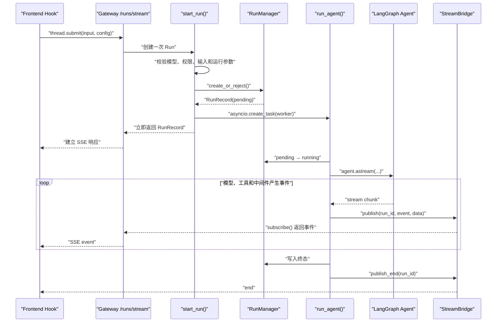
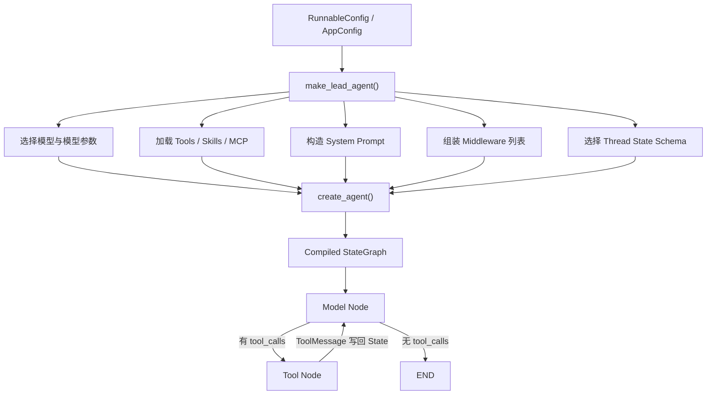
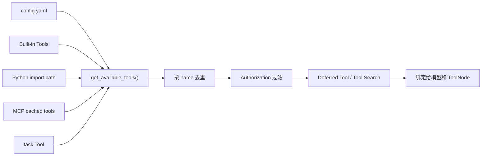
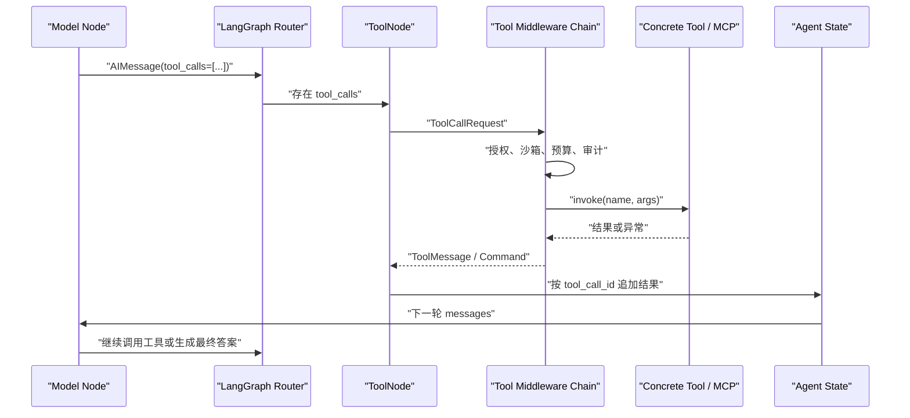
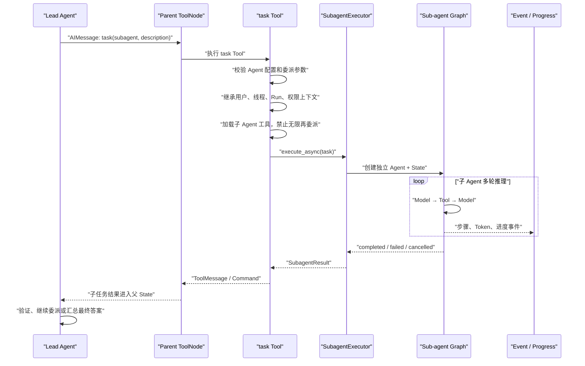
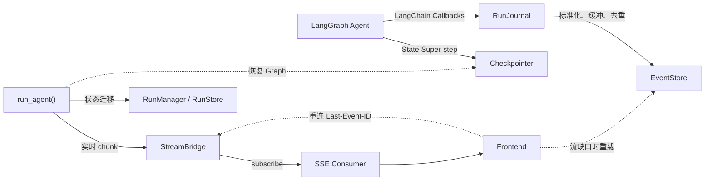
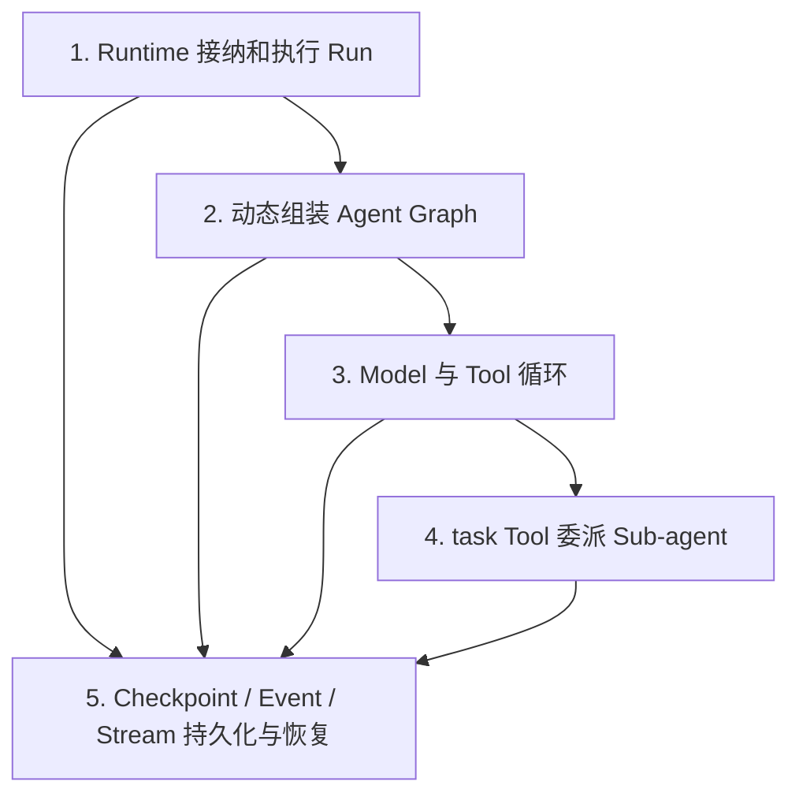

# DeerFlow 前五条简历亮点深度准备与面试拷打手册

> 本文对应简历中的前五条项目亮点，目标不是背诵 DeerFlow 的功能，而是能够从场景、原理、源码、设计取舍和故障边界五个角度讲清楚它。
>
> 源码位置基于当前本地 DeerFlow 版本。行号会随着项目升级发生变化，面试准备时应优先记住文件、类和函数名。

## 0. 应该怎样使用这份文档

每个亮点都需要准备三个表达层次：

1. **30 秒简历回答**：说明解决了什么问题、核心方案是什么。
2. **3 分钟原理回答**：讲清楚组件职责、调用链路和设计原因。
3. **源码级回答**：能指出入口函数、关键对象、状态如何流转，并说明异常和边界情况。

面试中建议统一使用下面的表达结构：

```text
场景：项目遇到了什么工程问题？
问题：普通 Chatbot 的实现为什么无法满足？
方案：DeerFlow 使用了哪些组件？它们怎样协作？
源码：入口在哪，关键函数分别负责什么？
取舍：为什么这样设计？有什么代价和边界？
验证：我如何通过断点、日志或实验确认这个结论？
```

还要注意代码归属。DeerFlow 是开源项目，如果你目前主要完成的是部署、调试、源码分析和二次开发学习，面试中应说“我基于 DeerFlow 深入分析并验证了这套机制”，不要把所有上游能力描述成自己从零实现。完成自己的改造后，再明确说明“我新增或优化了哪一部分”。

---

# 亮点一：长任务 Agent Runtime 与流式执行

## 1.1 简历表述

> 基于 Gateway + Run/Worker Runtime 梳理前端 Hook → Gateway → Worker → LangGraph 的完整链路，通过 StreamBridge/SSE 实现长任务异步执行与增量响应，并解耦任务执行和前端连接生命周期。

## 1.2 场景

普通 Chatbot 的请求通常比较简单：浏览器发送一条消息，服务端调用一次模型，得到完整回答后返回。

Agent 的任务却可能持续几十秒甚至几分钟，中间还可能发生：

- 模型连续输出 token；
- 调用搜索、文件、Bash 或 MCP 工具；
- 委派多个 Sub-agent；
- 等待网络请求或长时间命令；
- 用户关闭页面后重新连接；
- 用户主动取消任务；
- Worker 异常退出或服务重启。

如果整个 Agent 都直接运行在 HTTP 路由函数中，就会把“HTTP 连接是否还存在”和“Agent 是否应该继续运行”强绑定在一起。连接超时、代理断开或浏览器刷新，都可能让任务被错误取消，或者让调用方拿到一个还没有完成的中间状态。

因此 DeerFlow 把一次用户请求抽象成一个独立的 **Run**，由后台 Worker 执行；HTTP/SSE 只负责订阅这个 Run 的实时事件。

## 1.3 核心原理

主要对象的职责如下：

| 组件 | 主要职责 |
|---|---|
| Frontend Hook | 收集用户消息，调用 LangGraph SDK 的 `thread.submit()`，消费流式事件并更新 UI |
| Gateway Router | 提供 `/runs/stream` HTTP 接口，创建 Run 并返回 SSE 响应 |
| `start_run()` | 校验请求、构造运行配置、创建 `RunRecord`、启动后台 `asyncio.Task` |
| `RunManager` | 管理 Run 的 pending/running/success/error/interrupted 状态、并发策略、取消和持久化 |
| `run_agent()` | 真正构造 Agent，绑定 Checkpointer/Store，调用 `agent.astream()` 驱动执行 |
| StreamBridge | 将 Worker 产生的事件交给一个或多个流式消费者，提供事件 ID、心跳、结束和有限重放 |
| `sse_consumer()` | 订阅 StreamBridge，把内部事件格式化成 SSE，并处理浏览器断线策略 |

完整链路如下：



这里最重要的关系是：

```text
Run 是任务生命周期
asyncio.Task 是当前进程里的执行载体
StreamBridge 是实时事件通道
SSE 是浏览器到 Gateway 的传输协议
```

四者不能混为一谈。SSE 连接断了，不一定代表 Run 应该结束；`asyncio.Task` 被取消，也需要 RunManager 将 Run 更新为正确终态；StreamBridge 里的事件也不是完整持久化状态。

## 1.4 关键源码

### 前端入口

文件：`frontend/src/core/threads/hooks.ts`

- `useThreadStream()`：约第 1527 行，创建并管理一次线程流。
- `sendMessage()`：约第 2051 行，整理用户输入和上下文。
- `thread.submit()`：约第 2200 行，真正向 Gateway 提交请求。

前端不是直接调用模型，而是提交 Thread Run，并订阅这个 Run 的事件。

### Gateway 路由

文件：`backend/app/gateway/routers/thread_runs.py`

- `stream_run()`：约第 846 行。

简化后的结构如下：

```python
async def stream_run(thread_id, body, request):
    # 获取实时事件桥和 RunManager。
    bridge = get_stream_bridge(request)
    run_mgr = get_run_manager(request)

    # 创建 Run，同时启动后台 Worker。
    record = await start_run(body, thread_id, request)

    # 当前 HTTP 请求只消费事件，不直接执行 Agent。
    return StreamingResponse(
        sse_consumer(bridge, record, request, run_mgr),
        media_type="text/event-stream",
    )
```

### Run 创建与后台任务启动

文件：`backend/app/gateway/services.py`

- `start_run()`：约第 1050 行。
- `sse_consumer()`：约第 1325 行。

`start_run()` 的主要步骤：

```python
async def start_run(body, thread_id, request):
    # 1. 校验 thread_id、模型白名单、用户权限和敏感配置。
    # 2. 标准化输入，构造 LangGraph RunnableConfig。
    # 3. 根据 assistant_id 找到 Agent Factory。
    # 4. 通过 RunManager 创建 pending 状态的 RunRecord。
    record = await run_mgr.create_or_reject(...)

    # 5. 后台运行 Agent，不阻塞 HTTP 路由继续建立 SSE。
    worker = run_after_metadata(record)
    record.task = asyncio.create_task(worker)

    return record
```

`sse_consumer()` 的主要步骤：

```python
async def sse_consumer(bridge, record, request, run_mgr):
    # 浏览器重连时，可以携带上次收到的事件 ID。
    last_event_id = request.headers.get("Last-Event-ID")

    async for entry in bridge.subscribe(
        record.run_id,
        last_event_id=last_event_id,
    ):
        # 将内部事件、心跳、结束标记转换成 SSE。
        yield format_sse(entry.event, entry.data, event_id=entry.id)

    # 断线后是否取消任务由 on_disconnect 决定。
    if record.on_disconnect == DisconnectMode.cancel:
        await run_mgr.cancel(record.run_id)
```

### Worker 与 LangGraph 执行

文件：`backend/packages/harness/deerflow/runtime/runs/worker.py`

- `run_agent()`：约第 534 行。
- `agent.astream()`：约第 922、933 行。
- `bridge.publish_end()`：约第 1246 行。

核心结构：

```python
async def run_agent(...):
    # 1. 将 pending Run 原子地切换到 running，处理提前取消。
    # 2. 通过 agent_factory 构造本次请求使用的 Agent Graph。
    agent = agent_factory(config)

    # 3. 绑定状态持久化组件。
    agent.checkpointer = checkpointer
    agent.store = store

    # 4. 驱动 LangGraph，并把每个 chunk 发布到 StreamBridge。
    async for chunk in agent.astream(input_payload, config=stream_config):
        await bridge.publish(run_id, event_name, serialize(chunk))

    # 5. 在 finally 中写入终态，并通知所有消费者流已经结束。
    await bridge.publish_end(run_id)
```

### Run 状态管理

文件：`backend/packages/harness/deerflow/runtime/runs/manager.py`

重点关注：

- `RunRecord`：一次 Run 的状态和运行信息。
- `create_or_reject()`：根据同一 Thread 的并发策略创建或拒绝 Run。
- `try_start()`：确保一个 Run 不会被重复启动。
- `cancel()`：统一处理本地与跨 Worker 取消。
- `set_status_if_not_cancelled()`：避免“取消”和“正常完成”同时写终态产生竞争。

## 1.5 为什么这么做

### 1. 解耦 HTTP 生命周期和任务生命周期

长任务不应该因为浏览器刷新或网关超时就必然停止。Run 是稳定的业务对象，SSE 只是观察它的一种方式。

### 2. HTTP 能快速完成任务接纳

`start_run()` 创建 Run 并把 Worker 放入 `asyncio.Task` 后，就可以开始返回 SSE。Agent 初始化、模型调用和工具执行都在后台继续。

### 3. 统一取消与终态竞争

如果用户点击取消的同时模型刚好执行完成，直接修改变量容易得到不一致结果。RunManager 集中管理状态迁移和持久化，让取消、完成、错误之间有统一裁决入口。

### 4. 支持实时输出和有限重连

StreamBridge 为事件分配 ID，SSE 客户端可通过 `Last-Event-ID` 请求从某个位置继续；如果事件已被清理，则返回 StreamGap，让前端改为加载持久化状态。

### 5. 为多 Worker 扩展留下边界

内存中的 `asyncio.Task` 只能属于当前进程，但 Run 状态、租约、取消请求和支持跨进程的 StreamBridge 可以持久化或放入 Redis。这样后续可以把执行从单进程扩展到多 Worker。

## 1.6 设计代价和边界

- `asyncio.create_task()` 本身不是可靠任务队列。进程崩溃后 Task 会消失，仍需要 RunStore、租约、Checkpoint 和恢复逻辑兜底。
- StreamBridge 只保留有限事件，不能当作最终事实来源。
- SSE 是服务端单向推送，客户端控制消息仍需额外 HTTP 请求；但聊天流式输出通常不需要 WebSocket 的全双工复杂度。
- 长时间阻塞且不让出事件循环的同步工具，会影响其他请求，因此工具应尽量异步或在线程/进程中隔离。
- 断线继续并不代表一定能跨进程崩溃继续，后者还取决于持久化后端和恢复策略。

## 1.7 建议的断点与验证实验

按顺序打断点：

1. `hooks.ts` 的 `sendMessage()` 和 `thread.submit()`。
2. `thread_runs.py::stream_run()`。
3. `services.py::start_run()` 创建 `RunRecord` 的位置。
4. `services.py` 中 `asyncio.create_task(worker)`。
5. `worker.py::run_agent()`。
6. `worker.py` 中 `agent.astream()` 循环。
7. `services.py::sse_consumer()`。

建议观察：

```text
thread_id
record.run_id
record.status
record.on_disconnect
id(record.task)
stream_modes / lg_modes
chunk 的类型和内容
StreamEvent.id / event / data
```

实验一：发送普通问题，确认 Run 状态按 pending → running → success 变化。

实验二：触发一个较慢工具，关闭浏览器，再查看 `on_disconnect=continue` 和 `cancel` 的差异。

实验三：在 `bridge.publish()` 和 `sse_consumer()` 同时打断点，确认两者运行在不同的生产、消费位置。

## 1.8 面试官可能追问及参考回答

### Q1：`start_run()` 和 `run_agent()` 有什么区别？

`start_run()` 位于 Gateway 服务层，负责请求校验、输入和配置标准化、权限检查、创建 RunRecord，并将 Worker 注册为后台 `asyncio.Task`。`run_agent()` 位于 Runtime Worker 层，负责真正构造 Agent、绑定 Checkpointer/Store、调用 `agent.astream()`、发布事件和收敛终态。前者解决“接纳并调度一次任务”，后者解决“执行一次任务”。

### Q2：为什么不直接在 `stream_run()` 中调用 `agent.astream()`？

这样会把任务生命周期绑定到 HTTP Handler。浏览器断线、代理超时或路由协程取消，都可能直接影响 Agent；也不利于其他接口加入同一个 Run。拆分后，Worker 作为生产者持续执行，SSE 只是消费者，是否断线取消由明确的 `on_disconnect` 策略决定。

### Q3：为什么使用 SSE，而不是 WebSocket？

Agent 输出主要是服务端向客户端单向推送，SSE 原生基于 HTTP，浏览器支持事件流、事件 ID 和重连，部署和代理兼容性更简单。用户提交、取消等客户端动作可以继续走普通 HTTP。若业务需要高频双向交互、二进制传输或实时协同，再考虑 WebSocket。

### Q4：浏览器断线后 Run 是否停止？

不一定。`start_run()` 把请求中的 `on_disconnect` 映射为 `cancel` 或 `continue`。`sse_consumer()` 在退出时检查该配置：`cancel` 会调用 `RunManager.cancel()`，`continue` 则让后台任务继续。跨 Worker 的观察句柄还有额外限制，普通订阅断线不能随意替其他 Worker 创建取消请求。

### Q5：StreamBridge 和 SSE 的区别是什么？

StreamBridge 是服务端内部生产者与消费者之间的事件抽象，可以有内存或 Redis 等实现；SSE 是 Gateway 到浏览器的 HTTP 传输格式。Worker 向 Bridge 发布内部事件，Gateway 从 Bridge 订阅并编码为 SSE。

### Q6：`asyncio.Task` 能保证任务不丢吗？

不能。它只保证当前事件循环中的并发调度，进程崩溃后 Task 会消失。DeerFlow 还需要 RunStore、Worker 租约、Checkpointer、EventStore 和孤儿 Run 恢复机制。面试中不能把 `create_task()` 说成可靠消息队列。

### Q7：如何处理同一个 Thread 同时发起多个 Run？

RunManager 通过 `create_or_reject()` 和 `multitask_strategy` 处理并发接纳，并使用持久化约束、锁和状态检查避免同一个 Run 被重复启动。不同策略可以拒绝、取消旧 Run 或采用项目支持的其他行为，核心目标是避免同一 Thread 状态被并发写坏。

### Q8：Worker 如何告诉前端任务结束？

Worker 在终态处理完成后调用 `bridge.publish_end(run_id)`。StreamBridge 向订阅者提供 `END_SENTINEL`，`sse_consumer()` 将其编码为 `end` 事件。显式结束标记比“连接突然关闭”更可靠，因为后者无法区分正常完成和网络故障。

## 1.9 30 秒回答模板

> DeerFlow 没有把 Agent 直接跑在 HTTP 请求里，而是把一次请求抽象成 Run。Gateway 的 `start_run()` 完成校验、创建 Run 并启动后台 Task，Worker 的 `run_agent()` 调用 LangGraph `agent.astream()` 执行。执行事件先写入 StreamBridge，再由 Gateway 转成 SSE 推给前端，因此任务生命周期和浏览器连接是解耦的，断线时可以按 `on_disconnect` 选择继续或取消。

---

# 亮点二：动态 Agent Graph 与 Middleware 编排

## 2.1 简历表述

> 围绕 `make_lead_agent()` 动态组装模型、工具、Prompt、Middleware 与 State Schema，构建 Model → Tool → Model 循环，并通过 Middleware 统一处理工具授权、异常、输出预算和结果清洗。

## 2.2 场景

一个生产级 Agent 不能只有“模型 + 一组固定工具”。不同用户、模型、Agent 类型和运行环境可能需要：

- 使用不同模型和思考模式；
- 加载不同工具、Skills 或 MCP 服务；
- 根据权限过滤工具；
- 使用不同 System Prompt；
- 在模型调用前压缩上下文；
- 在工具调用前后做授权、审计、超时和结果清洗；
- 使用扩展后的 State 保存目标、沙箱、文件、Token 等状态；
- 对 Lead Agent 和 Sub-agent 设置不同限制。

如果把这些逻辑全部写进一个 Agent 主循环，会产生大量条件分支，难以测试，也很难保证所有工具都经过相同的安全规则。

DeerFlow 的做法是：每次创建 Agent 时，根据配置动态组装模型、Tools、Prompt、Middleware 和 State Schema，再交给 LangChain/LangGraph 的 `create_agent()` 编译成可执行 Graph。

## 2.3 核心原理



### `make_lead_agent()` 是装配入口

它读取运行配置，决定本次 Run 使用什么模型、有哪些工具、启用哪些 Middleware、Prompt 包含哪些能力说明，以及使用哪种 State Schema。

### `create_agent()` 负责生成 Graph

DeerFlow 最终调用 LangChain 的 `create_agent()`。底层会创建 Model 节点和 ToolNode，并通过条件边决定：

```text
模型没有返回 tool_calls → 结束
模型返回 tool_calls → 进入 ToolNode
ToolNode 返回 ToolMessage → 回到 Model 节点
```

### Middleware 负责横切能力

Middleware 可以作用在 Agent 前后、模型前后或工具调用前后。典型能力包括：

- 工具授权；
- Tool 异常转换；
- 工具结果清洗；
- Tool 输出长度预算；
- Token 预算；
- 循环检测；
- Skill 激活和工具策略；
- Sandbox 上下文；
- Read-before-write；
- 进度上报和审计。

### State Schema 定义 Graph 的共享状态

Graph 不只是保存 `messages`。DeerFlow 的 `ThreadState` 还可以承载线程数据、沙箱状态、目标、任务相关状态等。Middleware 如果需要增加自己的状态字段，也需要通过 Schema 参与合并和 Checkpoint。

## 2.4 关键源码

### Lead Agent 装配

文件：`backend/packages/harness/deerflow/agents/lead_agent/agent.py`

- `make_lead_agent()`：约第 640 行。
- `_make_lead_agent()`：约第 671 行。

简化结构：

```python
def _make_lead_agent(config, app_config):
    # 1. 从 RunnableConfig 中解析模型、Agent 和运行模式。
    model = create_chat_model(...)

    # 2. 加载本次 Agent 可以看到的工具。
    raw_tools = get_available_tools(...)

    # 3. 应用授权策略和延迟工具装配。
    tools = apply_tool_authorization(raw_tools, ...)
    tools, deferred_setup = assemble_deferred_tools(tools, ...)

    # 4. 根据配置组装 Middleware。
    middlewares = build_runtime_middlewares(...)

    # 5. 构造 Prompt，并选择与 checkpoint 模式匹配的 State Schema。
    return create_agent(
        model=model,
        tools=tools,
        system_prompt=system_prompt,
        middleware=normalize_middleware_state_schemas(middlewares, mode),
        state_schema=get_thread_state_schema(mode),
    )
```

当前代码有不同装配分支，例如 setup agent 和正式 lead agent，但核心思想相同：先解析配置和能力，再一次性编译 Graph。

### DeerFlow Agent Factory

文件：`backend/packages/harness/deerflow/agents/factory.py`

- `create_deerflow_agent()`：约第 64 行。

该 Factory 主要负责：

- 合并默认 Middleware 和调用方传入的 Middleware；
- 根据 checkpoint channel mode 调整 State Schema；
- 调用 `langchain.agents.create_agent()`；
- 返回 `CompiledStateGraph`。

### Thread State

文件：`backend/packages/harness/deerflow/agents/thread_state.py`

- `ThreadState`：约第 264 行。
- `get_thread_state_schema()`：约第 396 行。
- `normalize_middleware_state_schemas()`：约第 434 行。

重点理解：

```text
messages 是对话和工具循环的核心通道
其他字段是 DeerFlow 在 AgentState 基础上的扩展
State Schema 决定字段类型、Reducer 和 Checkpoint 结构
Middleware 的 State 也必须适配当前 checkpoint channel mode
```

### Middleware

目录：`backend/packages/harness/deerflow/agents/middlewares/`

优先阅读：

- `tool_error_handling_middleware.py`
- `tool_result_sanitization_middleware.py`
- `tool_output_budget_middleware.py`
- `token_budget_middleware.py`
- `loop_detection_middleware.py`
- `skill_tool_policy_middleware.py`
- `read_before_write_middleware.py`
- `tool_progress_middleware.py`

Middleware 顺序不是随意的。例如 ToolProgressMiddleware 需要包在 ToolErrorHandlingMiddleware 外层，才能读取后者统一写入的结果元数据。面试中如果被问“Middleware 列表能否任意排序”，答案是否定的。

### LangChain/LangGraph 的实际 Tool 循环

依赖源码：

- `backend/.venv/lib/python3.12/site-packages/langchain/agents/factory.py`
- `backend/.venv/lib/python3.12/site-packages/langgraph/prebuilt/tool_node.py`

DeerFlow 负责把参数交给 `create_agent()`，真正创建 Model/Tool 节点和条件边的是依赖库。阅读项目源码时必须区分 DeerFlow 自己的装配逻辑和 LangChain 提供的底层执行机制。

## 2.5 为什么这么做

### 1. 配置驱动，而不是硬编码

模型、工具和策略可以根据 AppConfig、Agent 配置和请求上下文变化，同一套 Runtime 能服务不同 Agent。

### 2. 关注点分离

模型负责推理，Tool 负责执行能力，State 负责数据流，Middleware 负责通用策略。这样新增审计或预算限制时，不需要修改每个 Tool 和主循环。

### 3. 安全规则覆盖更完整

如果授权逻辑写在某个 Tool 内，开发者新增 Tool 时很容易忘记。放在统一 Middleware/Authorization 层，可以让所有工具调用经过相同检查。

### 4. 更容易测试和替换

单个 Middleware 可以独立测试；模型、工具和 State Schema 也可以替换。Factory 本身不需要了解每个业务 Tool 的内部实现。

### 5. 支持 Lead Agent 和 Sub-agent 的差异化策略

两类 Agent 可以复用公共 Middleware，但使用不同工具集、Token 预算、循环上限和 Prompt，避免复制一套 Agent 主循环。

## 2.6 设计代价和边界

- Middleware 数量多以后，执行顺序和状态依赖会变得复杂。
- 同一个异常可能被多层 Wrapper 捕获，需要明确哪一层负责转换、记录和重试。
- 动态装配让运行时更灵活，但调试时必须先确认“本次 Run 实际装入了哪些组件”。
- State Schema 变更可能影响旧 Checkpoint 的兼容性。
- Middleware 只能约束进入其调用链的行为，绕开标准 ToolNode 的外部代码仍需单独防护。

## 2.7 建议的断点与验证实验

断点顺序：

1. `lead_agent/agent.py::make_lead_agent()`。
2. `_make_lead_agent()` 创建模型的位置。
3. `get_available_tools()` 返回后。
4. Middleware 列表组装完成后。
5. `create_agent()` 调用前。
6. `factory.py::create_deerflow_agent()`。
7. LangChain `factory.py` 创建 ToolNode 和条件边的位置。

重点观察：

```text
model_name / model 类型
[tool.name for tool in tools]
[type(m).__name__ for m in middleware]
system_prompt 的组成
state_schema.__name__
checkpoint_channel_mode
CompiledStateGraph 的 nodes / channels
```

实验一：禁用一个工具组，确认最终 Tool 列表发生变化。

实验二：让工具抛出异常，观察 ToolErrorHandlingMiddleware 如何生成错误 ToolMessage。

实验三：降低 Token Budget 或循环阈值，观察 Middleware 如何提前终止，而不是让 Graph 无限循环。

## 2.8 面试官可能追问及参考回答

### Q1：LangGraph 的 Graph 入口是什么？

从 DeerFlow 业务代码看，装配入口是 `make_lead_agent()`，它最终调用 `create_agent()` 返回 `CompiledStateGraph`；从运行入口看，Worker 在 `run_agent()` 中调用这个 Graph 的 `agent.astream()`。因此应区分“Graph 创建入口”和“Graph 执行入口”。

### Q2：为什么 `make_lead_agent()` 要同时组装模型、工具、Middleware 和 State Schema？

因为这些组件共同定义一个 Agent 的运行契约。模型决定推理能力，工具决定可执行动作，Prompt 告诉模型目标与规则，Middleware 约束调用过程，State Schema 决定节点和 Middleware 之间可以传递、合并和持久化的数据。它们必须在编译 Graph 时保持一致。

### Q3：Middleware 和普通函数装饰器有什么区别？

装饰器通常静态包裹单个函数；Agent Middleware 可以感知 Agent State、Runtime Context、模型调用和 ToolCallRequest，并挂载在 before/after agent、before/after model、wrap tool call 等生命周期位置。它解决的是一次 Agent 执行中的横切行为，而不只是某个 Python 函数的调用包装。

### Q4：Middleware 和 Tool 的边界是什么？

Tool 提供具体业务能力，例如搜索或写文件；Middleware 不应承担主要业务动作，而是对一类调用统一实施策略，例如授权、超时、错误转换、审计和输出限制。一个 Tool 应尽量只关心自己的输入、执行和结果。

### Q5：State Schema 有什么作用？只有 `messages` 不行吗？

简单 ReAct Agent 只用 messages 也可以运行，但 DeerFlow 还需要保存线程数据、沙箱状态、目标、任务和 Middleware 状态。Schema 定义字段结构以及并发更新时如何合并，并决定这些字段如何进入 Checkpoint。没有明确 Schema，复杂状态容易发生覆盖、类型不一致和恢复失败。

### Q6：为什么 Middleware 顺序重要？

多个 `wrap_tool_call` 会形成嵌套调用链。外层 Middleware 看到的是内层处理后的结果。例如错误处理层先把异常转换并打上统一元数据，进度层才能据此判断工具成功、失败或无进展。顺序错误可能导致异常漏出、审计拿不到结果或策略重复执行。

### Q7：模型什么时候停止循环？

正常情况下，Model 节点返回不含 `tool_calls` 的最终 AIMessage，条件边进入 END。DeerFlow 还通过 TokenBudgetMiddleware、LoopDetectionMiddleware 和安全终止相关 Middleware，在模型持续调用工具或超出预算时移除或阻止后续 ToolCall，并生成可解释的终止结果。

### Q8：Checkpointer 为什么不是在 `make_lead_agent()` 里固定？

Agent 的逻辑结构可以复用，但 Checkpointer 是 Runtime 基础设施，可能根据部署环境使用内存、SQLite 或 PostgreSQL 等后端。Worker 在执行前绑定具体 Checkpointer，可以把 Graph 定义和运行环境解耦，也便于测试和多租户配置。

## 2.9 30 秒回答模板

> DeerFlow 通过 `make_lead_agent()` 按配置动态组装模型、Tools、Prompt、Middleware 和 ThreadState，然后调用 LangChain `create_agent()` 编译为 LangGraph。Graph 的核心是 Model → ToolNode → Model 循环，而授权、异常转换、预算、结果清洗等横切能力放在 Middleware 中。这样能够避免主循环硬编码，也让 Lead Agent 和 Sub-agent 复用同一套运行机制但采用不同策略。

---

# 亮点三：Tool / Skill / MCP 扩展体系

## 3.1 简历表述

> 基于配置加载内置、Python、MCP 工具及 Skills，追踪 `AIMessage.tool_calls` → ToolNode → `ToolMessage` 的执行闭环，将结果回写 State 并驱动下一轮推理，同时支持工具授权和错误结果标准化。

## 3.2 场景

大模型自身只能生成文本，不能真正搜索互联网、读取本地文件、执行命令或操作第三方系统。Agent 的关键不是“模型会说要调用工具”，而是系统能够安全地完成以下闭环：

1. 告诉模型当前有哪些工具以及参数 Schema。
2. 模型根据任务生成结构化 `tool_calls`。
3. Runtime 找到对应工具并传入参数。
4. 工具执行时经过授权、沙箱、异常和输出控制。
5. 执行结果以模型能识别的格式写回对话状态。
6. 模型读取结果，决定继续调用工具还是生成最终答案。

DeerFlow 还需要同时兼容：

- 项目内置 Tool；
- `config.yaml` 指向的 Python Tool；
- 外部 MCP Server 暴露的 Tool；
- `task` 这种委派 Sub-agent 的特殊 Tool；
- Skill 激活后允许或限制的工具集合；
- 工具数量过多时的延迟加载和 Tool Search。

## 3.3 Tool、Skill、MCP 的边界

| 概念 | 本质 | 主要作用 | 是否直接产生副作用 |
|---|---|---|---|
| Tool | 可执行函数及其名称、描述、参数 Schema | 搜索、读写文件、执行命令、调用业务接口 | 可以 |
| Skill | 可复用的任务知识、提示、资源和工具策略集合 | 告诉 Agent 某类任务应如何完成，并约束可使用的工具 | 通常不直接执行副作用 |
| MCP | 外部能力的标准协议 | 从独立 Server 发现并调用 Tool，也可承载资源和 Prompt | 通过 MCP Tool 间接产生 |

可以这样记：

```text
Tool 是“能做什么动作”
Skill 是“完成某类任务的方法和规则”
MCP 是“怎样连接外部能力提供方”
```

Skill 激活后最终仍需通过 Tool 执行动作；MCP Server 暴露的能力也会被包装成 LangChain Tool，进入同一 ToolNode 执行闭环。

## 3.4 核心原理

### 工具加载阶段



工具加载不是简单地把所有函数全部交给模型。系统还要处理：

- 配置中的启用状态和工具分组；
- 本地 Sandbox 是否允许 Host Bash；
- MCP Server 是否可用；
- 工具名冲突；
- 当前用户是否有执行权限；
- 当前 Agent 是 Lead 还是 Sub-agent；
- 工具数量是否过多，需要延迟暴露。

### 工具执行阶段



关键消息类型：

```text
HumanMessage：用户输入
AIMessage：模型输出；可能包含 tool_calls
ToolMessage：某一个 tool_call 的执行结果
Command：除了返回消息，还可以更新 Graph 的其他 State 字段
```

`tool_call_id` 非常重要。一次 AIMessage 可以并行发出多个工具调用，ToolMessage 必须通过 ID 与原调用对应，否则模型无法判断哪个结果属于哪个动作。

## 3.5 一次工具调用的完整过程

以“搜索 DeerFlow 的最新资料并总结”为例：

1. `make_lead_agent()` 将 `web_search` 的名称、描述和参数 Schema 绑定给模型。
2. Model Node 收到用户消息，返回带 `tool_calls` 的 AIMessage。
3. LangGraph 条件边检测到 `tool_calls`，路由到 ToolNode。
4. ToolNode 根据工具名查找 Tool，并构造 `ToolCallRequest`。
5. 请求穿过 Middleware：权限检查、Skill 工具策略、输出预算、错误处理等。
6. `web_search` 执行搜索并返回结果。
7. ToolNode 将结果包装成具有相同 `tool_call_id` 的 ToolMessage。
8. ToolMessage 追加到 State 的 `messages`。
9. Graph 回到 Model Node，模型读取搜索结果并生成总结；若资料不够，可以再次调用工具。
10. 模型最终返回不包含 `tool_calls` 的 AIMessage，Graph 结束。

因此，工具结果不是由 Python 代码直接拼成最终答案，而是重新作为上下文交给模型，由模型完成下一步推理。

## 3.6 关键源码

### 工具统一加载

文件：`backend/packages/harness/deerflow/tools/tools.py`

- `get_available_tools()`：约第 45 行。

简化结构：

```python
def get_available_tools(
    model_name=None,
    groups=None,
    subagent_enabled=True,
    include_mcp=True,
    app_config=None,
):
    loaded_tools = []

    # 1. 解析 config.yaml 中的 Python import path。
    loaded_tools.extend(load_configured_tools(groups))

    # 2. 加入 DeerFlow 内置工具。
    loaded_tools.extend(get_builtin_tools(...))

    # 3. 加入启动阶段已经发现和缓存的 MCP Tools。
    if include_mcp:
        loaded_tools.extend(get_cached_mcp_tools(...))

    # 4. Lead Agent 可加入 task Tool；Sub-agent 通常关闭再次委派。
    if subagent_enabled:
        loaded_tools.append(task_tool)

    # 5. 按工具名称去重，避免模型看到两个同名 Schema。
    return deduplicate_by_name(loaded_tools)
```

上面是便于理解的结构化伪代码。实际源码还包括 ACP、Host Bash 过滤、MCP 来源标记、日志和错误兼容等逻辑。

### 工具授权和延迟加载

文件：

- `backend/packages/harness/deerflow/authz/tool_filter.py`
  - `apply_tool_authorization()`：约第 22 行。
- `backend/packages/harness/deerflow/tools/builtins/tool_search.py`
  - `assemble_deferred_tools()`：约第 200 行。

授权过滤决定“工具是否允许被暴露或执行”；Deferred Tool 决定“工具是否立即绑定给模型”。两者解决的问题不同。

### ToolNode 和循环路由

依赖源码：

- `backend/.venv/lib/python3.12/site-packages/langchain/agents/factory.py`
- `backend/.venv/lib/python3.12/site-packages/langgraph/prebuilt/tool_node.py`

重点观察：

- `create_agent()` 如何创建 ToolNode；
- Model Node 如何根据 AIMessage 是否包含 `tool_calls` 选择下一条边；
- ToolNode 如何运行每个 ToolCall；
- Tool 的返回值如何被转换为 ToolMessage 或 Command。

### 工具异常处理

文件：`backend/packages/harness/deerflow/agents/middlewares/tool_error_handling_middleware.py`

- `ToolErrorHandlingMiddleware`：约第 56 行。
- `awrap_tool_call()`：约第 139 行。

核心思想：

```python
async def awrap_tool_call(request, handler):
    try:
        # 继续调用内层 Middleware，最终执行实际 Tool。
        result = await handler(request)
        return normalize_tool_result(result)
    except Exception as exc:
        # 将可恢复的工具错误转成带 tool_call_id 的错误 ToolMessage。
        # 模型可以读取错误并修改参数、换工具或向用户解释。
        return ToolMessage(
            content=format_error(exc),
            tool_call_id=request.tool_call["id"],
            status="error",
        )
```

并非所有异常都应该吞掉。进程取消、系统级错误、明确要求中断 Run 的异常，仍应向上层传播。面试时应强调“根据错误类型分层处理”，而不是简单说“所有异常都返回给模型”。

### 具体 Tool

文件：`backend/packages/harness/deerflow/sandbox/tools.py`

- `bash_tool()`：约第 1768 行。
- `write_file_tool()`：约第 2235 行。

它们会经过 Sandbox 初始化、路径验证、权限检查、命令执行、结果截断等步骤，是理解“工具不等于直接调用系统函数”的最佳例子。

### MCP Tool

文件：`backend/packages/harness/deerflow/mcp/tools.py`

重点关注：

- MCP Tool 的发现和包装；
- 按 `(server_name, user_id:thread_id)` 复用有状态 Session；
- Session 初始化超时；
- `session.call_tool()`；
- MCP 内容块向 LangChain Tool 结果的转换；
- MCP 返回本地路径时的路径映射和安全处理。

MCP Tool 最终也表现为 LangChain `BaseTool`，因此可以复用 ToolNode 和 DeerFlow Middleware。

### Tool 结果持久化

文件：

- `backend/packages/harness/deerflow/runtime/journal.py`
- `backend/packages/harness/deerflow/runtime/converters.py`

RunJournal 通过 LangChain Callback 观察 Tool 开始和结束事件，把 ToolMessage、耗时、错误和产物信息写入 EventStore；Converters 负责内部 Message 与前端事件格式之间的转换。

## 3.7 为什么这么做

### 1. 使用统一的 Tool 抽象

内置函数、Python Tool、MCP Tool 和 Sub-agent Tool 都进入同一个执行协议，Graph 不需要为每种能力写独立分支。

### 2. ToolMessage 让工具结果成为可追踪的对话状态

模型不仅看到结果，还能知道它对应哪个 ToolCall。消息可以被 Checkpoint、回放、前端展示和后续模型调用复用。

### 3. 错误返回模型可以形成自修复

例如模型传错参数时，如果整个 Run 直接失败，用户只能重试；转换成错误 ToolMessage 后，模型可以重新构造参数或换用其他工具。

### 4. MCP 降低外部系统接入成本

外部服务只需实现 MCP 协议，DeerFlow 就可以动态发现工具 Schema，不必为每个系统手写一套 SDK 适配层。

### 5. Skill 将“知识和策略”与“执行动作”分开

同一个 Tool 可以被多个 Skill 复用；Skill 可以规定任务步骤和允许的工具，避免把流程知识硬编码进 Tool。

### 6. 加载期过滤和执行期授权双重防护

加载期少暴露不允许的工具，可以减少模型误选；执行期再次校验，可以防止运行上下文变化、伪造 ToolCall 或策略绕过。

## 3.8 设计代价和边界

- Tool 描述和参数 Schema 不清晰时，模型容易选错工具或构造错误参数。
- 将错误返回模型会增加一次或多次 LLM 调用，也可能进入反复重试循环，因此需要 Loop Detection 和预算限制。
- MCP 增加网络、进程、Session 和第三方可信边界，需要超时、鉴权、工具名校验和结果清洗。
- ToolMessage 被写入上下文后可能很长，需要输出预算、截断或文件化，否则会快速消耗 Token。
- 工具产生的外部副作用不一定能被 Checkpoint 回滚，例如已经发送的邮件或创建的订单。
- 同名 Tool 必须去重，否则模型和 ToolNode 可能对名称的解析不一致。

## 3.9 建议的断点与验证实验

断点顺序：

1. `get_available_tools()` 返回之前。
2. `make_lead_agent()` 中授权过滤之后。
3. LangChain `factory.py` 的 Model 路由函数。
4. LangGraph `tool_node.py` 的单个 ToolCall 执行函数。
5. `ToolErrorHandlingMiddleware.awrap_tool_call()`。
6. 一个具体 Tool，例如 `write_file_tool()`。
7. `RunJournal.on_tool_end()` 或工具结果持久化位置。

重点观察：

```text
tool.name / description / args_schema
AIMessage.tool_calls
tool_call["id"] / tool_call["name"] / tool_call["args"]
ToolCallRequest.state / runtime
ToolMessage.tool_call_id / status / content
执行前后 State["messages"] 的变化
```

推荐实验：

1. 让 Agent 写一个文件，追踪 `write_file` 完整闭环。
2. 故意让模型访问非法路径，观察错误如何回到 ToolMessage。
3. 编写一个最简单的 `calculator` Tool，验证配置加载、参数 Schema 和结果回写。
4. 配置一个 MCP Server，对比本地 Tool 与 MCP Tool 在 ToolNode 以上部分是否一致。

## 3.10 面试官可能追问及参考回答

### Q1：模型返回 `tool_calls` 后，谁真正执行工具？

模型只生成结构化调用意图。LangGraph 根据 AIMessage 中的 `tool_calls` 路由到 ToolNode；ToolNode 查找已注册 Tool，构造 ToolCallRequest，并经过 Middleware 调用 Tool 的异步或同步执行接口。模型自身没有执行 Python 函数或系统命令的能力。

### Q2：工具结果如何回到 Agent 的下一轮推理？

ToolNode 将结果包装为带相同 `tool_call_id` 的 ToolMessage，并追加到 Graph State 的 messages。随后条件边回到 Model Node，新的模型请求会携带原 AIMessage 和对应 ToolMessage，模型据此继续推理。

### Q3：为什么一定要有 `tool_call_id`？

模型可能在一次响应中产生多个 ToolCall，执行也可能并行完成。仅依靠工具名无法唯一对应调用，特别是同一个工具被调用多次时。`tool_call_id` 建立请求和响应的一一对应关系。

### Q4：Tool、Skill 和 MCP 有什么区别？

Tool 是具体可执行动作；Skill 是某类任务的知识、提示、资源和工具策略；MCP 是把外部能力标准化暴露给 Agent 的协议。MCP Tool 被包装后仍通过 ToolNode 执行，Skill 本身通常不直接产生系统副作用。

### Q5：为什么工具异常不直接让 Run 失败？

参数错误、资源不存在和临时搜索失败等错误对 Agent 来说可能可恢复。把错误转成 ToolMessage 后，模型可以修正参数、换工具或向用户说明。但取消、基础设施故障或明确不可恢复错误仍应上抛，不能无条件吞掉。

### Q6：如何防止模型调用未授权工具？

第一层是在装配阶段过滤工具，避免模型看到不允许的 Schema；第二层是在执行阶段通过授权 Middleware 根据用户和运行上下文再次检查。双层校验避免只依赖 Prompt 或模型自觉。

### Q7：为什么需要 Deferred Tool 或 Tool Search？

工具数量很多时，把全部名称、描述和 Schema 放入每次模型请求会占用大量 Token，也会降低模型选对工具的概率。Deferred Tool 先暴露搜索或少量核心工具，需要时再激活匹配能力。

### Q8：MCP Session 为什么按用户和 Thread 隔离？

一些 MCP Server 是有状态的，例如浏览器 Session。相同 Thread 的连续调用需要复用状态，但不同用户或 Thread 不能共享 Cookie、页面和临时文件，因此 Session Key 至少应包含 Server、用户和 Thread 维度。

### Q9：Tool 返回字符串、ToolMessage 和 Command 有什么区别？

普通字符串会由 ToolNode 转成 ToolMessage；ToolMessage 可以显式控制内容、状态和 `tool_call_id`；Command 除了返回消息，还能更新其他 State 字段或控制 Graph 行为。具体选择取决于工具是否只返回文本，还是还要修改状态。

### Q10：如何避免工具结果撑爆上下文？

在工具层限制查询范围，在 Middleware 中设置输出预算和截断策略，大结果写入文件只返回摘要与路径，必要时使用上下文压缩。不能把几十 MB 日志原样放入 ToolMessage。

## 3.11 30 秒回答模板

> DeerFlow 在装配阶段通过 `get_available_tools()` 统一加载内置、Python 和 MCP Tools，再应用授权和延迟加载。运行时模型返回带 `tool_calls` 的 AIMessage，LangGraph 路由到 ToolNode，工具调用经过授权、Sandbox、异常和输出控制后生成 ToolMessage，按 `tool_call_id` 写回 State，再回到模型继续推理。Skill 负责任务知识和工具策略，MCP 负责连接外部能力，最终都复用同一 Tool 执行闭环。

---

# 亮点四：Sub-agent 任务委派机制

## 4.1 简历表述

> 通过 `task` Tool 与 `SubagentExecutor` 将复杂任务委派给子 Agent，继承必要的用户、线程和运行上下文，隔离工具集与终止条件，并将执行进度、结果及异常状态汇总回主 Agent。

## 4.2 场景

假设用户要求：

```text
调研三个 Agent 框架，分别分析架构、工具机制和部署方式，最后给出选型报告。
```

如果 Lead Agent 独自完成全部工作，它的上下文会同时混入：

- 多个框架的大量搜索结果；
- 每个方向的中间推理；
- 多次 ToolMessage；
- 最终报告要求；
- 可能失败或重试的局部步骤。

这会造成上下文快速膨胀、注意力分散，而且不同子任务无法使用不同的模型、工具和预算。

Sub-agent 的作用是把一个复杂目标拆成多个具有独立上下文和执行边界的 Agent 任务。Lead Agent 负责规划、委派、检查和汇总，Sub-agent 负责在限定范围内完成某个子任务。

## 4.3 Sub-agent 与普通 Tool 的区别

| 对比项 | 普通 Tool | Sub-agent |
|---|---|---|
| 推理能力 | 通常执行一次确定函数 | 拥有自己的多轮 Model → Tool 循环 |
| 上下文 | 接收明确参数 | 拥有独立消息和运行上下文 |
| 工具 | Tool 本身就是能力 | 可以使用一组工具继续行动 |
| 生命周期 | 一次调用完成 | 有运行状态、进度、取消和终止原因 |
| 适合任务 | 搜索一次、读取文件、执行命令 | 调研、分析、编码等多步骤子目标 |

`task` 在 Lead Agent 看来仍是一个 Tool，但这个 Tool 的内部不是简单函数，而是启动另一个 Agent Runtime。

## 4.4 核心原理



### 谁决定是否委派

Lead Agent 的模型根据 Prompt、`task` Tool 描述和当前任务，自主生成对 `task` Tool 的 ToolCall。Runtime 不会在每个复杂问题上硬编码“必须创建子 Agent”。

### 上下文继承与隔离

Sub-agent 需要继承：

- 用户和权限身份；
- Thread/Run/Trace 信息；
- Sandbox 或 Workspace 上下文；
- 当前可用的 Skills；
- 必要的父任务信息。

但不应复制父 Agent 的全部消息历史。子 Agent 的输入应聚焦在明确子任务，减少 Token 和无关信息；工具集也应按角色裁剪。

### 终止条件

Sub-agent 不能无限执行，通常需要：

- 最大 Turn；
- Token Budget；
- Loop Detection；
- 父任务取消信号；
- 安全终止策略；
- 工具权限限制。

### 结果回传

SubagentExecutor 将子 Agent 的终态归一化为 completed、failed 或 cancelled，并附带结果、错误、Token 使用和步骤信息。`task` Tool 再把它转换成父 Graph 能理解的 ToolMessage 或 Command。

## 4.5 关键源码

### `task` Tool

文件：`backend/packages/harness/deerflow/tools/builtins/task_tool.py`

- `task_tool()`：约第 232 行。

主要步骤：

```python
async def task_tool(task, subagent_type, runtime, tool_call_id):
    # 1. 校验请求的 Sub-agent 是否在允许列表中。
    config = resolve_subagent_config(subagent_type)

    # 2. 从父 Runtime 提取用户、Thread、Run、权限和 Sandbox 上下文。
    parent_context = runtime.context

    # 3. 加载子 Agent 工具。关闭 subagent_enabled，避免无限 task → task。
    tools = get_available_tools(subagent_enabled=False, ...)

    # 4. 创建并运行 SubagentExecutor。
    executor = SubagentExecutor(config=config, tools=tools, ...)
    result = await executor.execute_async(task)

    # 5. 把子任务终态和结果转回父 Agent 的 ToolMessage/Command。
    return build_parent_tool_result(result, tool_call_id)
```

实际源码还处理事件上报、取消、Skills、扩展数据、授权身份和错误格式。

### SubagentExecutor

文件：`backend/packages/harness/deerflow/subagents/executor.py`

- `SubagentExecutor`：约第 433 行。
- `_create_agent()`：约第 544 行。
- `_aexecute()`：约第 788 行。
- `agent.astream()`：约第 930 行附近。

`_create_agent()` 会为子 Agent 创建模型、专属 Middleware、Deferred MCP 路由和限制策略。`_aexecute()` 则构建初始 State 和 Context，通过 `agent.astream(..., stream_mode="values")` 执行，并收集每一步新增的 AIMessage 和 ToolMessage。

值得注意的取消边界：

```python
async for chunk in agent.astream(...):
    # 父任务通过 cancel_event 请求停止。
    if result.cancel_event.is_set():
        result.try_set_terminal(SubagentStatus.CANCELLED)
        return result
```

这是协作式取消。只有当 `astream()` 产生下一个 chunk、控制权回到循环时才能检查取消。如果子 Agent 正在执行一个很长且不可取消的工具调用，取消不会立刻生效。

### Sub-agent 限制

文件：`backend/packages/harness/deerflow/agents/middlewares/subagent_limit_middleware.py`

- `SubagentLimitMiddleware`：约第 95 行。

它用于限制同一次模型输出中过多的委派或其他子 Agent 调用模式。再配合子 Agent 工具加载时禁用 `task`、Token Budget 和 Loop Detection，形成多层防护。

### 子 Agent 事件持久化

文件：`backend/packages/harness/deerflow/runtime/runs/worker.py`

Worker 中的 `_SubagentEventBuffer` 会缓冲子 Agent 步骤事件，并批量写入 EventStore。这样前端和审计系统可以看到委派进度，又不会在热循环中为每个步骤进行一次低效持久化写入。

## 4.6 为什么这么做

### 1. 控制上下文膨胀

子 Agent 只接收子任务所需信息，搜索结果和中间步骤留在子上下文中，Lead Agent 最终只接收结构化总结和必要证据。

### 2. 分工和能力隔离

不同 Sub-agent 可以有不同 Prompt、模型、工具和预算。例如研究 Agent 只允许搜索，编码 Agent 才允许文件与 Bash。

### 3. Lead Agent 保持全局视角

Lead Agent 不需要亲自执行每个细节，可以聚焦任务规划、结果验证、冲突处理和最终汇总。

### 4. 失败被限制在子任务范围

某个 Sub-agent 失败时，可以把失败结果返回 Lead Agent，由 Lead 决定重试、换 Agent、降级或向用户说明，而不是让整个父 Run 必然崩溃。

### 5. 可观察性

子 Agent 有 task_id、进度和终态，前端可以展示“正在调研”“已完成”“失败”，也便于统计 Token 和排查问题。

## 4.7 设计代价和边界

- 每个 Sub-agent 都需要额外模型调用，会增加延迟和成本。
- 上下文裁剪过度会让子 Agent 缺少关键背景；继承过多又会失去隔离价值。
- 多个子 Agent 并行写同一 Workspace 时可能产生文件冲突，需要文件锁、任务划分或独立工作区。
- Lead Agent 仍需验证子 Agent 结果，不能默认子 Agent 一定正确。
- 协作式取消不能立即终止阻塞工具，需要 Tool 自身支持超时或可取消执行。
- 层级过深会放大成本并增加调试难度，因此通常限制递归委派。

## 4.8 建议的断点与验证实验

断点顺序：

1. `task_tool()` 入口。
2. 解析 Sub-agent 配置的位置。
3. `get_available_tools(subagent_enabled=False)`。
4. `SubagentExecutor.__init__()`。
5. `_create_agent()`。
6. `_aexecute()` 中 `agent.astream()`。
7. 子任务结果转换成父 ToolMessage/Command 的位置。
8. Worker 的 `_SubagentEventBuffer`。

重点观察：

```text
task / subagent_type
parent_context 中继承了哪些字段
[tool.name for tool in child_tools]
child tools 中是否仍然存在 task
SubagentExecutor.config.max_turns
SubagentResult.status / result / error
父 ToolMessage.tool_call_id
父 State 中新增的消息
```

实验一：给 Lead Agent 一个明显可拆分的调研任务，观察它是否调用 `task`。

实验二：比较父 Agent 与子 Agent 的 Tool 列表和消息历史。

实验三：让子 Agent 调用失败工具，确认失败如何转为 `task_failed` 或错误结果返回父 Agent。

实验四：触发较长子任务后取消，观察取消发生在什么时间点。

## 4.9 面试官可能追问及参考回答

### Q1：Sub-agent 是如何从主 Agent 中被委派出来的？

Lead 模型生成对 `task` Tool 的 ToolCall。父 ToolNode 执行 `task_tool()`，它读取父 Runtime Context，解析允许的子 Agent 配置，裁剪工具和上下文，然后创建 SubagentExecutor。Executor 构建独立 Agent Graph 并调用 `astream()`，最后把结果转换为父 ToolCall 对应的 ToolMessage/Command，父 Agent 再继续推理。

### Q2：谁决定创建哪个 Sub-agent？

通常是 Lead 模型根据 Prompt、可用 Sub-agent 描述和任务内容选择。系统负责提供允许列表、参数 Schema和权限边界，并在执行时校验，不能只相信模型传入的任意名称。

### Q3：为什么不让 Sub-agent 继承主 Agent 的全部上下文？

全部继承会增加 Token、引入无关信息和敏感数据，也会降低子任务聚焦度。更合理的方式是传递明确任务、必要背景、用户权限和共享运行上下文，把详细中间历史留在父 Agent。

### Q4：如何避免 Sub-agent 无限创建 Sub-agent？

子 Agent 加载工具时关闭 `subagent_enabled`，使其通常拿不到 `task` Tool；父 Agent还有 SubagentLimitMiddleware，子 Agent自身还有最大 Turn、Token Budget 和 Loop Detection。它是工具暴露、Middleware 和预算三层共同限制。

### Q5：Sub-agent 的结果如何回到主 Agent？

Executor 生成统一的 SubagentResult，包含状态、结果、错误和用量；`task` Tool 将其包装成与原 ToolCall ID 对应的 ToolMessage 或 Command，写入父 Graph State，Lead 模型在下一轮读取后进行验证和汇总。

### Q6：子 Agent 失败是否会导致父 Run 失败？

不一定。可恢复的子任务失败通常会成为 `task` Tool 的错误结果，由 Lead 决定重试、调整任务或降级。只有取消、基础设施异常或父层无法处理的错误才可能终止整个 Run。

### Q7：Sub-agent 能并行吗？

模型可以在一次 AIMessage 中产生多个 `task` ToolCall，ToolNode 具备并发执行多个工具调用的能力，但实际并行度还受 Runtime、工具实现、资源限制和共享 Workspace 冲突影响。不能只因为有多个 Sub-agent 就断言一定完全并行。

### Q8：如何控制子 Agent 成本？

限制最大 Turn 和 Token Budget，使用更便宜的子模型，裁剪上下文与工具集，避免递归委派，对重复工具调用进行 Loop Detection，并让 Lead Agent只在确有必要时委派。

### Q9：父任务取消后，Sub-agent 会立即停止吗？

Executor 会检查父任务的 cancel event，但这是协作式取消，主要在 `astream()` 迭代边界生效。如果当前 Tool 长时间不返回，需要 Tool 自己实现超时或支持取消，否则不会瞬间停止。

## 4.10 30 秒回答模板

> DeerFlow 把 Sub-agent 封装成 `task` Tool。Lead 模型决定委派后，`task_tool()` 从父 Runtime 继承用户、Thread、Run 和权限上下文，裁剪子 Agent 的工具并关闭再次委派，再由 SubagentExecutor 创建独立 Graph，通过 `astream()` 执行。子任务的进度、结果和失败被归一化后作为 ToolMessage 写回父 State，Lead Agent 再负责验证和汇总。

---

# 亮点五：状态持久化与可恢复执行

## 5.1 简历表述

> 结合 Checkpointer、EventStore、RunJournal 与 StreamBridge 管理执行状态、事件历史和实时订阅，支持浏览器断线后的继续或取消策略，以及任务恢复、事件回放和重复消费处理。

## 5.2 场景

长任务 Agent 同时存在四类不同问题：

1. **执行到哪一步了**：当前 messages、目标、工具结果和其他 Graph State 是什么？
2. **过去发生了什么**：模型调用、工具调用、消息和错误事件怎样查询和审计？
3. **浏览器现在看到什么**：新产生的 token、工具进度怎样实时推送？
4. **任务本身是什么状态**：Run 是 pending、running、success、error 还是 interrupted？

如果只用一个数据库表或一条 SSE 流同时解决这四个问题，会出现职责混乱：

- SSE 断开后历史丢失；
- 仅保存最终消息无法恢复 Graph；
- 仅保存 Checkpoint 无法展示完整事件和 Token 统计；
- 仅保存事件日志又很难高效恢复当前 State；
- Run 状态和 Graph 状态不一致时无法判断任务是否真的结束。

因此 DeerFlow 把状态、事件、实时流和 Run 生命周期拆成不同组件。

## 5.3 四个核心组件的边界

| 组件 | 保存或传输什么 | 主要写入方 | 主要读取方 | 是否是最终持久化事实 |
|---|---|---|---|---|
| Checkpointer | LangGraph State 快照和 Channel 版本 | LangGraph Runtime | Graph 恢复、查看线程状态、回滚 | 取决于配置后端，通常用于持久状态 |
| EventStore | Message、Tool、Trace、进度、终态回执等事件 | RunJournal、Worker | 前端历史、审计、调试、统计 | 使用 DB/JSONL 时是持久化事件源 |
| RunJournal | 将 LangChain Callback 转成标准 RunEvent | Callback Handler | EventStore | 自身不是存储 |
| StreamBridge | 当前 Run 的实时流事件、事件 ID、心跳和结束标记 | Worker | SSE Consumer、等待接口 | 通常只保留有限窗口，不是最终事实 |

此外还需要：

| 组件 | 职责 |
|---|---|
| RunManager / RunStore | 管理 RunRecord、状态迁移、取消、并发、Worker 租约和终态 |
| SSE | 把 StreamBridge 事件通过 HTTP 推给浏览器 |

一句话区分：

```text
Checkpointer 回答“Graph 当前是什么状态”
EventStore 回答“这次 Run 发生过什么”
RunManager 回答“这个任务现在是什么生命周期状态”
StreamBridge 回答“此刻有哪些新事件需要推给订阅者”
SSE 回答“如何把事件送到浏览器”
```

## 5.4 核心原理



### Checkpointer

LangGraph 按执行步骤保存 State 快照。它不是简单保存最终答案，而是保存 Graph Channel 的当前值和版本信息，使 Runtime 可以：

- 继续同一个 Thread 的上下文；
- 在 interrupt 后恢复；
- 读取当前消息和目标；
- 进行 regenerate、edit 或 rollback；
- 在 Delta/Full 等模式下适配不同快照策略。

Checkpoint 通常发生在 Graph 的 super-step 边界，而不是每生成一个 token 就写一次。

### EventStore

EventStore 保存顺序化事件，要求同一 Thread 内 `seq` 递增。它区分：

- `category=message`：前端可展示的用户、AI、Tool 等消息；
- 其他 Trace/Progress 类型：调试、审计、Token 和步骤信息。

当前抽象支持 Memory、DB、JSONL 等实现。`put_if_absent()` 用于终态回执等可重试写入，避免恢复流程重复插入同类事件。

### RunJournal

RunJournal 是 LangChain Callback Handler。它监听 Model、Tool 和 Chain 生命周期，把不同来源的数据转换成统一 RunEvent，然后缓冲批量写入 EventStore。

它还负责：

- Token 用量和模型维度统计；
- Lead、Sub-agent、Middleware 调用来源区分；
- Tool 结果和产物记录；
- 对重复 Callback 进行去重；
- 将高频事件批量 Flush，减少存储压力。

### StreamBridge

StreamBridge 是 Producer/Consumer 抽象：

- Worker 使用 `publish()` 写实时事件；
- Gateway 使用 `subscribe()` 读取；
- 每个事件有单调递增 ID；
- 没有事件时产生 Heartbeat；
- Worker 完成时产生 END_SENTINEL；
- 客户端请求的旧事件已不在保留窗口时产生 StreamGap。

MemoryStreamBridge 适合本地单进程；RedisStreamBridge 可以支持跨 Worker 发布与订阅。

## 5.5 三种“恢复”不要混为一谈

### 1. 浏览器短暂断线后的流重连

客户端携带 `Last-Event-ID` 重新订阅，StreamBridge 尝试重放保留窗口内的后续事件。此时 Run 可能从未停止。

### 2. 实时流出现缺口后的 UI 恢复

如果客户端落后太多，StreamBridge 返回 StreamGap。Gateway 会告诉前端 `recovery=reload_durable_state`，前端应从 EventStore/Checkpoint 对应 API 重新加载持久状态，不能假装自己拿到了完整实时流。

### 3. Graph 执行恢复

Worker 中断后，利用 Checkpointer 保存的 State，从合适的 Checkpoint 继续 Graph。它涉及 Run 状态、Worker 租约、恢复策略以及 Tool 副作用幂等性，远比 SSE 重连复杂。

面试中如果对方问“断线恢复”，要先确认他问的是浏览器网络断线，还是 Worker 进程崩溃。二者不是同一个问题。

## 5.6 浏览器断线策略

`start_run()` 会把请求中的：

```text
on_disconnect = "cancel"   → DisconnectMode.cancel
on_disconnect = "continue" → DisconnectMode.continue_
```

写入 RunRecord。

`sse_consumer()` 在退出时检查：

```python
if record.status in (pending, running):
    if record.on_disconnect == DisconnectMode.cancel:
        await run_mgr.cancel(record.run_id)
    # continue 模式不取消，Worker 保持运行。
```

但还要注意源码中的边界：对于 `store_only` 的跨 Worker 观察句柄，普通订阅断线不能直接发起一个新的取消请求，否则当前 Gateway 可能错误取消其他 Worker 正在负责的 Run。

## 5.7 关键源码

### Checkpoint 绑定和使用

文件：`backend/packages/harness/deerflow/runtime/runs/worker.py`

重点位置：

- `run_agent()` 获取 `ctx.checkpointer`；
- 构造 Agent 后执行 `agent.checkpointer = checkpointer`；
- 执行前后读取 Checkpoint；
- interrupt、rollback、目标状态和最终线程信息同步。

文件：`backend/packages/harness/deerflow/runtime/checkpoint_state.py`

- `CheckpointStateAccessor`：约第 112 行。

该类统一封装 Graph 与 Checkpointer 的读写，确保使用与当前 Checkpoint Channel Mode 匹配的 State Schema。

### EventStore 抽象

文件：`backend/packages/harness/deerflow/runtime/events/store/base.py`

- `RunEventStore`：约第 20 行。

接口重点：

```python
await event_store.put(...)            # 写单个事件并分配 seq
await event_store.put_batch(events)   # RunJournal 批量写入
await event_store.put_if_absent(...)  # 幂等终态事件
await event_store.list_messages(...)  # 查询前端消息
await event_store.list_events(...)    # 查询完整 Run 事件
```

实现文件：

- `runtime/events/store/memory.py`
- `runtime/events/store/db.py`
- `runtime/events/store/jsonl.py`

### RunJournal

文件：`backend/packages/harness/deerflow/runtime/journal.py`

- `RunJournal`：约第 208 行。

优先阅读：

- 构造函数中的缓冲区和去重集合；
- `on_chat_model_start()` / `on_llm_end()`；
- `on_tool_start()` / `on_tool_end()`；
- `_put()` 和 `flush()`；
- Token、产物和最终回执相关逻辑。

### StreamBridge

文件：`backend/packages/harness/deerflow/runtime/stream_bridge/base.py`

- `StreamEvent`：事件 ID、名称和数据。
- `StreamGap`：请求游标已经超出保留范围。
- `HEARTBEAT_SENTINEL`：保持连接和检测孤儿 Run。
- `END_SENTINEL`：明确表示生产结束。
- `StreamBridge`：约第 53 行。

实现文件：

- `runtime/stream_bridge/memory.py`
- `runtime/stream_bridge/redis.py`

### SSE 和断线

文件：`backend/app/gateway/services.py`

- `start_run()`：约第 1050 行，解析 `on_disconnect`。
- `sse_consumer()`：约第 1325 行，处理 Last-Event-ID、Heartbeat、StreamGap、End 和断线取消。
- `wait_for_run_completion()`：非流式等待接口复用类似的断线语义，避免把中间 Checkpoint 当作正常完成结果。

### Run 生命周期和取消

文件：`backend/packages/harness/deerflow/runtime/runs/manager.py`

重点关注：

- RunRecord；
- RunStore 持久化；
- Worker owner 与 lease；
- `try_start()`；
- `cancel()`；
- `set_status_if_not_cancelled()`；
- orphan recovery 和 shutdown drain。

## 5.8 为什么这么做

### 1. 当前状态和事件历史是两种数据模型

Checkpoint 为恢复当前 Graph State 优化；EventStore 为顺序查询、UI 展示和审计优化。用事件流每次重算完整 State 成本高，用 Checkpoint 又无法回答每一步发生了什么。

### 2. 实时链路不能代替持久化

StreamBridge 追求低延迟，只保留有限窗口。连接断开或进程重启后，系统必须能够回到 EventStore 和 Checkpoint 获取可靠数据。

### 3. Callback 转换与存储解耦

RunJournal 负责理解 LangChain Callback，EventStore 只负责标准事件的存取。以后更换模型框架事件格式或存储后端时，不需要同时改所有层。

### 4. 断线策略必须显式化

交互式短任务可能希望断线即取消以节省费用；后台研究任务通常希望继续执行。通过 `on_disconnect` 让调用方明确选择，而不是由网络异常隐式决定业务语义。

### 5. 终态写入需要幂等

Worker 崩溃恢复、取消竞争和重试都可能重复执行终态记录。`put_if_absent()`、Callback 去重和 Run 状态条件更新可以减少重复回执和错误覆盖。

## 5.9 一致性、幂等和故障边界

这是面试官最可能深入追问的部分。

### Checkpoint 成功，不代表外部副作用可回滚

假设 Tool 已经成功创建订单，但 Worker 在写下一个 Checkpoint 前崩溃。恢复后 Graph 可能再次调用 Tool，造成重复订单。Checkpoint 只能恢复 Agent State，不能自动撤销外部系统的副作用。

解决方式通常包括：

- Tool 传递业务幂等键，例如 `run_id + tool_call_id`；
- 外部系统支持幂等写入；
- 在执行副作用前后记录操作状态；
- 对高风险操作加入人工确认；
- 将副作用 Tool 设计成可查询、可补偿的事务流程。

### 多种存储之间不是天然强事务

RunStore、Checkpointer 和 EventStore 可能使用不同后端，很难在一个数据库事务内同时提交。系统通常通过幂等写入、终态回执、状态条件更新和恢复扫描实现最终一致性。

### 实时事件可能重复或出现缺口

客户端应按事件 ID 或持久化 `seq` 去重。出现 StreamGap 时必须重载持久状态；不能仅靠累计收到的 SSE 构造最终事实。

### “恢复”不是“完全从断点处精确一次继续”

LLM 调用和外部 Tool 通常不具备 exactly-once 保证。更准确的表达是：系统恢复已持久化的 Graph State，并通过幂等、去重和补偿降低重复执行的风险。

## 5.10 设计代价和边界

- 多套存储增加部署、监控和一致性复杂度。
- 频繁 Checkpoint 会增加写入开销，间隔过大又会增加恢复后的重复工作。
- EventStore 保存完整 Trace 会占用大量空间，需要保留策略和敏感信息清洗。
- Memory 后端只适合本地和测试，不能提供跨进程恢复。
- Redis Stream 的保留长度有限，仍必须以持久状态兜底。
- 断线 `continue` 会继续消耗模型和工具费用，需要有任务列表、通知和取消入口。

## 5.11 建议的断点与验证实验

断点顺序：

1. `start_run()` 解析 `on_disconnect`。
2. `run_agent()` 获取并绑定 Checkpointer。
3. `agent.astream()` 前后查看 Checkpoint。
4. `RunJournal.on_llm_end()` 和 `on_tool_end()`。
5. EventStore 的 `put_batch()`。
6. `StreamBridge.publish()` / `subscribe()`。
7. `sse_consumer()` 对 Heartbeat、StreamGap、END 的分支。
8. `RunManager.cancel()` 和终态条件更新。

推荐实验：

### 实验一：区分 Checkpoint 与 EventStore

发送一次包含 Tool 的请求，分别查看：

- Checkpoint 中当前 `messages` 和 State；
- EventStore 中按 seq 排列的 message、tool、trace 事件；
- RunRecord 的最终状态。

### 实验二：验证 `on_disconnect=continue`

发起一个较慢任务后关闭浏览器，重新打开任务列表，确认 Run 是否继续并最终完成。

### 实验三：验证 `on_disconnect=cancel`

修改请求配置为 cancel，重复相同操作，观察 RunManager 是否收到取消，以及最终状态和 Checkpoint 是否保留。

### 实验四：验证事件重连

在浏览器网络面板观察 SSE 的事件 ID，模拟断线后携带 Last-Event-ID 重连，查看是否从后续事件开始。

### 实验五：验证 Tool 副作用风险

使用写文件 Tool，在 Tool 执行后、下一步 Checkpoint 前人为中断，思考恢复后是否可能重复写入。这个实验的重点是理解“状态恢复不等于副作用回滚”。

## 5.12 面试官可能追问及参考回答

### Q1：Checkpointer 和 EventStore 有什么区别？

Checkpointer 保存 LangGraph 当前 State 和 Channel 版本，面向恢复、interrupt 和线程状态读取；EventStore 保存按序发生的 Message、Tool、Trace 和进度事件，面向 UI 历史、审计和统计。一个优化当前快照，一个优化事件历史。

### Q2：RunJournal 的作用是什么？为什么不让 Tool 直接写 EventStore？

RunJournal 统一监听 LangChain 的 Model、Tool 和 Chain Callback，标准化事件、统计 Token、缓冲批量写入并去重。让每个 Tool 自己写会造成格式不一致，也会漏掉模型和 Graph 事件，并把业务 Tool 与观测基础设施耦合。

### Q3：StreamBridge 和 EventStore 有什么区别？

StreamBridge 是低延迟实时通道，保存有限事件窗口并支持订阅、心跳和结束标记；EventStore 是可查询的持久事件历史。实时流缺失时，应从 EventStore 或 Checkpoint 重载，而不是要求 StreamBridge 永久保存全部数据。

### Q4：浏览器断线后任务会停止吗？

由 Run 的 `on_disconnect` 决定。cancel 模式在 SSE Consumer 退出时调用 RunManager.cancel；continue 模式只结束当前订阅，后台 Worker 继续。进程崩溃属于另一种恢复问题，不由这个配置单独保证。

### Q5：`Last-Event-ID` 能保证永远不丢事件吗？

不能。它只能在 StreamBridge 的保留窗口内重放。如果游标早于最早保留事件，Bridge 返回 StreamGap，客户端必须重新加载持久状态。它是有限重连机制，不是永久消息队列保证。

### Q6：如何避免重复事件？

实时层使用事件 ID，持久层使用 Thread 内递增 seq；RunJournal 对重复 Callback 标识进行去重，终态事件使用 `put_if_absent()`，客户端也应按 ID/seq 幂等消费。但跨多个存储通常仍是最终一致性，而不是全局 exactly-once。

### Q7：Worker 在 Tool 执行后、Checkpoint 前崩溃会怎样？

恢复时只能看到上一个已持久化 State，可能重新执行 Tool。对外部副作用必须使用幂等键、状态记录或补偿机制，不能依赖 Checkpointer 自动解决重复订单、重复邮件等问题。

### Q8：为什么需要 Heartbeat？

长 Tool 调用期间可能没有普通事件，Heartbeat 可以防止代理把连接判定为空闲，也让等待逻辑周期性检查客户端断线和孤儿 Run 状态。Heartbeat 不代表 Graph 有业务进度。

### Q9：Checkpoint 是每个 token 写一次吗？

通常不是。Token 通过 Stream Event 实时输出，而 Checkpoint 一般在 LangGraph super-step 或节点边界保存 State。每 token 持久化会产生过高写入开销，也没有必要。

### Q10：interrupt 和 rollback 有什么区别？

interrupt 停止执行但保留当前 Checkpoint，后续可以从当前状态继续；rollback 会恢复到 Run 开始前的 Checkpoint 分支。即使 Graph State 回滚，已经发生的外部系统副作用仍可能无法自动撤销。

### Q11：系统能做到 exactly-once 执行吗？

对包含 LLM 和外部 Tool 的分布式工作流，端到端 exactly-once 通常不现实。更可行的是至少一次执行风险下，通过幂等 Tool、唯一业务键、条件状态更新、事件去重和补偿实现业务上的“效果一次”。

## 5.13 30 秒回答模板

> DeerFlow 将状态恢复、事件历史和实时推送拆开处理：Checkpointer 保存 LangGraph 当前 State，EventStore 保存按 seq 排列的消息和执行事件，RunJournal 把 LangChain Callback 标准化后批量写入 EventStore，StreamBridge 负责 Worker 到 SSE 的低延迟实时流。浏览器断线按 `on_disconnect` 选择继续或取消，重连可使用 Last-Event-ID；如果流出现缺口，则回到持久状态重载。对于外部 Tool 副作用，还需要幂等键和补偿，Checkpoint 本身不能保证 exactly-once。

---

# 6. 五条亮点之间怎样串起来

这五条不是五个孤立功能，而是同一条 Agent 运行链路的不同层次：



你应该形成下面这条完整叙事：

> 前端提交请求后，Gateway 创建独立 Run 并启动后台 Worker。Worker 根据配置动态组装 Lead Agent Graph，调用 `agent.astream()` 执行。模型如果需要外部能力，就通过 ToolNode 完成 ToolCall → ToolMessage 循环；任务复杂时，模型可以调用 `task` Tool 启动隔离的 Sub-agent。执行过程中，Checkpointer 保存 Graph State，RunJournal 将 Callback 写入 EventStore，StreamBridge 将实时事件通过 SSE 推给前端，从而支持长任务观察、断线策略和恢复。

# 7. 推荐准备顺序

## 第一阶段：能讲清主链路

先把亮点一讲熟。要求：

- 不看文档画出请求时序图；
- 能区分 Run、Task、Worker、StreamBridge 和 SSE；
- 能在 PyCharm 中从 `stream_run()` 追到 `agent.astream()`；
- 能解释断线 continue/cancel。

## 第二阶段：进入 Agent 内部

学习亮点二和三。要求：

- 打印本次 Agent 实际加载的模型、Tools、Middleware 和 State Schema；
- 追踪一次普通回答和一次 Tool 回答的分支差异；
- 手写 Model → ToolNode → ToolMessage → Model 流程；
- 增加一个简单 Tool，并处理一次错误输入。

## 第三阶段：理解多智能体

学习亮点四。要求：

- 触发一次真实 Sub-agent 委派；
- 对比父子 Agent 的 Context、Tools 和 State；
- 能解释取消、失败和递归限制；
- 记录一次 SubagentResult 回到父 ToolMessage 的过程。

## 第四阶段：理解生产级可靠性

学习亮点五。要求：

- 分别查看 Checkpoint、EventStore、RunRecord 和实时 SSE；
- 验证浏览器断线继续和取消；
- 能解释 StreamGap；
- 能举出 Tool 副作用无法被 Checkpoint 回滚的例子；
- 能回答 exactly-once、幂等和最终一致性。

# 8. 每条亮点必须留下的学习产物

每学习完一条，建议至少留下：

1. 一张自己画的流程图。
2. 一份关键函数和职责清单。
3. 一次 PyCharm 断点截图或变量记录。
4. 一个真实运行实验及结果。
5. 一段 30 秒回答和一段 3 分钟回答。
6. 至少十个追问的口头答案。
7. 一个你真正完成的小改造。

推荐的小改造方向：

| 亮点 | 小改造建议 |
|---|---|
| Runtime | 为 Run 增加统一 trace_id 日志，或增加可观察的阶段耗时 |
| Graph/Middleware | 新增一个简单 Middleware，例如 Tool 调用耗时统计或参数脱敏 |
| Tool 体系 | 接入一个自定义业务 Tool 或 MCP Server，并补充授权与错误处理 |
| Sub-agent | 新增一个专用 Sub-agent，限制其工具和 Token，并输出结构化结果 |
| 恢复执行 | 增加一个幂等 Tool 示例，或完善断线恢复/事件去重演示 |

# 9. 面试前自测清单

如果下面的问题都能不看文档回答，这五条才算真正准备完成：

- 一次用户消息如何从前端到达 `agent.astream()`？
- `start_run()`、RunManager 和 `run_agent()` 的职责为什么要分开？
- HTTP 连接断了，为什么 Agent 仍可能继续？
- `make_lead_agent()` 最终产出的对象是什么？
- Model Node 和 ToolNode 依靠什么条件循环？
- Middleware 为什么有顺序要求？
- Tool、Skill 和 MCP 的边界是什么？
- Tool 异常为什么有时返回模型，有时终止 Run？
- ToolMessage 如何和 ToolCall 对应？
- 主 Agent 如何启动 Sub-agent？
- 父子 Agent 继承和隔离了哪些上下文？
- 如何阻止 Sub-agent 无限递归？
- Checkpointer、EventStore、RunJournal、StreamBridge 和 SSE 分别解决什么问题？
- Last-Event-ID 与 StreamGap 分别意味着什么？
- Checkpoint 为什么不能保证外部副作用 exactly-once？
- 如果用户质疑“这些都是开源项目原有功能，你做了什么”，你能展示哪一个真实改造、实验和源码理解？

# 10. 最终面试表达原则

不要只说“项目支持流式输出、工具调用和多 Agent”。这种说法只能证明你使用过功能。

更好的表达是：

> 我先从真实请求入手，把 Gateway、RunManager、Worker 和 LangGraph 的执行边界梳理清楚；然后追踪 `make_lead_agent()` 如何动态装配 Graph，以及模型如何通过 ToolNode 和 ToolMessage形成循环。复杂任务通过 `task` Tool 委派给隔离的 Sub-agent。最后我验证了 Checkpointer、EventStore 和 StreamBridge 的不同职责，以及断线、恢复和外部副作用幂等的边界。对于其中的某个机制，我还完成了实际改造和运行验证。

面试官真正想确认的是：你是否能从代码解释系统为什么这样运行、在哪些情况下会失败，以及你能否基于这些理解继续改造它。
