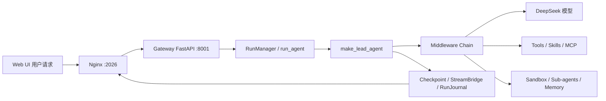

# DeerFlow 学习计划与简历改造路线

> 目标：从“能够运行 DeerFlow”逐步达到“能够解释核心架构、独立改造功能、设计评测指标，并在面试中经得起追问”。
>
> 适用版本：当前仓库 `main` 分支。DeerFlow 迭代较快，后续代码变化时需要重新核对关键入口。

> 建议先阅读配套地图：[DEERFLOW架构总览与第一轮阅读路线.md](./DEERFLOW架构总览与第一轮阅读路线.md)。这份文档专门解释整体模块、请求链路和核心名词；本文件再用于安排深入阅读、实验和简历改造。

## 1. 最终目标

学习结束后，应当能够回答以下问题：

1. DeerFlow 和普通 Chatbot 的区别是什么？
2. 一次用户请求从前端如何流转到 Agent，再返回前端？
3. Lead Agent 如何创建？模型、Tools、Skills 和 Sub-agents 如何注入？
4. Middleware 为什么需要严格排序？
5. Thread、Run、Checkpoint 分别是什么？
6. Sub-agent 如何调度、并发、超时和返回结果？
7. Local Sandbox 和 Docker Sandbox 的安全边界是什么？
8. Memory 如何抽取、检索、更新、过期和注入？
9. Agent 断线或失败后如何恢复？
10. 如何证明自己的改造真的提升了系统，而不是只做了一个 Demo？

最终简历上不应写“学习并部署了 DeerFlow”，而应该写成：

> 基于 LangGraph/DeerFlow 构建并改造长周期 Agent 系统，实现多 Agent 编排、工具调用、沙箱执行、长期记忆和状态持久化，并通过任务成功率、引用准确率、延迟、Token 成本和失败恢复率进行评测。

所有指标必须使用自己实际跑出来的数据。

## 2. DeerFlow 整体架构



需要建立的核心认知：

- **模型**：负责推理、决策和 Tool Calling。
- **Lead Agent**：当前主 Agent，负责理解任务并决定下一步行动。
- **Middleware**：在模型调用、工具执行、状态更新前后加入可靠性、安全、记忆和上下文处理逻辑。
- **Tool**：原子能力，例如搜索、读文件、写文件、浏览器操作。
- **Skill**：一套可复用的任务流程和规范，通常由 `SKILL.md` 描述。
- **Sub-agent**：拥有独立上下文、工具和终止条件的子任务执行者。
- **Sandbox**：Agent 的文件和命令执行环境。
- **Memory**：跨 Session 保存的用户级长期信息。
- **Checkpoint**：保存 LangGraph 状态，使任务可以继续、分支或恢复。
- **StreamBridge**：解耦后台 Agent 执行和前端 SSE 流式消费。

## 3. 文件阅读优先级

### P0：必须掌握

这些文件决定你能否解释 DeerFlow 的核心架构。

#### 项目地图和配置

- `AGENTS.md`
- `backend/AGENTS.md`
- `README_zh.md` 中“从 Deep Research 到 Super Agent Harness”和“核心特性”部分
- `Install.md`
- `config.yaml`
- `config.example.yaml`
- `backend/langgraph.json`
- `backend/packages/harness/deerflow/config/app_config.py`
- `backend/packages/harness/deerflow/config/model_config.py`
- `backend/packages/harness/deerflow/config/memory_config.py`
- `backend/packages/harness/deerflow/config/subagents_config.py`
- `backend/packages/harness/deerflow/config/sandbox_config.py`

#### Agent 核心

- `backend/packages/harness/deerflow/agents/lead_agent/agent.py`
- `backend/packages/harness/deerflow/agents/lead_agent/prompt.py`
- `backend/packages/harness/deerflow/agents/factory.py`
- `backend/packages/harness/deerflow/agents/thread_state.py`
- `backend/packages/harness/deerflow/agents/features.py`

重点函数：

```text
make_lead_agent()
_make_lead_agent()
_resolve_model_name()
build_middlewares()
apply_prompt_template()
create_deerflow_agent()
```

#### 一次请求的运行链路

- `frontend/src/app/workspace/chats/[thread_id]/page.tsx`
- `frontend/src/core/threads/hooks.ts`
- `frontend/src/core/api/api-client.ts`
- `backend/app/gateway/app.py`
- `backend/app/gateway/services.py`
- `backend/app/gateway/routers/runs.py`
- `backend/app/gateway/routers/thread_runs.py`
- `backend/packages/harness/deerflow/runtime/runs/worker.py`
- `backend/packages/harness/deerflow/runtime/runs/manager.py`
- `backend/packages/harness/deerflow/runtime/stream_bridge/base.py`
- `backend/packages/harness/deerflow/runtime/checkpointer/async_provider.py`

### P1：需要理解并能够修改

#### Middleware

优先阅读：

- `backend/packages/harness/deerflow/agents/middlewares/input_sanitization_middleware.py`
- `backend/packages/harness/deerflow/agents/middlewares/thread_data_middleware.py`
- `backend/packages/harness/deerflow/agents/middlewares/uploads_middleware.py`
- `backend/packages/harness/deerflow/agents/middlewares/tool_error_handling_middleware.py`
- `backend/packages/harness/deerflow/agents/middlewares/read_before_write_middleware.py`
- `backend/packages/harness/deerflow/agents/middlewares/loop_detection_middleware.py`
- `backend/packages/harness/deerflow/agents/middlewares/summarization_middleware.py`
- `backend/packages/harness/deerflow/agents/middlewares/memory_middleware.py`
- `backend/packages/harness/deerflow/agents/middlewares/subagent_limit_middleware.py`
- `backend/packages/harness/deerflow/agents/middlewares/clarification_middleware.py`

之后再选择性阅读：

- `title_middleware.py`
- `todo_middleware.py`
- `view_image_middleware.py`
- `token_usage_middleware.py`
- `tool_output_budget_middleware.py`
- `tool_result_sanitization_middleware.py`
- `skill_activation_middleware.py`
- `skill_tool_policy_middleware.py`
- `mcp_routing_middleware.py`

#### Tools、Skills 和 MCP

- `backend/packages/harness/deerflow/tools/tools.py`
- `backend/packages/harness/deerflow/tools/types.py`
- `backend/packages/harness/deerflow/tools/builtins/task_tool.py`
- `backend/packages/harness/deerflow/tools/builtins/tool_search.py`
- `backend/packages/harness/deerflow/tools/builtins/clarification_tool.py`
- `backend/packages/harness/deerflow/tools/builtins/present_file_tool.py`
- `backend/packages/harness/deerflow/skills/parser.py`
- `backend/packages/harness/deerflow/skills/catalog.py`
- `backend/packages/harness/deerflow/skills/installer.py`
- `backend/packages/harness/deerflow/skills/projection.py`
- `backend/packages/harness/deerflow/mcp/client.py`
- `backend/packages/harness/deerflow/mcp/session_pool.py`
- `backend/packages/harness/deerflow/mcp/tools.py`
- `backend/app/gateway/routers/mcp.py`

实际 Skill：

- `skills/public/deep-research/SKILL.md`
- `skills/public/academic-paper-review/SKILL.md`
- `skills/public/ppt-generation/SKILL.md`
- `skills/public/frontend-design/SKILL.md`

#### Sandbox 和安全

- `backend/packages/harness/deerflow/sandbox/sandbox.py`
- `backend/packages/harness/deerflow/sandbox/sandbox_provider.py`
- `backend/packages/harness/deerflow/sandbox/middleware.py`
- `backend/packages/harness/deerflow/sandbox/tools.py`
- `backend/packages/harness/deerflow/sandbox/local/local_sandbox_provider.py`
- `backend/packages/harness/deerflow/sandbox/local/local_sandbox.py`
- `backend/packages/harness/deerflow/sandbox/security.py`
- `backend/packages/harness/deerflow/sandbox/path_patterns.py`

#### Sub-agent

- `backend/packages/harness/deerflow/subagents/executor.py`
- `backend/packages/harness/deerflow/subagents/registry.py`
- `backend/packages/harness/deerflow/subagents/config.py`
- `backend/packages/harness/deerflow/subagents/builtins/general_purpose.py`
- `backend/packages/harness/deerflow/subagents/builtins/bash_agent.py`
- `backend/packages/harness/deerflow/subagents/status_contract.py`
- `backend/packages/harness/deerflow/agents/middlewares/delegation_ledger.py`

#### Memory 和上下文

- `backend/packages/harness/deerflow/agents/memory/manager.py`
- `backend/packages/harness/deerflow/agents/memory/tools.py`
- `backend/packages/harness/deerflow/agents/memory/summarization_hook.py`
- `backend/packages/harness/deerflow/agents/memory/backends/deermem/deer_mem.py`
- `backend/packages/harness/deerflow/agents/memory/backends/deermem/deermem/core/retrieval.py`
- `backend/packages/harness/deerflow/agents/memory/backends/deermem/deermem/core/updater.py`
- `backend/packages/harness/deerflow/agents/memory/backends/deermem/deermem/core/storage.py`

#### 模型适配

- `backend/packages/harness/deerflow/models/factory.py`
- `backend/packages/harness/deerflow/models/patched_deepseek.py`
- `backend/packages/harness/deerflow/models/credential_loader.py`

### P2：先了解作用即可

暂时不需要逐行阅读：

- `backend/app/channels/` 下所有 Feishu、Slack、Telegram、DingTalk 等适配器
- 复杂认证、OIDC、JWT、RBAC 和 GitHub Webhook
- `frontend/src/components/` 下所有 UI 组件和 CSS
- Docker Provisioner 和 Kubernetes
- PostgreSQL 生产部署和全部 Alembic 历史迁移
- Langfuse、LangSmith、Monocle 等完整观测系统
- TUI
- `docs/plans/` 下所有历史设计文档
- 大量兼容性和边界测试

## 4. 实验驱动学习步骤

### 实验一：普通对话

输入：

```text
请解释 LangGraph 和 DeerFlow 的关系。
```

重点观察：

- 使用了哪个模型；
- 是否调用了 Tool；
- 前端如何显示流式消息；
- 一次请求对应几个 Run；
- Run 完成后哪些状态被保存。

### 实验二：Deep Research

输入：

```text
搜索 DeerFlow 官方资料，总结它的核心架构，并生成一份带来源链接的 Markdown 报告。
```

重点观察：

- `web_search` 如何进入工具列表；
- 工具输出如何重新进入模型上下文；
- Agent 什么时候继续搜索，什么时候停止；
- Skill 是否被加载；
- 报告是否生成到 artifacts。

### 实验三：文件处理

上传 PDF 后输入：

```text
总结这份 PDF，提取关键结论，并生成 Markdown 文件。
```

重点观察：

- UploadsMiddleware 如何注入文件；
- 文件进入哪个 Thread 目录；
- Sandbox 如何读写文件；
- 输出文件如何被 Gateway 和前端发现。

### 实验四：Sub-agent

输入：

```text
调研三个主流 Agent 框架，分别分析优缺点，最后给出选型建议。
```

重点观察：

- 是否启动子任务；
- 子任务是否并行；
- 子任务上下文是否独立；
- 主 Agent 如何汇总结果；
- 子任务失败或超时后如何处理。

### 实验五：长上下文和 Goal

尝试：

```text
/goal 完成一份包含目录、引用和结论的技术调研报告
```

然后多轮追加任务，观察：

- Goal 状态保存在哪里；
- 什么时候触发 continuation；
- `/compact` 如何压缩上下文；
- 压缩后可见历史和模型实际上下文有什么区别。

## 5. 两周学习计划

| 时间 | 学习目标 | 重点文件/任务 | 应产出的结果 |
|---|---|---|---|
| 第 1 天 | 建立项目地图 | 根目录文档、README、配置文件 | 一张服务拓扑图 |
| 第 2 天 | 追踪普通请求 | 前端请求、Gateway、RunManager | 一张请求时序图 |
| 第 3 天 | 掌握 Lead Agent | `agent.py`、`factory.py`、`ThreadState` | 能解释 Agent 如何创建 |
| 第 4 天 | 掌握 Middleware | 10 个核心 Middleware | Middleware 顺序表 |
| 第 5 天 | 掌握 Tools | Tools、Built-ins、Tool Search | Tool 调用流程图 |
| 第 6 天 | 掌握 Skills | Parser、Catalog、Activation、SkillScan | 一个自定义 Skill |
| 第 7 天 | 掌握 Sandbox | Sandbox 抽象、Local Provider、安全逻辑 | Sandbox 威胁模型 |
| 第 8 天 | 掌握 Sub-agent | Executor、Registry、Task Tool | 一次子任务执行记录 |
| 第 9 天 | 掌握 Memory | Manager、DeerMem、Retrieval、Updater | 记忆生命周期图 |
| 第 10 天 | 掌握上下文管理 | Summarization、Context Compaction | 长上下文实验记录 |
| 第 11 天 | 掌握运行时 | RunManager、StreamBridge、Checkpoint | 断线恢复解释 |
| 第 12 天 | 掌握 Gateway | FastAPI、Routers、Uploads、Artifacts | 一个 API 调用示例 |
| 第 13 天 | 掌握测试 | 阅读核心测试并运行离线测试 | 测试覆盖地图 |
| 第 14 天 | 选择改造方向 | 设计文档、最小实现、评测 | 简历项目雏形 |

如果 Python、LangChain 和 Agent 基础还不熟，可以将两周扩展到三到四周。

## 6. 测试学习路线

测试文件本身就是设计文档，优先阅读：

- `backend/tests/test_create_deerflow_agent.py`
- `backend/tests/test_lead_agent_model_resolution.py`
- `backend/tests/test_lead_agent_prompt.py`
- `backend/tests/test_checkpoint_state.py`
- `backend/tests/test_checkpoint_mode.py`
- `backend/tests/test_tool_error_handling_middleware.py`
- `backend/tests/test_loop_detection_middleware.py`
- `backend/tests/test_local_sandbox_virtual_path_contract.py`
- `backend/tests/test_delegation_ledger.py`
- `backend/tests/test_memory_updater.py`
- `backend/tests/test_context_compaction.py`
- `backend/tests/test_harness_boundary.py`

运行后端离线测试：

```bash
cd backend
make test
```

后续每次改造都遵循：

```text
修改实现 → 增加回归测试 → 运行目标测试 → 运行完整离线测试
```

不要一开始运行需要真实 API 的 Live 测试。Live 测试会调用外部模型，并可能产生文件、Token 和本地状态副作用。

## 7. 推荐的简历改造方向

### 方向 A：可验证 Deep Research Agent（优先推荐）

项目名称示例：

```text
基于 DeerFlow 的可验证 Deep Research Agent
```

实现内容：

1. 保留 Lead Agent、Tools、Skills、Sub-agent 的整体架构；
2. 为搜索结果建立来源记录；
3. 让每个关键结论绑定至少一个来源；
4. 增加验证 Sub-agent，检查结论与来源是否支持；
5. 对引用正确率、覆盖率、任务成功率进行评测；
6. 统计 Token 成本、延迟、重试次数和失败恢复率。

适合修改或扩展：

- `skills/public/deep-research/SKILL.md`
- `backend/packages/harness/deerflow/tools/`
- `backend/packages/harness/deerflow/subagents/`
- `backend/packages/harness/deerflow/agents/middlewares/`
- `backend/tests/`

### 方向 B：成本感知的 Sub-agent 调度器

核心问题：

> 不是所有复杂任务都值得启动多个 Sub-agent，如何在任务收益、延迟和 Token 成本之间做决策？

可以实现：

- 根据任务类型决定是否并行；
- 设置每次 Run 的 Token 预算；
- 根据子任务价值动态限制并发；
- 失败后选择重试、降级或交给主 Agent；
- 统计并行加速比和成本变化。

重点代码：

- `backend/packages/harness/deerflow/subagents/executor.py`
- `backend/packages/harness/deerflow/subagents/config.py`
- `backend/packages/harness/deerflow/agents/middlewares/subagent_limit_middleware.py`
- `backend/packages/harness/deerflow/tools/builtins/task_tool.py`

### 方向 C：Agent 可靠性 Middleware

实现一个新的 Middleware，例如：

- 工具失败分类；
- 自动重试策略；
- 风险工具人工确认；
- 工具调用质量评估；
- 长时间无进展检测；
- 高成本任务提前终止。

重点代码：

- `backend/packages/harness/deerflow/agents/middlewares/`
- `backend/packages/harness/deerflow/agents/factory.py`
- `backend/tests/`

## 8. 评测指标

不要只展示“可以运行”，至少建立一个 20～50 条任务的小型评测集。

推荐指标：

- 任务成功率；
- 工具调用成功率；
- 引用正确率；
- 引用覆盖率；
- 平均延迟；
- P95 延迟；
- 输入和输出 Token；
- 单任务成本；
- 自动重试次数；
- 失败恢复率；
- Sub-agent 并行加速比；
- 不受支持结论比例；
- 人工介入次数。

至少做一次对照实验，例如：

```text
单 Agent vs. 多 Agent
无引用校验 vs. 有引用校验
无记忆 vs. 有记忆
无重试 vs. 有重试
```

## 9. 面试重点问题

### 架构

1. DeerFlow 和普通 Chatbot 的区别是什么？
2. 为什么使用 LangGraph？
3. Harness 和 App 为什么要分层？
4. 一次用户请求经过哪些服务和模块？

### Agent

5. Lead Agent 如何创建？
6. Tool、Skill、Sub-agent 的区别是什么？
7. 为什么不能把所有功能都写进 Prompt？
8. 多 Agent 一定比单 Agent 好吗？

### 可靠性和安全

9. 如何避免工具调用死循环？
10. 如何限制 Agent 修改文件？
11. Local Sandbox 和 Docker Sandbox 的差异是什么？
12. 如何防止网页内容中的 Prompt Injection？
13. Tool 失败后为什么不能简单无限重试？
14. 如何限制 Token 成本和子任务数量？

### 状态和运行时

15. Thread、Run、Checkpoint 的区别是什么？
16. StreamBridge 为什么存在？
17. Agent 断线后如何恢复？
18. Memory 和聊天历史有什么区别？
19. 上下文压缩后如何避免丢失关键事实？

### 工程和评测

20. 如何证明你的改造提升了效果？
21. 如何设计 Agent 评测集？
22. 如何定位模型差、工具差还是流程差？
23. 如何控制延迟、Token 和并发？
24. 如果模型不支持 Tool Calling，该怎么办？

## 10. 学习过程中的记录方式

建议在本仓库旁边维护四份笔记：

```text
architecture.md       # 系统架构和模块边界
request-trace.md      # 一次请求的时序过程
middleware-table.md   # Middleware 顺序和职责
interview-questions.md# 面试问题和自己的答案
```

每读完一个模块，记录四项：

1. 解决什么问题？
2. 输入和输出是什么？
3. 失败时如何处理？
4. 如果让我改，我会改什么？

阅读代码时可以使用：

```bash
rg -n "^(class|def|async def)" <file>
rg -n "function_name|class_name" .
git log --oneline -- <file>
git blame -L <start>,<end> <file>
```

当前仓库是浅克隆。如果后续需要研究历史设计，再执行：

```bash
git fetch --unshallow
```

## 11. 最终完成标准

达到下面标准后，才算真正掌握了这个项目：

- 能画出完整请求链路；
- 能解释 `make_lead_agent()` 如何组装模型、Tools 和 Middleware；
- 能解释 ThreadState 和 Checkpoint；
- 能独立写一个自定义 Skill；
- 能独立增加一个 Tool 或 Middleware；
- 能为改造增加单元测试；
- 能跑出一组真实评测数据；
- 能解释至少三种失败场景和恢复策略；
- 能说明 Local Sandbox 的安全限制；
- 能把自己的改造压缩成两到三条简历 bullet；
- 能回答“为什么这么设计，而不是另一种设计”。
