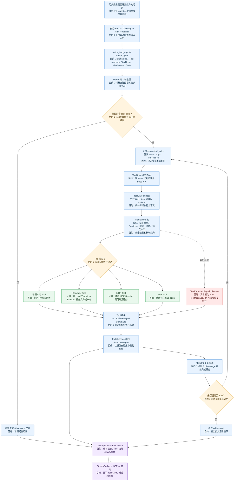

# DeerFlow 普通问答：一次真实请求的源码追踪

> 目标：只追踪一条最小链路——用户输入一句普通文本问题，模型直接回答，不调用 Tool、不委派 Sub-agent、不上传文件、不进入 Plan Mode。
>
> 示例问题：`请用一句话介绍一下你自己。`
>
> 代码版本：当前本地仓库 `99c926b`。

## 1. 先记住完整链路

一次普通问答可以拆成两条并行链路：

```text
浏览器发送链路：
ChatPage.handleSubmit
  -> useThreadStream.sendMessage
  -> thread.submit
  -> LangGraph SDK client.runs.stream
  -> POST /api/threads/{thread_id}/runs/stream
  -> Gateway.stream_run

后台执行链路：
stream_run
  -> start_run
  -> RunManager.create_or_reject
  -> asyncio.create_task
  -> run_agent
  -> make_lead_agent
  -> create_agent
  -> agent.astream
  -> StreamBridge.publish
  -> sse_consumer
  -> StreamingResponse
  -> 浏览器收到 SSE 事件并更新 UI
```

最重要的理解是：HTTP 请求不会一直同步等待模型执行完毕。Gateway 先创建 Run，再把 Agent 放到后台 asyncio Task 中执行；浏览器通过 SSE 订阅这个 Run 的事件。

## 2. 本次请求的简化输入

前端最终提交给 LangGraph SDK 的核心信息大致如下。真实请求还可能包含更多上下文和流模式字段，但学习第一条链路时先关注这些字段。

```ts
// 用户输入会被包装成 LangGraph Agent State 的 messages 字段。
const values = {
  // role=user 表示这是用户消息。
  messages: [{ role: "user", content: "请用一句话介绍一下你自己。" }],
};

// threadId 表示长期会话；assistantId 决定使用哪个 Agent Factory。
const submitOptions = {
  // 当前页面所属的 Thread。
  threadId: threadId,
  // DeerFlow 的默认 Lead Agent。
  assistantId: "lead_agent",
  // 断线后允许 Run 继续执行并支持重新连接。
  streamResumable: true,
  // LangGraph 的图递归步数上限。
  config: { recursion_limit: 1000 },
  // DeerFlow 的运行时开关，例如模型、思考模式和用户上下文。
  context: { ...context, thread_id: threadId },
};
```

## 3. 第 0 步：如果是新聊天，先创建 Thread

这一段只在用户位于 `/chats/new` 或当前没有有效 Thread 时发生。如果你是在已有聊天窗口中继续提问，可以先跳过本节。

### 3.1 LangGraph SDK 自动创建 Thread

文件：`frontend/node_modules/@langchain/langgraph-sdk/dist/react/stream.lgp.js:252-261`

```ts
// submit() 开始处理本次提交。
await stream.start(async (signal) => {
  // 如果当前还没有 Thread，先调用后端创建 Thread。
  if (!usableThreadId) {
    // submitOptions.threadId 可以让前端指定一个预先生成的 ID。
    usableThreadId = (await client.threads.create({
      // 传递前端准备好的 Thread ID；没有时由服务端生成。
      threadId: submitOptions?.threadId,
      // 新 Thread 可以附带元数据。
      metadata: submitOptions?.metadata,
      // 使用同一个 AbortSignal 管理本次请求。
      signal,
    })).thread_id;

    // 把服务端确认的 Thread ID 写回 SDK 和 React 状态。
    threadIdRef.current = usableThreadId;
    threadIdStreamingRef.current = usableThreadId;
    onThreadId(usableThreadId);
  }
});
```

### 3.2 Gateway 写入 Thread 元数据和初始 Checkpoint

文件：`backend/app/gateway/routers/threads.py:709-783`

```python
# 接收 POST /api/threads 请求。
@router.post("", response_model=ThreadResponse)
async def create_thread(body: ThreadCreateRequest, request: Request):
    # 获取 Checkpointer，用于保存 LangGraph 状态。
    checkpointer = get_checkpointer(request)
    # 获取 Thread Store，用于保存 Thread 元数据。
    thread_store = get_thread_store(request)
    # 解析或生成最终 Thread ID。
    thread_id = resolve_thread_id(body.thread_id)

    # 写入 thread_meta，让 Thread 可以出现在历史列表中。
    await thread_store.create(
        thread_id,
        assistant_id=getattr(body, "assistant_id", None),
        metadata=body.metadata,
    )

    # 创建空 Checkpoint，让 Thread 在第一次 Run 前也有合法状态。
    config = {"configurable": {"thread_id": thread_id, "checkpoint_ns": ""}}
    await checkpointer.aput(
        config,
        empty_checkpoint(),
        {"step": -1, "source": "input", "writes": None, "parents": {}},
        {},
    )

    # 返回 Thread ID，前端后续 Run 都使用它。
    return ThreadResponse(thread_id=thread_id, status="idle", ...)
```

这里要区分：Thread 不是一次模型调用。Thread 是长期会话容器，后续每次提问都会在它下面创建一个新的 Run。

## 4. 第 1 步：页面收到用户提交

文件：`frontend/src/app/workspace/chats/[thread_id]/page.tsx:179-187`

```tsx
// 输入框提交后，页面组件执行 handleSubmit。
const handleSubmit = useCallback(
  // message 中包含用户输入文本和可能的文件；本次只有文本。
  (message: PromptInputMessage, options?: InputBoxSubmitOptions) => {
    // 页面不直接请求后端，而是把工作交给 useThreadStream。
    const sendPromise = sendMessage(threadId, message, undefined, options);

    // 没有附件时，普通文本请求在后台等待即可。
    if (message.files.length === 0) {
      void sendPromise;
    }
  },
  // 当 sendMessage 或 threadId 变化时重新生成回调。
  [sendMessage, threadId],
);
```

页面层的职责很薄：获取当前 Thread ID，把输入交给线程流 Hook。真正的请求参数组装和流式连接都在下一层。

## 5. 第 2 步：`useThreadStream` 组装请求并调用 `thread.submit`

文件：`frontend/src/core/threads/hooks.ts:1650-1662`、`2051-2250`

### 5.1 Hook 创建 LangGraph Stream 实例

```tsx
// useStream 是 LangGraph SDK 提供的 React 流管理器。
const thread = useStream<AgentThreadState>({
  // DeerFlow 自己创建的 API Client，内部会指向 Gateway。
  client: getAPIClient(isMock),
  // assistantId 会最终传给后端的 RunCreateRequest。
  assistantId: "lead_agent",
  // 已有 Thread 直接复用；新聊天时这里可能为空。
  threadId: onStreamThreadId,
  // 页面重新挂载时允许恢复已有流。
  reconnectOnMount: true,
  // 只读取最近一段状态历史用于初始化界面。
  fetchStateHistory: { limit: 1 },
  // 将同一时刻收到的多个事件合并后再通知 React。
  throttle: true,
});
```

### 5.2 `sendMessage` 调用 `thread.submit`

文件：`frontend/src/core/threads/hooks.ts:2200-2236`

```tsx
// sendMessage 把用户文本转换成 Agent State 的 messages 输入。
await thread.submit(
  {
    // buildThreadSubmitMessages 会生成 role=user 的消息对象。
    messages: buildThreadSubmitMessages({
      text,
      additionalKwargs: options?.additionalKwargs,
      additionalInputMessages: options?.additionalInputMessages,
      filesForSubmit,
    }),
  },
  {
    // 指定本次 Run 所属的 Thread。
    threadId: threadId,
    // 允许浏览器断线后 Run 继续执行。
    streamResumable: true,
    // 限制 LangGraph 图的最大递归步数。
    config: { recursion_limit: 1000 },
    // 把前端模式转换成后端 Agent 的运行时配置。
    context: {
      ...extraContext,
      ...context,
      // flash 模式关闭思考；其他模式默认打开。
      thinking_enabled: context.mode !== "flash",
      // pro 和 ultra 模式进入计划能力。
      is_plan_mode: context.mode === "pro" || context.mode === "ultra",
      // 当前代码只在 ultra 模式开启 Sub-agent。
      subagent_enabled: context.mode === "ultra",
      // 把当前 Thread ID 放入运行时上下文。
      thread_id: threadId,
    },
  },
);
```

这一层还会更新 optimistic UI，但那只是前端体验，不代表后端已经完成了回答。真正的后端 Run 要等下一层 SDK 发起 HTTP 请求。

## 6. 第 3 步：LangGraph SDK 把提交转换成 HTTP 请求

### 6.1 SDK 的 `submit` 调用 `client.runs.stream`

文件：`frontend/node_modules/@langchain/langgraph-sdk/dist/react/stream.lgp.js:272-301`

```ts
// SDK 已经拿到可用的 Thread ID 后，开始创建并订阅 Run。
return client.runs.stream(usableThreadId, options.assistantId, {
  // 把 messages 作为本次 Graph 的输入。
  input: values,
  // 传递递归步数等 LangGraph 配置。
  config: submitOptions?.config,
  // 传递 DeerFlow 的运行时上下文。
  context: submitOptions?.context,
  // streamResumable=true 时，断线默认继续执行。
  onDisconnect: submitOptions?.onDisconnect ?? "continue",
  // 告诉后端这是一条可恢复的流。
  streamResumable,
  // 后端返回 Run 元数据后，SDK 通知 React Hook。
  onRunCreated(params) {
    // 保存 run_id，后续可以停止、重连或查询这次 Run。
    callbackMeta = { run_id: params.run_id, thread_id: params.thread_id };
    // 前端把 run_id 写入 sessionStorage 作为重连依据。
    runMetadataStorage?.setItem(`lg:stream:${usableThreadId}`, params.run_id);
    // 通知 DeerFlow UI 当前 Run 已创建。
    options.onCreated?.(callbackMeta);
  },
});
```

### 6.2 SDK 生成真实请求路径和 JSON Body

文件：`frontend/node_modules/@langchain/langgraph-sdk/dist/client.js:724-758`

```js
// RunsClient.stream 将 SDK 参数转换成后端协议字段。
const json = {
  // Agent 的输入状态，核心是 messages。
  input: payload?.input,
  // LangGraph 配置。
  config: payload?.config,
  // DeerFlow 运行时上下文。
  context: payload?.context,
  // 使用 lead_agent Graph。
  assistant_id: assistantId,
  // 可恢复流和断线策略。
  stream_resumable: payload?.streamResumable,
  on_disconnect: payload?.onDisconnect,
};

// 有 Thread 时，请求进入 /threads/{thread_id}/runs/stream。
yield* this.streamWithRetry({
  endpoint: `/threads/${threadId}/runs/stream`,
  method: "POST",
  json,
  signal: payload?.signal,
});
```

因此，最简单问答的核心 HTTP 请求是：

`POST /api/threads/{thread_id}/runs/stream`

注意：SDK 文件位于 `node_modules`，第一轮只需要知道它负责“协议转换和发请求”，不必深入依赖库内部实现。

## 7. 第 4 步：Gateway 路由接收请求

文件：`backend/app/gateway/routers/thread_runs.py:844-869`

```python
# thread_runs.router 的 prefix 是 /api/threads。
@router.post("/{thread_id}/runs/stream")
async def stream_run(
    thread_id: ThreadId,
    body: RunCreateRequest,
    request: Request,
) -> StreamingResponse:
    # 获取事件桥；Worker 会向它发布事件，SSE 消费者从它订阅事件。
    bridge = get_stream_bridge(request)
    # 获取 Run 生命周期管理器。
    run_mgr = get_run_manager(request)

    # 这里只负责创建 Run 并启动后台 Worker，不直接执行完整 Agent。
    record = await start_run(body, thread_id, request)

    # 把 SSE Consumer 包装成 HTTP 流返回给浏览器。
    return StreamingResponse(
        sse_consumer(bridge, record, request, run_mgr),
        # 告诉浏览器这是 Server-Sent Events。
        media_type="text/event-stream",
        # 禁止代理缓存和缓冲，保证事件及时到达。
        headers={
            "Cache-Control": "no-cache",
            "Connection": "keep-alive",
            "X-Accel-Buffering": "no",
            # SDK 从这个路径提取 run_id。
            "Content-Location": f"/api/threads/{thread_id}/runs/{record.run_id}",
        },
    )
```

这里是 HTTP 入口，也是“请求线程”和“后台执行线程”分离的地方。

## 8. 第 5 步：`start_run` 完成 Run Admission

文件：`backend/app/gateway/services.py:1050-1267`

`start_run` 可以理解成 Run 的“准入和调度器”，主要做四件事：校验、规范化输入、组装配置、创建后台任务。

### 8.1 校验并选择 Agent Factory

```python
# start_run 接收已通过 Pydantic 校验的请求体。
async def start_run(body: RunCreateRequest, thread_id: str, request: Request) -> RunRecord:
    # 校验 Thread ID，避免非法路径进入运行时。
    validate_thread_id(thread_id)

    # stream_mode 决定 Worker 需要从 Agent 读取哪些流事件。
    stream_modes = normalize_stream_modes(body.stream_mode)
    # 获取事件桥、Run 管理器和运行时基础设施。
    bridge = get_stream_bridge(request)
    run_mgr = get_run_manager(request)
    run_ctx = get_run_context(request)

    # 将请求中的断线策略转换成后端枚举。
    disconnect = (
        DisconnectMode.cancel
        if body.on_disconnect == "cancel"
        else DisconnectMode.continue_
    )

    # 当前 assistant_id 最终解析到 make_lead_agent。
    agent_factory = resolve_agent_factory(body.assistant_id)
    # 把 input.messages 转换成 LangChain Message 对象。
    graph_input = normalize_input(body.input, trusted_internal=False)
    # 组装 RunnableConfig，包含 Thread、模型、上下文和递归限制。
    config = build_run_config(
        thread_id,
        body.config,
        body.metadata,
        assistant_id=body.assistant_id,
    )
    # 如果本次请求指定了某个 Checkpoint，合并到运行配置。
    await apply_checkpoint_to_run_config(
        config,
        body=body,
        thread_id=thread_id,
        request=request,
    )
```

对于最简单的普通问答，`graph_input` 大致是：

```python
# normalize_input 最终返回 Graph 可以理解的状态输入。
graph_input = {
    # LangChain HumanMessage 会被放入 messages 列表。
    "messages": [HumanMessage(content="请用一句话介绍一下你自己。")],
}
```

### 8.2 创建 Run 记录并启动 `asyncio.Task`

文件：`backend/app/gateway/services.py:1221-1250`

```python
# 使用 Thread 锁，避免同一个 Thread 的并发状态写入冲突。
async with goal_thread_lock(thread_id):
    # 确保 Checkpoint 历史基础记录存在。
    await ensure_checkpoint_history_seeded(
        request,
        thread_id=thread_id,
        assistant_id=body.assistant_id,
    )

    # 先把本次执行登记为 pending/running 生命周期中的一个 Run。
    record = await run_mgr.create_or_reject(
        thread_id,
        body.assistant_id,
        on_disconnect=disconnect,
        metadata=body.metadata or {},
        # 持久化到 RunStore 的配置会脱敏；实际运行 config 保留在内存中。
        kwargs={"input": body.input, "config": redact_config_secrets(body.config)},
        multitask_strategy=body.multitask_strategy,
        model_name=model_name,
        user_id=owner_user_id,
    )

    # 把真正的 Worker 函数包装起来。
    worker = run_after_metadata(record)
    # 关键点：create_task 让 Agent 在后台执行，HTTP Handler 不同步等待。
    record.task = asyncio.create_task(worker)

# 返回 RunRecord，让 stream_run 立即建立 SSE 消费端。
return record
```

面试时可以这样说：`start_run()` 的边界是“Run 已被接受并获得后台执行资格”，不是“模型已经回答完成”。

## 9. 第 6 步：后台 Worker 启动 Agent

文件：`backend/packages/harness/deerflow/runtime/runs/worker.py:534-820`

### 9.1 Worker 抢占 Run 并更新状态

```python
# Worker 是真正执行一个 Run 的后台协程。
async def run_agent(
    bridge: StreamBridge,
    run_manager: RunManager,
    record: RunRecord,
    *,
    ctx: RunContext,
    agent_factory: Any,
    graph_input: dict,
    config: dict,
    stream_modes: list[str] | None = None,
):
    # 取出本次 Run 使用的持久化和事件基础设施。
    checkpointer = ctx.checkpointer
    store = ctx.store
    event_store = ctx.event_store
    thread_id = record.thread_id
    run_id = record.run_id

    # 等待同一 Thread 的前一个 Run 完成 finalizing。
    await run_manager.wait_for_prior_finalizing(
        thread_id,
        run_id,
        abort_event=record.abort_event,
    )

    # 将 Run 从 pending 变成 running；抢占失败则不构造 Agent。
    start_outcome = await run_manager.try_start(run_id)
    if start_outcome is not RunStartOutcome.started:
        return

    # 同步 Thread 的展示状态，前端可以显示 busy/running。
    await thread_store.update_status(thread_id, "running")
```

### 9.2 构造运行时上下文

```python
# 运行时上下文会被 Middleware、ToolRuntime 和回调使用。
runtime_ctx = _build_runtime_context(
    thread_id,
    run_id,
    config.get("context"),
    ctx.app_config,
    task_store,
    extensions,
)

# 将当前 Run 的上下文安装到 RunnableConfig。
_install_runtime_context(config, runtime_ctx)

# LangGraph Runtime 允许节点和 Tool 访问 context/store。
runtime = Runtime(context=cast(Any, runtime_ctx), store=store)
config.setdefault("configurable", {})["__pregel_runtime"] = runtime

# 将完整配置转换成 LangChain/LangGraph 使用的 RunnableConfig。
initial_runnable_config = RunnableConfig(**config)
```

这一步不是在调用模型，而是在准备“模型、Tool、Middleware 执行时需要的环境”。

## 10. 第 7 步：调用 `make_lead_agent` 构造 Graph

### 10.1 Worker 调用 Agent Factory

文件：`backend/packages/harness/deerflow/runtime/runs/worker.py:814-826`

```python
# 这里 agent_factory 实际上就是 make_lead_agent。
agent_factory_kwargs = {"config": initial_runnable_config}

# 扩展点可以在 Agent 构造前注入额外行为。
with bind_agent_build_extensions(extensions):
    # 进入 make_lead_agent，返回一个已编译的 LangGraph Agent。
    agent = agent_factory(**agent_factory_kwargs)

# 将 Checkpointer 和 Store 绑定到编译后的 Agent。
accessor = CheckpointStateAccessor.bind(
    agent,
    checkpointer,
    store=store,
    mode=mode,
)

# 后续 graph.invoke/astream 会把状态写入这个 Checkpointer。
if checkpointer is not None:
    agent.checkpointer = checkpointer
if store is not None:
    agent.store = store
```

### 10.2 `make_lead_agent` 解析运行时配置

文件：`backend/packages/harness/deerflow/agents/lead_agent/agent.py:640-728`

```python
# LangGraph 的 graph 入口；backend/langgraph.json 将 lead_agent 指向这里。
def make_lead_agent(config: RunnableConfig):
    # 从配置中获取全局 AppConfig；模型、Skill 和数据库配置都来自这里。
    runtime_config = _get_runtime_config(config)
    app_config = runtime_config.get("app_config") or get_app_config()

    # 读取本次 Run 的模式开关。
    cfg = _get_runtime_config(config)
    requested_model_name = cfg.get("model_name") or cfg.get("model")
    is_plan_mode = cfg.get("is_plan_mode", False)
    subagent_enabled = cfg.get("subagent_enabled", False)
    agent_name = validate_agent_name(cfg.get("agent_name"))

    # 读取当前 Agent 允许使用的 Skill 和自定义配置。
    agent_config = load_agent_config(agent_name, user_id=resolve_config_user_id(config))
    available_skills = _available_skill_names(agent_config, is_bootstrap=False)

    # 按“请求指定模型 -> Agent 配置 -> 全局默认模型”解析模型。
    model_name = _resolve_model_name(
        requested_model_name or agent_config.model if agent_config else requested_model_name,
        app_config=app_config,
    )

    # 做模型白名单和权限校验。
    model_name = _authorize_model_name(model_name, context=cfg, app_config=app_config)

    # 找不到模型时，直接阻止 Agent 构造，避免运行到一半才失败。
    model_config = app_config.get_model_config(model_name)
    if model_config is None:
        raise ValueError("No chat model could be resolved")
```

### 10.3 同时组装 Model、Tools、Middleware、Prompt 和 State Schema

文件：`backend/packages/harness/deerflow/agents/lead_agent/agent.py:873-929`

```python
# 获取当前 Run 允许使用的 Tool；普通问答可能不调用它们，但 Agent 仍需知道能力边界。
raw_tools = get_available_tools(
    model_name=model_name,
    groups=agent_config.tool_groups if agent_config else None,
    subagent_enabled=subagent_enabled,
    app_config=app_config,
)

# 根据权限过滤 Tool，避免模型看到不允许使用的动作。
authorized_tools, authorization_provider = apply_tool_authorization(
    raw_tools,
    context=cfg,
    app_config=app_config,
)

# 组装延迟加载的 Tool/MCP 路由能力，减少初始 Prompt 体积。
final_tools, deferred_setup = assemble_deferred_tools(
    authorized_tools,
    enabled=app_config.tool_search.enabled,
)

# 创建完整的 DeerFlow Agent Graph。
return create_agent(
    # Model 负责决定回答还是调用 Tool。
    model=create_chat_model(
        name=model_name,
        thinking_enabled=thinking_enabled,
        reasoning_effort=reasoning_effort,
        app_config=app_config,
    ),
    # Tools 是模型可以调用的实际动作。
    tools=final_tools,
    # Middleware 处理安全、错误、压缩、Skill、限流等横切逻辑。
    middleware=normalize_middleware_state_schemas(
        build_middlewares(
            config,
            model_name=model_name,
            agent_name=agent_name,
            available_skills=available_skills,
            app_config=app_config,
            deferred_setup=deferred_setup,
            user_id=resolve_config_user_id(config),
            authorization_provider=authorization_provider,
        ),
        mode,
    ),
    # System Prompt 告诉模型它是谁、能做什么、如何使用能力。
    system_prompt=apply_prompt_template(
        subagent_enabled=subagent_enabled,
        available_skills=available_skills,
        app_config=app_config,
        deferred_names=deferred_setup.deferred_names,
    ),
    # State Schema 定义 Graph 中共享的 messages、计划、摘要等状态结构。
    state_schema=get_thread_state_schema(mode),
)
```

这一段是 DeerFlow 区别于普通“直接调用模型”的关键：它返回的是一个可执行的 Agent Graph，而不是一个裸模型对象。

## 11. 第 8 步：Worker 调用 `agent.astream`

文件：`backend/packages/harness/deerflow/runtime/runs/worker.py:914-931`

```python
# _stream_once 负责执行本次用户输入，并把 Graph 的输出转成事件。
async def _stream_once(input_payload, stream_config):
    # 使用 Thread 级 Checkpoint 锁，避免并发修改同一份图状态。
    async with _checkpoint_thread_lock(thread_id):
        # 普通请求通常走单流模式，chunk 可以直接消费。
        if len(lg_modes) == 1 and not stream_subgraphs:
            single_mode = lg_modes[0]

            # astream 内部驱动 LangGraph：模型节点、Tool 节点、Middleware 依次运行。
            async for chunk in agent.astream(
                input_payload,
                config=stream_config,
                stream_mode=single_mode,
            ):
                # 用户点击停止后，尽快退出流循环。
                if record.abort_event.is_set():
                    break

                # 把 LangGraph chunk 转成 DeerFlow 的 SSE 事件类型。
                sse_event = _lg_mode_to_sse_event(single_mode)

                # 发布给 StreamBridge；SSE Consumer 会从另一端订阅。
                await bridge.publish(
                    run_id,
                    sse_event,
                    serialize(chunk, mode=single_mode),
                )
```

对于本次“纯问答”，Agent 通常经历：读取已有 Checkpoint 状态 → 追加 HumanMessage → 调用 Chat Model → 产生 AIMessage → 写回 Graph State。由于没有 `tool_calls`，不会进入 Tool 执行分支。

`agent.astream()` 是学习时的关键边界：DeerFlow 负责运行 Graph 和转发事件；具体某个模型 SDK 如何发 HTTP 请求，属于模型适配层和第三方依赖，第一轮暂时不展开。

## 12. 第 9 步：Checkpoint 保存 Graph 状态

Worker 会把 Checkpointer 绑定到 Agent：

```python
# Checkpointer 是 LangGraph 状态持久化入口。
if checkpointer is not None:
    # Agent 执行过程中产生的状态可以写入 Thread 对应的 Checkpoint。
    agent.checkpointer = checkpointer

# Store 用于保存 Agent 运行时需要的共享数据。
if store is not None:
    agent.store = store
```

这里不要误解为“Worker 手动保存每一个 Token”。通常是 LangGraph 在图执行过程中根据 Checkpoint 机制保存状态；Worker 负责把持久化组件注入 Agent，并在 Run 结束时完成状态、时长和结果相关的收尾。

## 13. 第 10 步：StreamBridge 把后台事件交给 SSE

### 13.1 Worker 发布事件

文件：`backend/packages/harness/deerflow/runtime/stream_bridge/base.py:53-79`

```python
# StreamBridge 是生产者和消费者之间的抽象事件桥。
class StreamBridge(abc.ABC):
    # Worker 调用 publish，把事件放入指定 Run 的事件流。
    @abc.abstractmethod
    async def publish(self, run_id: str, event: str, data: Any) -> None:
        """Enqueue one event for a Run."""

    # Worker 完成时发送结束信号。
    @abc.abstractmethod
    async def publish_end(self, run_id: str) -> None:
        """Signal that no more events will be produced."""

    # SSE Consumer 按 Run ID 订阅事件，也可以使用 Last-Event-ID 重放。
    @abc.abstractmethod
    def subscribe(self, run_id: str, *, last_event_id: str | None = None):
        """Yield events, heartbeats, replay gaps and the end sentinel."""
```

### 13.2 Worker 完成 Run

文件：`backend/packages/harness/deerflow/runtime/runs/worker.py:1230-1247`

```python
# 根据 Run 结果同步 Thread 的最终状态。
final_status = "idle" if record.status == RunStatus.success else record.status.value
await thread_store.update_status(thread_id, final_status)

# 通知所有订阅者：这个 Run 不会再产生新事件。
await bridge.publish_end(run_id)

# 延迟清理内存中的事件资源，为迟到的订阅者留出时间。
asyncio.create_task(bridge.cleanup(run_id, delay=60))
```

## 14. 第 11 步：SSE Consumer 把事件写回 HTTP 响应

文件：`backend/app/gateway/services.py:1325-1383`

```python
# SSE Consumer 是一个异步生成器，负责把 StreamBridge 事件编码成 SSE 帧。
async def sse_consumer(bridge, record, request, run_mgr):
    # 浏览器重连时会带上上次收到的事件 ID。
    last_event_id = request.headers.get("Last-Event-ID")

    try:
        # 按 run_id 订阅 Worker 发布的事件。
        async for entry in bridge.subscribe(
            record.run_id,
            last_event_id=last_event_id,
        ):
            # 如果浏览器已断开，跳出消费循环。
            if await request.is_disconnected():
                break

            # 事件缺口表示无法完整重放，需要重新加载持久化状态。
            if isinstance(entry, StreamGap):
                yield format_sse("gap", {"recovery": "reload_durable_state"})
                return

            # 心跳用于保持连接，并检测孤儿 Run。
            if entry is HEARTBEAT_SENTINEL:
                yield ": heartbeat\\n\\n"
                continue

            # END_SENTINEL 表示后台 Worker 已经结束。
            if entry is END_SENTINEL:
                yield format_sse("end", None, event_id=entry.id or None)
                return

            # 普通 token、状态更新、自定义事件都编码成 SSE 帧。
            yield format_sse(entry.event, entry.data, event_id=entry.id or None)
    finally:
        # 只有 on_disconnect=cancel 时，断线才会取消仍在运行的 Run。
        if record.status in (RunStatus.pending, RunStatus.running):
            if record.on_disconnect == DisconnectMode.cancel:
                await run_mgr.cancel(record.run_id)
```

最终浏览器看到的不是 Python 对象，而是类似下面的 SSE 数据帧：

```text
// 事件类型告诉前端如何处理这条消息。
event: messages
// id 用于断线重连时携带 Last-Event-ID。
id: 42
// data 是序列化后的 token、消息或状态更新。
data: {"content":"你好"}
```

## 15. 第 12 步：前端接收事件并更新界面

文件：`frontend/src/core/threads/hooks.ts:1700-1779`

```tsx
// LangGraph SDK 收到 updates 事件后调用 onUpdateEvent。
onUpdateEvent(data) {
  // 将事件中的各个状态更新取出来。
  const updates: Array<Partial<AgentThreadState> | null> = Object.values(
    data || {},
  );

  // 逐个处理 Graph State 更新。
  for (const update of updates) {
    // 如果状态中出现 title，更新侧边栏缓存。
    if (update && "title" in update && update.title) {
      void queryClient.setQueriesData(
        { queryKey: ["threads", "search"], exact: false },
        (oldData) => {
          // 只更新当前 Thread，避免影响其他会话。
          return oldData?.map((thread) =>
            thread.thread_id === threadIdRef.current
              ? { ...thread, values: { ...thread.values, title: update.title } }
              : thread,
          );
        },
      );
    }
  }
}
```

消息 token 的具体拼接、Tool Step 的显示和 React 状态更新主要由 LangGraph SDK 的 `StreamManager` 负责；DeerFlow Hook 通过 `onUpdateEvent`、`onCustomEvent` 等回调把它们映射到自己的 UI 状态。

## 16. 一次普通问答中，哪些模块没有真正执行？

虽然 `make_lead_agent()` 会把很多能力装配进 Graph，但本次最小问题通常不会进入以下路径：

- `task_tool.py`：因为模型没有产生 `task` Tool Call。
- `subagents/executor.py`：没有委派 Sub-agent。
- `sandbox/`：没有执行 Shell、文件或代码任务。
- MCP Client：没有调用外部 MCP Tool。
- `tool_search.py` 的实际 Tool 激活：没有发生 Tool 搜索。
- Plan/Todo 相关逻辑：只有复杂任务或指定模式才会明显参与。

这正是第一轮学习应该选择普通问答的原因：先看清“输入如何进入 Graph、Graph 如何调用模型、事件如何返回浏览器”，再分别加入 Tool、Sandbox 和 Sub-agent。

## 17. PyCharm 断点顺序

建议先只打下面 10 个断点，然后在浏览器发送一句简单问题：

| 顺序 | 文件 | 断点位置 | 观察重点 |
|---:|---|---|---|
| 1 | `frontend/src/app/workspace/chats/[thread_id]/page.tsx` | `handleSubmit` 内 `sendMessage(...)` | 页面拿到了什么输入 |
| 2 | `frontend/src/core/threads/hooks.ts` | `await thread.submit(...)` | 提交给 SDK 的 values 和 context |
| 3 | `frontend/node_modules/@langchain/langgraph-sdk/dist/react/stream.lgp.js` | `client.runs.stream(...)` | SDK 传给 Runs Client 的参数 |
| 4 | `backend/app/gateway/routers/thread_runs.py` | `record = await start_run(...)` | HTTP 是否进入正确路由 |
| 5 | `backend/app/gateway/services.py` | `graph_input = normalize_input(...)` | 输入如何转成 LangChain Message |
| 6 | `backend/app/gateway/services.py` | `record = await run_mgr.create_or_reject(...)` | Run ID 和 Run 状态 |
| 7 | `backend/app/gateway/services.py` | `record.task = asyncio.create_task(worker)` | 后台 Task 在哪里创建 |
| 8 | `backend/packages/harness/deerflow/runtime/runs/worker.py` | `agent = agent_factory(...)` | Worker 如何构造 Agent |
| 9 | `backend/packages/harness/deerflow/runtime/runs/worker.py` | `async for chunk in agent.astream(...)` | Graph 如何流式运行 |
| 10 | `backend/app/gateway/services.py` | `yield format_sse(...)` | 事件如何返回浏览器 |

### 17.1 每个断点建议观察的变量

```text
前端：
  text
  threadId
  values.messages
  submitOptions.context

Gateway：
  thread_id
  body.input
  body.context
  graph_input
  config
  record.run_id

Worker：
  run_id
  thread_id
  record.status
  runtime_ctx
  agent
  stream_config
  chunk

SSE：
  entry.event
  entry.id
  entry.data
  record.on_disconnect
```

## 18. 最后用一句话复述本次请求

> 用户在 `ChatPage` 提交文本后，`useThreadStream` 通过 LangGraph SDK 请求 Gateway 的 `stream_run` 路由；Gateway 的 `start_run` 规范化输入、创建 Run 并启动 asyncio Worker；Worker 调用 `make_lead_agent` 组装出带模型、Tools、Middleware 和 State Schema 的 LangGraph Agent，再通过 `agent.astream` 执行一次普通模型推理；每个流式结果经 StreamBridge 发布，由 SSE Consumer 编码后返回浏览器，最终前端 Hook 将事件拼接成可见回答，同时 Checkpointer 保存 Thread 状态。

## 19. 下一步进阶顺序

完成本文件的普通问答断点调试后，再按下面顺序增加复杂度：

1. 普通问答 + `updates` 状态事件。
2. 调用一个本地 Tool，观察 `AIMessage.tool_calls` 和 `ToolMessage`。
3. 调用文件 Tool，追踪 Local Sandbox。
4. 调用 `task` Tool，追踪 Sub-agent。
5. 断开浏览器连接，观察 `streamResumable`、`on_disconnect` 和重连。
6. 修改一个 Middleware，并用同一组问题比较修改前后的事件和状态。

---

# DeerFlow 调用 Tool：一次真实请求的完整源码追踪

> 本节在前面普通问答链路的基础上，增加“模型决定调用 Tool”这一条分支。
>
> 建议测试问题：`请在当前工作区创建一个文件 /mnt/user-data/workspace/tool-demo.txt，内容写入 hello deerflow，然后告诉我文件是否创建成功。`
>
> 这类问题比普通问答多出一个核心循环：模型先生成 `AIMessage.tool_calls`，Tool 执行后产生 `ToolMessage`，然后 Graph 把包含工具结果的消息历史再次交给模型。

## 23. 调用 Tool 后的完整主链路

普通问答的前半段完全不变，变化从 `agent.astream()` 内部开始：

```text
前端页面提交问题
  -> useThreadStream.sendMessage
  -> thread.submit
  -> client.runs.stream
  -> Gateway.stream_run
  -> start_run
  -> asyncio.create_task
  -> run_agent
  -> make_lead_agent
  -> create_agent
  -> agent.astream

模型第一轮推理
  -> AIMessage(tool_calls=[{name, args, id}])
  -> LangChain create_agent 的模型路由
  -> LangGraph ToolNode
  -> ToolCallRequest
  -> Middleware 链
  -> 具体 Tool 函数
  -> 外部系统 / Sandbox / MCP Server
  -> ToolMessage(tool_call_id, content)
  -> 写回 Graph State.messages
  -> 回到模型节点
  -> 模型第二轮推理
  -> AIMessage(最终文本)
  -> Checkpointer / EventStore
  -> StreamBridge
  -> SSE
  -> 前端显示 Tool Step 和最终答案
```

关键理解：模型本身不会直接执行 Python 函数。模型只输出一个结构化的“工具调用意图”；真正的函数调用由 LangGraph 的 ToolNode 和 DeerFlow 的工具运行时完成。

## 24. Tool 是什么时候被装配进 Agent 的？

### 24.1 配置声明 Tool

文件：`config.yaml:994-1026`

```yaml
# 只读文件工具属于 file:read 工具组。
- name: read_file
  group: file:read
  # use 指向真正的 Python Tool 对象。
  use: deerflow.sandbox.tools:read_file_tool

# 写文件工具属于 file:write 工具组。
- name: write_file
  group: file:write
  use: deerflow.sandbox.tools:write_file_tool

# Shell 工具属于 bash 工具组。
- name: bash
  group: bash
  use: deerflow.sandbox.tools:bash_tool
```

配置层只描述“有哪些能力以及如何加载”，不会在这里执行 Tool。

### 24.2 `get_available_tools()` 加载和过滤 Tool

文件：`backend/packages/harness/deerflow/tools/tools.py:45-183`

```python
# 根据当前模型、工具组和运行时开关构建候选工具集合。
def get_available_tools(
    groups: list[str] | None = None,
    include_mcp: bool = True,
    model_name: str | None = None,
    subagent_enabled: bool = False,
    *,
    include_upload_tool: bool = True,
    app_config: AppConfig | None = None,
) -> list[BaseTool]:
    # 读取全局配置中的 tools 列表。
    config = app_config or get_app_config()
    tool_configs = [
        tool for tool in config.tools
        if groups is None or tool.group in groups
    ]

    # Local Sandbox 下默认移除宿主机 bash，避免直接暴露宿主机 Shell。
    if not is_host_bash_allowed(config):
        tool_configs = [
            tool for tool in tool_configs
            if not _is_host_bash_tool(tool)
        ]

    # 根据配置中的 use 路径动态加载真实 BaseTool。
    loaded_tools_raw = [
        (cfg, resolve_variable(cfg.use, BaseTool))
        for cfg in tool_configs
    ]

    # 加入内置 Tool，例如澄清、展示文件、查看图片和 Sub-agent task。
    builtin_tools = BUILTIN_TOOLS.copy()
    if subagent_enabled:
        builtin_tools.extend(SUBAGENT_TOOLS)

    # 加载已经初始化的 MCP Tool。
    mcp_tools = get_cached_mcp_tools() if include_mcp else []

    # 合并配置 Tool、内置 Tool、MCP Tool，并按名称去重。
    all_tools = loaded_tools + builtin_tools + mcp_tools
    return deduplicate_by_tool_name(all_tools)
```

### 24.3 `make_lead_agent()` 把 Tool 绑定到模型

文件：`backend/packages/harness/deerflow/agents/lead_agent/agent.py:870-929`

```python
# 先加载当前 Agent 允许使用的 Tool。
raw_tools = get_available_tools(
    model_name=model_name,
    groups=agent_config.tool_groups if agent_config else None,
    subagent_enabled=subagent_enabled,
    app_config=resolved_app_config,
)

# 运行时权限过滤：即使配置存在，当前用户/Skill 也可能不能使用。
authorized_tools, authorization_provider = apply_tool_authorization(
    raw_tools,
    context=cfg,
    app_config=resolved_app_config,
)

# 延迟 Tool 可能先只暴露名字，等模型搜索或路由后再把完整 schema 放入上下文。
final_tools, deferred_setup = assemble_deferred_tools(
    authorized_tools,
    enabled=resolved_app_config.tool_search.enabled,
)

# create_agent 会把 tools 转换为模型可理解的工具 schema，
# 同时创建内部 ToolNode，后续负责真正执行工具。
return create_agent(
    model=create_chat_model(name=model_name, app_config=resolved_app_config),
    tools=final_tools,
    middleware=build_middlewares(...),
    system_prompt=apply_prompt_template(...),
    state_schema=get_thread_state_schema(mode),
)
```

这里要区分两件事：

- `tools=final_tools`：告诉 Agent 当前有哪些 Tool，以及每个 Tool 的参数 schema 和描述。
- `ToolNode`：由底层 `langchain.agents.create_agent()` 创建，负责根据模型输出的 Tool Call 找到并执行对应 Tool。

## 25. 第 1 轮模型推理：模型输出 `tool_calls`

### 25.1 模型看到的不是 Python 函数，而是 Tool Schema

概念上，模型收到的工具描述类似：

```json
{
  "name": "write_file",
  "description": "Write text content to a file.",
  "parameters": {
    "type": "object",
    "properties": {
      "description": {"type": "string"},
      "path": {"type": "string"},
      "content": {"type": "string"},
      "append": {"type": "boolean"}
    },
    "required": ["description", "path", "content"]
  }
}
```

模型基于这个 schema 决定是否调用工具。如果决定调用，它返回的不是普通文本，而是类似下面的 `AIMessage`：

```python
# AIMessage 表示模型决定调用 Tool。
AIMessage(
    content="",
    tool_calls=[
        {
            # id 用于把未来的 ToolMessage 与这次调用对应起来。
            "id": "call_abc123",
            # name 必须匹配 Agent 已注册的 Tool 名称。
            "name": "write_file",
            # args 是模型生成的结构化参数。
            "args": {
                "description": "Create a demo file",
                "path": "/mnt/user-data/workspace/tool-demo.txt",
                "content": "hello deerflow",
                "append": False,
            },
        }
    ],
)
```

### 25.2 `create_agent()` 根据 `tool_calls` 决定下一条边

代码来自当前环境依赖：`backend/.venv/lib/python3.12/site-packages/langchain/agents/factory.py:934-940、1620-1667`。

```python
# LangChain create_agent 的核心语义：
# 模型没有 tool_calls -> 结束本轮 Agent。
# 模型有 tool_calls -> 进入 tools 节点。

if output.tool_calls:
    # 通过条件边从模型节点跳转到 ToolNode。
    goto = "tools"
else:
    # 没有工具调用，离开 Agent 图并返回最终答案。
    goto = exit_node

# ToolNode 执行结束后，默认跳回 loop_entry_node，也就是下一轮模型节点。
tools -> loop_entry_node -> model
```

底层库的官方实现说明了这个循环：模型输出 `tool_calls` 后进入工具节点，工具节点生成 `ToolMessage` 并追加到消息列表，然后再次调用模型，直到没有更多 `tool_calls`。

## 26. 第 2 步：ToolNode 创建 `ToolCallRequest`

代码来自当前环境依赖：`backend/.venv/lib/python3.12/site-packages/langgraph/prebuilt/tool_node.py:1032-1055、1177-1210`。

```python
# ToolNode 根据模型输出的 name 查找已经注册的 Tool。
tool = self.tools_by_name.get(call["name"])

# 把 Tool Call、Tool 对象、当前 Graph State 和 Runtime 打包起来。
tool_request = ToolCallRequest(
    # 包含 name、args、id 的模型调用请求。
    tool_call=call,
    # 真正可执行的 BaseTool 对象。
    tool=tool,
    # 当前 Thread 的 Graph State。
    state=tool_runtime.state,
    # 包含 thread_id、sandbox、user、store 等运行时依赖。
    runtime=tool_runtime,
)

# 如果 DeerFlow 注册了 Middleware，就先经过 awrap_tool_call 链。
return await self._awrap_tool_call(tool_request, execute)
```

这一层的价值是统一工具调用入口。无论 Tool 是本地 Python 函数、Sandbox Tool、MCP Tool 还是 `task` Tool，最终都可以被包装成同一种 `ToolCallRequest`。

## 27. 第 3 步：Tool 调用前的 Middleware 链

文件：`backend/packages/harness/deerflow/agents/middlewares/tool_error_handling_middleware.py:155-220`，以及 `agent.py::build_middlewares()`。

Tool 不会直接裸奔执行。DeerFlow 会在 Tool 外层叠加多个 Middleware，常见顺序和目的如下：

| Middleware / 机制 | 目的 |
|---|---|
| Tool Authorization / Guardrail | 判断当前用户和当前上下文是否有权限调用这个 Tool。 |
| Skill Tool Policy | 根据当前激活 Skill 限制 Tool 是否可用、参数是否符合策略。 |
| SandboxMiddleware | 延迟初始化并维护当前 Thread 的 Sandbox。 |
| ReadBeforeWriteMiddleware | 防止没有先读取文件就直接覆盖写入。 |
| ToolProgressMiddleware | 发布 Tool 开始、进行中和结束状态。 |
| ToolOutputBudgetMiddleware | 限制 Tool 返回结果大小，避免上下文被巨大输出撑爆。 |
| ToolResultSanitizationMiddleware | 清理远程网页或 Tool 输出中的提示注入内容。 |
| ToolErrorHandlingMiddleware | 捕获异常并转换成错误 ToolMessage，让 Agent 有机会自我恢复。 |
| ClarificationMiddleware | 需要用户补充信息时暂停或生成澄清请求。 |

### 27.1 Tool 异常如何变成 Agent 可以理解的结果？

```python
# ToolErrorHandlingMiddleware 包住真正的 Tool 调用。
async def awrap_tool_call(self, request, handler):
    try:
        # 继续调用下一层 Middleware 或最终 Tool。
        result = await handler(request)
    except GraphBubbleUp:
        # LangGraph 的中断/恢复信号不能被普通异常处理吞掉。
        raise
    except Exception as exc:
        # 普通 Tool 异常会被转换成 ToolMessage。
        return ToolMessage(
            content=f"Error: Tool failed with {exc}",
            # 必须带上原始 Tool Call ID。
            tool_call_id=request.tool_call["id"],
            # 标记为错误，便于模型理解这次调用失败。
            status="error",
        )

    # 统一规范化成功结果和额外 metadata。
    return normalize_tool_result(result)
```

这使得 Tool 失败不一定等于整个 Run 失败。模型可以看到：

```text
ToolMessage: Error: Tool 'write_file' failed ...
```

然后重新选择参数、改用其他 Tool，或者向用户解释失败原因。

## 28. 第 4 步：以 `write_file` 为例进入 Sandbox

### 28.1 `write_file_tool` 做参数和路径安全检查

文件：`backend/packages/harness/deerflow/sandbox/tools.py:2235-2318`

```python
# write_file 是一个可被模型调用的 LangChain Tool。
@tool("write_file", parse_docstring=True)
def write_file_tool(
    runtime: Runtime,
    description: str,
    path: str,
    content: str,
    append: bool = False,
) -> str:
    # 非追加写入需要限制单次内容大小，避免 Tool Call JSON 过大。
    if not append and len(content.encode("utf-8")) > max_bytes:
        return "Error: content exceeds the single-call limit"

    # 从 Runtime 获取当前 Thread 对应的 Sandbox。
    sandbox = ensure_sandbox_initialized(runtime)
    # 创建当前 Thread 所需的目录结构。
    ensure_thread_directories_exist(runtime)

    if is_local_sandbox(runtime):
        # Local Sandbox 下检查路径是否属于允许的工作区。
        thread_data = get_thread_data(runtime)
        validate_local_tool_path(path, thread_data)
        # 把虚拟路径映射到宿主机允许的真实路径。
        path = _resolve_and_validate_user_data_path(path, thread_data)

    # 对同一 Sandbox/path 加锁，避免并发写入相互覆盖。
    with get_file_operation_lock(sandbox, path):
        sandbox.write_file(path, content, append)

    # 返回普通字符串；ToolNode 会将其包装为 ToolMessage。
    return "OK"
```

### 28.2 如果调用 `bash`，执行边界不同

文件：`backend/packages/harness/deerflow/sandbox/tools.py:1768-1849`

```python
# bash Tool 首先初始化当前 Run 的 Sandbox。
sandbox = ensure_sandbox_initialized(runtime)

if is_local_sandbox(runtime):
    # Local Sandbox 只有显式允许 host bash 才能执行宿主机命令。
    if not is_host_bash_allowed():
        return "Error: host bash is disabled"

    # 检查路径、替换虚拟路径并补充工作目录。
    validate_local_bash_command_paths(command, thread_data)
    command = replace_virtual_paths_in_command(command, thread_data)
    command = _apply_cwd_prefix(command, thread_data)

    # 在本机 Sandbox Provider 的执行实现中运行命令。
    output = sandbox.execute_command(command, env=injected_env, timeout=command_timeout)
else:
    # Container Sandbox 会将命令交给容器内的 Sandbox 执行。
    output = sandbox.execute_command(command, env=injected_env)

# 脱敏、限制输出长度后返回给 Agent。
return _truncate_bash_output(mask_secret_values(output, injected_env), max_chars)
```

因此，Sandbox 不是 Tool 本身，而是 Tool 执行时使用的环境和安全边界。

## 29. 第 5 步：Tool 返回 `ToolMessage` 并写回 State

### 29.1 普通字符串如何被转换成 ToolMessage

对于 `write_file_tool` 这种返回字符串的 Tool，底层 ToolNode 会使用本次调用的 `tool_call_id` 生成：

```python
# Tool 执行结果必须和原始调用 ID 对齐。
ToolMessage(
    # Tool 返回的字符串结果。
    content="OK",
    # 关联上 AIMessage.tool_calls 中的 call_abc123。
    tool_call_id="call_abc123",
    # Tool 名称有助于日志和前端显示。
    name="write_file",
)
```

### 29.2 DeerFlow 的 Tool 也可以主动返回 `Command`

一些需要更新多个状态字段、产生 artifacts 或控制图流程的 Tool，会返回：

```python
# Command 可以一次性更新多个 Graph State 字段。
Command(
    update={
        # 把 ToolMessage 写入 messages reducer。
        "messages": [ToolMessage("OK", tool_call_id="call_abc123")],
        # 同时写入工具产生的文件或其他状态。
        "artifacts": [{"path": "/mnt/user-data/workspace/tool-demo.txt"}],
    }
)
```

这就是为什么 DeerFlow 的很多 Tool 返回类型是 `str | Command`：简单 Tool 只返回文本，复杂 Tool 可以更新 Graph State 的多个字段。

### 29.3 RunJournal 记录 Tool 结果

文件：`backend/packages/harness/deerflow/runtime/journal.py:525-562`

```python
# Tool 结束时，RunJournal 观察 ToolMessage 或 Command。
def on_tool_end(self, output, *, run_id, parent_run_id=None, **kwargs):
    if isinstance(output, ToolMessage):
        # 记录 ToolMessage、工具调用 ID 和执行结果。
        self._persist_tool_result_message(output)
    elif isinstance(output, Command):
        # Command 中的 messages 同样要被记录。
        for message in output.update.get("messages", []):
            if isinstance(message, BaseMessage):
                self._persist_tool_result_message(message)

        # 如果 Command 带 artifacts，记录为本次 Run 的产物。
        if output.update.get("artifacts"):
            self._record_produced_artifacts(output.update["artifacts"])
```

## 30. 第 6 步：ToolMessage 触发模型下一轮推理

底层 Graph 的关键条件边是：

```python
# ToolNode 执行完成后，默认返回 Agent 循环入口。
tools -> loop_entry_node

# loop_entry_node 通常经过 before_model Middleware 后进入 model 节点。
loop_entry_node -> before_model middlewares -> model
```

此时 State 中的消息历史已经变成：

```text
SystemMessage: DeerFlow system prompt
HumanMessage: 请创建一个文件...
AIMessage: tool_calls=[write_file(...)]
ToolMessage: OK, tool_call_id=call_abc123
```

模型第二轮收到这段历史后，才有足够信息生成：

```python
# 模型根据 ToolMessage 生成最终自然语言回答。
AIMessage(content="文件已成功创建，路径是 ...")
```

如果模型第二轮再次生成 `tool_calls`，Graph 会再次进入 ToolNode；如果没有 `tool_calls`，Graph 才结束本次 Agent Run。

## 31. Tool 结果如何流式返回给前端？

Tool 的执行结果有两种视角：

```text
运行时视角：
ToolNode -> ToolMessage -> Graph State -> 下一轮模型

用户界面视角：
Tool 开始/结束事件、AIMessage.tool_calls、ToolMessage
  -> agent.astream chunk
  -> worker._publish_stream_item
  -> StreamBridge.publish
  -> sse_consumer
  -> SSE
  -> 前端显示 Tool Step / 最终回答
```

文件：`backend/packages/harness/deerflow/runtime/runs/worker.py:2328-2359`

```python
# Worker 将 LangGraph 的每个 stream item 转成 SSE 事件。
async def _publish_stream_item(..., mode, chunk, namespace, ...):
    # 根据 stream_mode 生成 messages、updates、custom 等事件名。
    sse_event = _compose_sse_event(_lg_mode_to_sse_event(mode), namespace)

    # 发送到 StreamBridge，而不是直接操作浏览器。
    await bridge.publish(
        run_id,
        sse_event,
        serialize(chunk, mode=mode),
    )

    # custom 事件还会进入 Sub-agent/Task 事件持久化缓冲区。
    if mode == "custom":
        await subagent_events.add(chunk)
```

前端的 `onUpdateEvent`、`onCustomEvent` 和 LangGraph SDK 的 `StreamManager` 会把这些事件转换成消息、Tool Step、任务进度和最终文本。

## 32. MCP Tool 的调用链有什么不同？

MCP Tool 从 Agent 视角仍然是普通 Tool，差别只在“Tool 函数内部不是直接调用本地逻辑，而是通过 MCP Session 调远程/独立进程服务”。

```text
模型输出 tool_calls(name=mcp_tool)
  -> ToolNode 找到 MCP StructuredTool
  -> MCP Tool wrapper.call_with_persistent_session
  -> 按 user_id:thread_id 获取 Session
  -> session.call_tool(original_name, arguments)
  -> MCP Server 执行
  -> MCP Result 转换成 ToolMessage / artifact
  -> 回到 Agent 下一轮模型
```

文件：`backend/packages/harness/deerflow/mcp/tools.py:450-610`

```python
# MCP Tool wrapper 为每次调用准备持久化 Session。
async def call_with_persistent_session(runtime=None, **arguments):
    # 当前 MCP Session 按用户和 Thread 隔离。
    scope_key = f"{user_id}:{thread_id}"

    # 从 SessionPool 获取或复用 MCP Server 会话。
    session = await pool.get_session(
        server_name,
        scope_key,
        session_connection,
    )

    # 通过 MCP 协议调用外部 Tool。
    call_tool_result = await session.call_tool(
        original_name,
        arguments,
    )

    # 把 MCP 返回格式转换成 DeerFlow 可消费的内容和 artifact。
    return await asyncio.to_thread(
        _convert_call_tool_result,
        call_tool_result,
        thread_id=thread_id,
        user_id=user_id,
    )
```

MCP 的重点不是重新发明一套 Agent Loop，而是把外部 Tool 适配进已有的 ToolNode、Middleware、ToolMessage 和事件链路。

## 33. `task` Tool / Sub-agent 的调用链

如果模型调用的不是 `write_file`、`web_search` 这类普通 Tool，而是 DeerFlow 内置的 `task` Tool，Tool 函数内部会再启动一个独立的 Sub-agent：

```text
Lead Agent 模型输出 task tool_call
  -> ToolNode 创建 ToolCallRequest
  -> task_tool(runtime, description, prompt, subagent_type)
  -> 校验 Sub-agent 类型和权限
  -> 继承 Thread/User/Model/Skill/Sandbox/Trace 上下文
  -> get_available_tools(subagent_enabled=False)
  -> SubagentExecutor
  -> create_agent()
  -> subagent.agent.astream()
  -> task_started / task_running / task_completed 事件
  -> _task_result_command()
  -> ToolMessage(name="task", tool_call_id=...)
  -> Lead Agent 下一轮模型推理
```

文件：`backend/packages/harness/deerflow/tools/builtins/task_tool.py:231-429`。

```python
# task_tool 先验证模型请求的 Sub-agent 类型。
config = get_subagent_config(subagent_type, app_config=runtime_app_config)
if config is None:
    return _task_result_command(
        tool_call_id=tool_call_id,
        status="failed",
        error="Unknown subagent type",
    )

# 子 Agent 不再暴露 task Tool，防止递归无限派生。
tools = get_available_tools(
    model_name=effective_model,
    subagent_enabled=False,
    include_upload_tool=False,
)

# 创建独立的 SubagentExecutor。
executor = SubagentExecutor(
    config=config,
    tools=tools,
    thread_id=thread_id,
    user_id=user_id,
    sandbox_state=sandbox_state,
)

# 异步启动子任务，不阻塞主 Agent 的 Tool 节点线程。
task_id = executor.execute_async(prompt, task_id=tool_call_id)

# task_tool 轮询子任务状态，并向前端发送进度事件。
await aemit_custom_event({
    "type": "task_started",
    "task_id": task_id,
    "description": description,
})
```

Sub-agent 最终通过 `_task_result_command()` 返回：

```python
# 子任务结果被包装成主 Agent 能理解的 ToolMessage。
Command(
    update={
        "messages": [
            ToolMessage(
                content="Sub-agent final result ...",
                name="task",
                tool_call_id=tool_call_id,
            )
        ]
    }
)
```

## 34. 调用 Tool 时的完整流程图



## 35. 一次 `write_file` 调用的断点顺序

建议先用文件 Tool 做实验，因为它不依赖外部搜索 API，且能同时看到 Tool、Sandbox、State 和产物。

测试问题：

```text
请在当前工作区创建 /mnt/user-data/workspace/tool-demo.txt，内容写入 hello deerflow，并告诉我是否成功。
```

断点顺序：

| 顺序 | 文件 | 断点位置 | 观察什么 |
|---:|---|---|---|
| 1 | `backend/packages/harness/deerflow/runtime/runs/worker.py` | `async for chunk in agent.astream(...)` | 第一轮模型输出何时出现。 |
| 2 | `backend/.venv/lib/python3.12/site-packages/langchain/agents/factory.py` | 模型到 `tools` 的条件边附近 | 为什么从 Model 跳到 ToolNode。 |
| 3 | `backend/.venv/lib/python3.12/site-packages/langgraph/prebuilt/tool_node.py` | 创建 `ToolCallRequest` 的 `_arun_one` | Tool 名称、args、tool_call_id。 |
| 4 | `backend/packages/harness/deerflow/agents/middlewares/tool_error_handling_middleware.py` | `awrap_tool_call` | Tool 是否经过错误处理 Middleware。 |
| 5 | `backend/packages/harness/deerflow/sandbox/middleware.py` | `awrap_tool_call` | Sandbox 是否被惰性初始化。 |
| 6 | `backend/packages/harness/deerflow/sandbox/tools.py` | `write_file_tool` | 虚拟路径如何校验和映射。 |
| 7 | `backend/packages/harness/deerflow/sandbox/local/local_sandbox.py` 或 Container Provider | `write_file` | 文件实际写入哪里。 |
| 8 | `backend/.venv/lib/python3.12/site-packages/langgraph/prebuilt/tool_node.py` | Tool 返回处理处 | 字符串如何生成 ToolMessage。 |
| 9 | `backend/packages/harness/deerflow/runtime/journal.py` | `on_tool_end` | Tool 结果和 artifact 如何记录。 |
| 10 | `backend/packages/harness/deerflow/runtime/runs/worker.py` | 第二次 `agent.astream(...)` chunk | ToolMessage 写回后模型如何继续推理。 |
| 11 | `backend/packages/harness/deerflow/runtime/runs/worker.py` | `_publish_stream_item` | Tool Step 和消息如何进入 StreamBridge。 |
| 12 | `backend/app/gateway/services.py` | `yield format_sse(...)` | 前端收到哪些 SSE 事件。 |

## 36. 调试时重点观察的对象

### 36.1 第一次模型输出

```python
# 重点查看 chunk 中是否出现 AIMessage。
chunk = {
    "messages": [
        {
            "type": "ai",
            "content": "",
            "tool_calls": [
                {
                    "name": "write_file",
                    "args": {
                        "path": "/mnt/user-data/workspace/tool-demo.txt",
                        "content": "hello deerflow",
                    },
                    "id": "call_abc123",
                }
            ],
        }
    ]
}
```

### 36.2 Tool 请求

```python
# 这是进入 ToolNode 后的统一请求对象。
request.tool_call["name"]          # write_file
request.tool_call["args"]          # path/content/append 等参数
request.tool_call["id"]            # call_abc123
request.runtime.context             # thread_id/user_id 等上下文
request.runtime.state                # 当前 Graph State
```

### 36.3 Tool 结果

```python
# 简单 Tool 结果。
ToolMessage(
    content="OK",
    tool_call_id="call_abc123",
    name="write_file",
)
```

### 36.4 第二次模型输入

```text
SystemMessage
HumanMessage: 请创建文件...
AIMessage: tool_calls=[write_file(...)]
ToolMessage: OK, tool_call_id=call_abc123
```

第二次模型调用的关键不是“重新问了一个新问题”，而是把 `ToolMessage` 追加到同一份 Graph State 的 messages 历史中，让模型知道上一动作的真实结果。

## 37. 普通 Tool、MCP Tool、Sandbox Tool、Sub-agent Tool 的区别

| 类型 | ToolNode 看到的形式 | 函数内部做什么 | 是否开启新的 Agent Loop |
|---|---|---|---|
| 普通 Python Tool | `BaseTool` / `StructuredTool` | 直接执行 Python 逻辑。 | 否 |
| Sandbox Tool | `BaseTool` | 通过 Sandbox 读写文件、执行命令。 | 否 |
| MCP Tool | `StructuredTool` | 通过 MCP Session 调用外部 Server。 | 否 |
| `task` Tool | `BaseTool` | 创建 `SubagentExecutor` 并运行子 Graph。 | 是 |

它们共同遵守同一个主循环：

```text
AIMessage.tool_calls
  -> ToolNode
  -> Tool 执行
  -> ToolMessage / Command
  -> Graph State
  -> 下一轮 Model
```

## 38. 面试时如何解释 Tool Loop

> DeerFlow 在构造 Lead Agent 时，会将配置中的本地 Tool、Sandbox Tool、MCP Tool 和内置 `task` Tool 统一转换成 LangChain `BaseTool`，并交给 `create_agent()`。模型第一次推理时并不直接执行函数，而是根据 Tool Schema 生成带 `name`、`args` 和 `tool_call_id` 的 `AIMessage.tool_calls`。LangGraph 的 ToolNode 根据名称查找 Tool，构造包含当前 State 和 Runtime 的 `ToolCallRequest`，再经过权限、Skill 策略、Sandbox、输出限制和错误处理等 Middleware 后执行实际 Tool。执行结果被规范化为 `ToolMessage` 或 `Command`，写回 Graph State 的 `messages`，然后条件边把流程重新路由到模型节点。模型读取 ToolMessage 后继续推理，直到不再产生 `tool_calls`，最后输出自然语言答案。Tool 执行过程同时通过 StreamBridge/SSE 展示给前端，并由 Checkpointer 和 EventStore 持久化。

## 39. 当前学习顺序

建议你不要一上来追 MCP 和 Sub-agent，按下面顺序做实验：

1. `write_file`：理解 ToolNode、ToolMessage 和 Local/Container Sandbox。
2. `read_file`：理解 ReadBeforeWrite、路径校验和文件内容返回。
3. `web_search`：理解外部网络 Tool 的结果如何进入上下文。
4. MCP Tool：理解 Session Pool、外部 Server 和结果转换。
5. `task`：理解主 Agent 如何创建独立 Sub-agent。
6. 多 Tool 连续调用：理解模型如何根据上一个 ToolMessage 选择下一个 Tool。

到这里，你就能完整解释 Agent 的两种基本状态转移：

```text
Model -> Final Answer

Model -> Tool -> ToolMessage -> Model -> ... -> Final Answer
```

## 40. 普通问答全链路流程图

下面这张图只突出“最简单文本问答”的主路径。节点中的“目的”说明这一段代码为什么存在；虚线分支是后面学习 Tool 时再追踪的路径，本次普通问答通常不会进入。

```mermaid
flowchart TD
    A["1. 用户输入普通问题<br/>目的：产生一条待处理的用户消息"]
    B["2. ChatPage.handleSubmit<br/>文件：frontend/src/app/workspace/chats/[thread_id]/page.tsx<br/>目的：接收输入并交给线程流 Hook"]
    C["3. useThreadStream.sendMessage<br/>文件：frontend/src/core/threads/hooks.ts<br/>目的：组装 messages、context、stream 配置，并更新 optimistic UI"]
    D{"4. 是否已有 Thread？<br/>目的：决定复用会话还是先创建会话"}
    E["4A. client.threads.create<br/>文件：LangGraph SDK<br/>目的：为新聊天取得 Thread ID"]
    F["4B. create_thread()<br/>文件：backend/app/gateway/routers/threads.py<br/>目的：写入 thread_meta 和空 Checkpoint"]
    G["5. thread.submit -> client.runs.stream<br/>文件：LangGraph SDK<br/>目的：把前端输入转换为 Run 请求"]
    H["6. POST /api/threads/{thread_id}/runs/stream<br/>文件：backend/app/gateway/routers/thread_runs.py<br/>目的：进入 Gateway 的流式 Run 入口"]
    I["7. stream_run()<br/>目的：获取 StreamBridge/RunManager，并启动 start_run"]
    J["8. start_run()<br/>文件：backend/app/gateway/services.py<br/>目的：校验请求、规范化输入、构造 RunnableConfig、解析 Agent Factory"]
    K["9. RunManager.create_or_reject()<br/>目的：登记 Run，生成 run_id，建立生命周期状态"]
    L["10. asyncio.create_task(worker)<br/>目的：把真正执行放到后台，避免 HTTP 请求同步阻塞"]
    M["11. StreamingResponse + sse_consumer()<br/>目的：让当前 HTTP 连接订阅这个 Run 的事件"]
    N["12. run_agent()<br/>文件：backend/packages/harness/deerflow/runtime/runs/worker.py<br/>目的：真正执行后台 Agent Run"]
    O["13. try_start + runtime context<br/>目的：将 Run 置为 running，并准备 Thread、Run、用户和基础设施上下文"]
    P["14. make_lead_agent()<br/>文件：backend/packages/harness/deerflow/agents/lead_agent/agent.py<br/>目的：按本次配置动态组装完整 Agent Graph"]
    Q["15. create_agent()<br/>目的：把 Model、Tools、Middleware、Prompt、State Schema 组合成可执行 Graph"]
    R["16. agent.astream(graph_input, config)<br/>目的：驱动 LangGraph 节点执行，并持续产生流式 chunk"]
    S["17. Chat Model 推理<br/>目的：读取 messages，生成 AIMessage；本次没有 tool_calls，因此直接回答"]
    T{"是否产生 tool_calls？<br/>目的：决定本轮结束还是进入 Tool 循环"}
    U["18A. AIMessage 最终回答<br/>目的：形成用户可见的模型输出"]
    V["18B. Tool Node / Tool Executor<br/>后续进阶路径<br/>目的：执行 Tool，生成 ToolMessage，再回到模型继续推理"]
    W["19. Checkpointer 写入 Graph State<br/>目的：保存 Thread 的消息和状态，使历史、恢复、重连成为可能"]
    X["20. EventStore / RunJournal 记录过程<br/>目的：保存 Run、LLM、Token 和生命周期事件，支持审计与观测"]
    Y["21. StreamBridge.publish(run_id, event, data)<br/>目的：将后台 Worker 与 HTTP/SSE 消费者解耦"]
    Z["22. bridge.subscribe(run_id)<br/>文件：backend/app/gateway/services.py::sse_consumer<br/>目的：按 Run ID 读取实时事件，并支持心跳和重连游标"]
    AA["23. format_sse(event, data)<br/>目的：把内部事件编码为浏览器可理解的 SSE 帧"]
    AB["24. 浏览器收到 SSE<br/>LangGraph SDK StreamManager 解析事件<br/>目的：把 token、消息和状态更新分发给 React Hook"]
    AC["25. 前端更新聊天界面<br/>目的：拼接 AI 回复、更新 Thread 状态，并结束本次 Run"]
    AD["26. bridge.publish_end(run_id)<br/>目的：通知 SSE 订阅者不再有新事件，并清理流资源"]

    A --> B --> C --> D
    D -- "否：新聊天" --> E --> F --> G
    D -- "是：复用已有会话" --> G
    G --> H --> I --> J --> K
    K --> L
    K --> M
    L --> N --> O --> P --> Q --> R --> S --> T
    T -- "否：本次普通问答" --> U
    T -. "是：后续学习 Tool" .-> V -. "ToolMessage 回到下一轮模型" .-> S
    R -. "执行过程中持久化" .-> W
    R -. "执行过程中记录" .-> X
    U --> Y
    Y --> Z --> AA --> AB --> AC
    N --> AD --> Z

    classDef frontend fill:#e8f3ff,stroke:#3686d8,color:#12324a;
    classDef gateway fill:#fff4df,stroke:#d99000,color:#4a3000;
    classDef runtime fill:#e9f8ed,stroke:#39a65a,color:#163d20;
    classDef persist fill:#f3eaff,stroke:#8b5cc7,color:#321d52;
    classDef future fill:#f5f5f5,stroke:#999,color:#555,stroke-dasharray:5 5;

    class A,B,C,D,E,F,G,AB,AC frontend;
    class H,I,J,K,L,M,Z,AA gateway;
    class N,O,P,Q,R,S,T,U,Y,AD runtime;
    class W,X persist;
    class V future;
```



## 41. 按阶段理解这张图

| 阶段 | 代码重点 | 这一阶段的核心目的 |
|---|---|---|
| 前端提交 | `page.tsx`、`hooks.ts` | 把用户输入变成带 Thread 和运行配置的请求。 |
| SDK 传输 | `thread.submit()`、`client.runs.stream()` | 遵循 LangGraph Server 协议，发起流式 Run 请求。 |
| Gateway 接入 | `stream_run()` | 建立 HTTP/SSE 入口，承接请求。 |
| Run 准入 | `start_run()`、`create_or_reject()` | 校验、登记 Run，并启动后台任务。 |
| 后台执行 | `run_agent()` | 管理 Run 状态，准备上下文并执行 Agent。 |
| Agent 构造 | `make_lead_agent()`、`create_agent()` | 组装模型、工具、中间件和状态，得到完整 Graph。 |
| 图执行 | `agent.astream()` | 驱动模型和 Graph 节点产生回答或工具调用。 |
| 状态持久化 | Checkpointer、EventStore | 分别保存可恢复状态和运行过程记录。 |
| 实时事件 | `StreamBridge.publish()` | 将后台产生的 chunk 送到订阅端。 |
| 浏览器返回 | `sse_consumer()`、`format_sse()` | 把内部事件转换为浏览器可以消费的 SSE。 |
| 前端渲染 | SDK `StreamManager`、React Hook | 将事件拼接成最终答案并更新界面。 |

## 42. 你调试时应该看到的主线

在 PyCharm 中，普通问答的断点命中顺序可以简化为：

```text
handleSubmit
  -> sendMessage
  -> thread.submit
  -> stream_run
  -> start_run
  -> create_or_reject
  -> asyncio.create_task
  -> run_agent
  -> make_lead_agent
  -> create_agent
  -> agent.astream
  -> bridge.publish
  -> sse_consumer
  -> format_sse
  -> 前端收到并渲染
```

如果你第一次调试时只想看最小闭环，优先观察这 6 个变量：`thread_id`、`graph_input`、`record.run_id`、`agent`、`chunk`、`entry.event`。它们分别代表会话、模型输入、一次执行、Agent 图、流式结果和浏览器事件。
