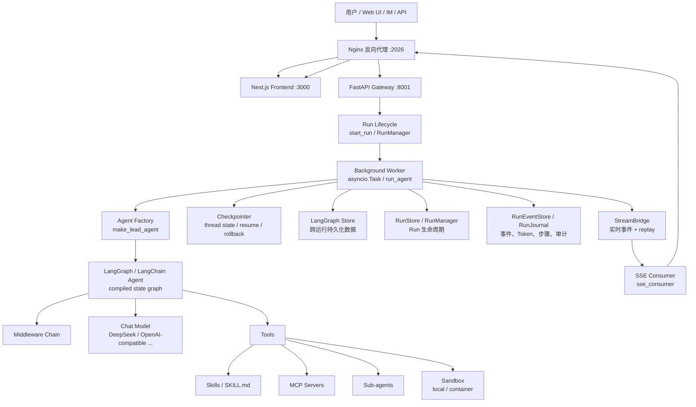

# DeerFlow 架构总览与第一轮阅读路线

> 适用代码：当前仓库 `main` 分支，提交 `99c926b` 附近的 DeerFlow 2.0。
>
> 目标：先建立一张准确的“系统地图”，再逐层阅读代码。第一轮不追求看完所有文件，而是要能解释：一次用户请求从哪里进入、如何创建 Agent、如何调用模型和工具、如何保存状态、如何把结果流式返回。

## 1. 先记住一句话

DeerFlow 2.0 是一个 **Super Agent Harness**：它不是某一个具体的 Agent，而是一套让 Agent 能够长期运行、调用工具、使用技能、委派子任务、操作沙箱、保存状态并通过 Web/IM/API 对外提供服务的运行底座。

可以把它理解成：

```text
Agent = 模型的推理能力
DeerFlow = Agent 的生产级运行环境
```

普通 Chatbot 通常是：

```text
用户问题 -> LLM -> 文本答案
```

DeerFlow 是：

```text
用户任务
  -> Agent 规划
  -> 模型决定下一步
  -> 工具 / Skill / MCP / Sub-agent / Sandbox
  -> 中间状态、事件、检查点、记忆
  -> 持续执行、恢复、流式展示
  -> 最终答案或文件产物
```

## 2. 全局架构图

### 2.1 运行时架构



### 2.2 最重要的边界

系统中有四条容易混淆的线：

| 边界 | 负责什么 | 关键代码 |
|---|---|---|
| HTTP / UI 边界 | 接收用户请求、鉴权、返回 SSE/API | `backend/app/gateway/`、`frontend/src/core/threads/` |
| Agent 执行边界 | 组装 Agent、调用模型、执行工具、推进图状态 | `backend/packages/harness/deerflow/agents/`、`runtime/runs/worker.py` |
| 实时流边界 | 把后台执行中的事件推给前端，支持断线重连 | `runtime/stream_bridge/`、`services.py::sse_consumer` |
| 持久化边界 | 保存可恢复状态、Run 记录、事件和跨会话数据 | `runtime/checkpointer/`、`runtime/store/`、`runtime/events/`、`persistence/` |

理解这四条边界后，再去看具体 Middleware 或 Tool，就不容易迷路。

## 2.3 这一轮四个问题的标准答案

### 1. 当前本地开发模式有哪些进程？

运行 `make dev` 时，主要有三个进程：

```text
1. Gateway  :8001
   Uvicorn + FastAPI，包含 DeerFlow 的 Agent Runtime

2. Frontend :3000
   Next.js Web 前端

3. Nginx   :2026
   对外统一入口，负责把页面和 API 反向代理到 Frontend / Gateway
```

需要特别注意：**当前本地开发模式没有单独启动一个 LangGraph 进程**。LangGraph 的 Agent 图和运行时组件是在 Gateway 进程内部初始化和执行的。

如果启用了容器化 Sandbox，可能还会有 Sandbox 容器；如果配置了 Postgres、Redis 或外部 MCP Server，它们也可能是独立进程或外部服务，但不属于 `make dev` 的三个核心进程。

对应代码：

```text
scripts/serve.sh:465-478
```

### 2. Gateway 启动什么？

Gateway 不只是一个普通 REST API 服务。它启动的是一个 FastAPI 应用，并在启动生命周期中完成三类工作：

#### 启动基础设施

```text
加载 config.yaml
初始化 StreamBridge
初始化 Checkpointer
初始化 LangGraph Store
初始化 RunStore / ThreadStore
初始化 RunEventStore
初始化 RunManager
执行异常 Run 恢复和可选的租约心跳
```

#### 注册 HTTP API

```text
模型、Skills、MCP、Memory、Artifacts、Uploads
Threads、Runs、Agents、Channels、Scheduler
认证、反馈、浏览器和健康检查等接口
```

#### 承担 Agent 运行入口

```text
接收用户请求
  -> 校验权限和配置
  -> 创建 Run
  -> 启动后台 Worker
  -> Worker 创建和执行 LangGraph Agent
  -> 通过 StreamBridge + SSE 向前端返回事件
```

所以可以这样概括：

> Gateway 是 DeerFlow 的接入层和运行时宿主。它既提供 HTTP API，也负责初始化 Agent 执行所需的状态、流式、事件和 Run 生命周期基础设施。

对应代码：

```text
backend/app/gateway/app.py
backend/app/gateway/deps.py::langgraph_runtime
backend/app/gateway/services.py::start_run
```

### 3. LangGraph 的 Graph 入口是什么？

在 `backend/langgraph.json` 中声明：

```json
{
  "graphs": {
    "lead_agent": "deerflow.agents:make_lead_agent"
  }
}
```

因此 Graph 的入口是：

```text
deerflow.agents:make_lead_agent
```

它不是一个写死的 Graph 对象，而是一个 **Graph Factory**：

```text
make_lead_agent(config)
  -> 读取运行配置
  -> 解析模型、Agent、Skills、Tools
  -> 组装 Middleware
  -> 生成 System Prompt 和 State Schema
  -> 调用 create_agent()
  -> 返回编译后的 LangGraph Agent
```

进一步的实际实现关系是：

```text
deerflow.agents:make_lead_agent
  -> backend/packages/harness/deerflow/agents/__init__.py
  -> backend/packages/harness/deerflow/agents/lead_agent/agent.py
  -> make_lead_agent()
  -> _make_lead_agent()
  -> create_agent()
```

可以直接这样回答面试官：

> DeerFlow 使用 `backend/langgraph.json` 注册 `lead_agent`，入口是 `deerflow.agents:make_lead_agent`。这个入口是工厂函数，会根据本次 Run 的配置动态组装模型、Tools、Skills、Middleware 和 State Schema，最后返回一个编译后的 LangGraph Agent。

### 4. 配置有哪些大类？

`config.yaml` 不是只有模型 API Key，而是整个 Agent Runtime 的配置中心。当前可以按职责分成六类：

| 配置大类 | 代表字段 | 作用 |
|---|---|---|
| 基础运行 | `config_version`、`log_level`、`logging` | 配置版本和日志行为 |
| 模型与 Agent 能力 | `models`、`tool_groups`、`tools`、`tool_search`、`skills`、`sandbox`、`memory` | 决定 Agent 能调用什么模型和能力 |
| Agent 行为与可靠性 | `token_usage`、`token_budget`、`max_recursion_limit`、`loop_detection`、`summarization`、`safety_finish_reason`、`read_before_write` | 控制推理深度、成本、循环、安全和长上下文 |
| 用户交互与产物 | `uploads`、`title`、`suggestions`、`input_polish`、`tool_output` | 文件上传、标题、建议问题、输入优化和工具输出 |
| 状态与运行基础设施 | `database`、`run_events`、`agent_storage`、`run_ownership` | Checkpoint、事件、Agent 配置和多 Worker 运行状态 |
| 集成与治理 | `agents_api`、`scheduler`、`authorization`、extensions / channels 相关配置 | 自定义 Agent、定时任务、权限和外部集成 |

最重要的理解是：

```text
配置不仅决定“连哪个模型”，还决定：
Agent 有哪些 Tool
哪些 Skill 可用
是否允许 Sandbox
如何保存 Checkpoint
如何限制 Token 和递归
如何处理断线、错误和多 Worker
```

对应参考文件：

```text
config.example.yaml
backend/packages/harness/deerflow/config/app_config.py
backend/packages/harness/deerflow/config/model_config.py
backend/packages/harness/deerflow/config/database_config.py
```

## 3. 一次聊天请求到底怎么走

下面以 Web UI 中发送一条普通消息为例。

### 3.1 请求阶段：浏览器把消息送进系统

1. 用户在聊天输入框输入消息。
2. 前端 `useThreadStream` / `sendMessage` 做乐观更新，必要时先上传附件。
3. 前端调用 LangGraph SDK 的 `thread.submit(...)`。
4. 请求通过 Nginx 的 `/api` 前缀进入 Gateway。
5. Gateway 路由进入：

   ```text
   backend/app/gateway/routers/thread_runs.py
   POST /api/threads/{thread_id}/runs/stream
   ```

6. `stream_run()` 调用 `services.py::start_run()`，而不是在 HTTP 请求线程里直接执行模型。

### 3.2 Admission 阶段：先创建 Run，再启动后台任务

`start_run()` 主要完成：

1. 校验 `thread_id`、模型、密钥和权限。
2. 解析用户输入，构造 `graph_input`。
3. 构造 `RunnableConfig`：包含 `thread_id`、`agent_name`、模型、模式和运行上下文。
4. 通过 `RunManager.create_or_reject()` 创建一条 Run 记录。
5. 创建后台 `asyncio.Task`，执行 `run_after_metadata()`。
6. HTTP 层立即转入 `sse_consumer()`，订阅这条 Run 的流。

关键文件：

```text
backend/app/gateway/routers/thread_runs.py:844
backend/app/gateway/services.py:1050
backend/packages/harness/deerflow/runtime/runs/manager.py
```

这里的设计非常重要：**Run 的创建、执行、消费是解耦的**。即使浏览器断开，后台 Run 也可以按照 `on_disconnect` 策略继续执行或被取消。

### 3.3 Agent 构造阶段：同一个入口，动态组装不同能力

当前代码中，`assistant_id` 并不会换成很多完全不同的 Python Agent 工厂。`resolve_agent_factory()` 最终都返回：

```text
deerflow.agents.lead_agent.agent:make_lead_agent
```

如果是自定义 Agent，Gateway 会把名称写入 `agent_name`，然后由 `make_lead_agent()` 读取对应的 Agent 配置、模型和 Skill 白名单。

`make_lead_agent()` 大致按照下面的顺序组装：

```text
RunnableConfig
  -> 解析用户、Agent、模型、思考模式
  -> 读取可用 Skills
  -> get_available_tools()
  -> Tool Authorization
  -> MCP 延迟工具 / Tool Search
  -> build_middlewares()
  -> apply_prompt_template()
  -> get_thread_state_schema()
  -> langchain.agents.create_agent()
  -> 编译后的 LangGraph Agent
```

核心代码：

```text
backend/app/gateway/services.py:487
backend/packages/harness/deerflow/agents/lead_agent/agent.py:640
backend/packages/harness/deerflow/agents/lead_agent/agent.py:671
backend/packages/harness/deerflow/agents/factory.py:64
```

### 3.4 执行阶段：Agent 在图中循环推进

`runtime/runs/worker.py::run_agent()` 负责真正执行：

```text
创建 RunJournal
  -> 等待前一个 Run 完成 finalizing
  -> RunManager.try_start()
  -> 注入 Runtime Context
  -> 调用 agent_factory 构造 Agent
  -> 绑定 Checkpointer / Store
  -> agent.astream(...)
  -> 模型调用
  -> 模型决定回复或 Tool Call
  -> 执行 Tool
  -> Tool 结果回到消息状态
  -> 继续下一轮模型调用
  -> 直到最终回答、澄清、达到限制或发生错误
```

可以把 Agent 的基本循环记成：

```text
读取 State
  -> Middleware 处理输入
  -> LLM 读取 System Prompt + 历史 + Tool Schema
  -> LLM 选择：直接回答 / 调 Tool / 委派 Sub-agent / 请求澄清
  -> Tool 执行
  -> 写回 State
  -> Checkpoint
  -> 继续循环
```

### 3.5 流式返回阶段：后台 Worker 不直接操作浏览器

Worker 不直接写 HTTP Response，而是：

```text
agent.astream() 产生 chunk
  -> bridge.publish(run_id, event, data)
  -> StreamBridge 暂存 / replay
  -> sse_consumer() subscribe()
  -> format_sse()
  -> SSE 返回浏览器
```

这就是 `StreamBridge` 存在的原因：

- Agent 执行和浏览器连接解耦。
- 前端断线后可以使用 `Last-Event-ID` 重连。
- 可以在内存、Redis 或其他后端之间替换实现。
- 事件流只是实时展示通道，不是最终事实来源；最终状态仍然来自 Checkpoint 和持久化事件。

关键文件：

```text
backend/packages/harness/deerflow/runtime/stream_bridge/base.py
backend/packages/harness/deerflow/runtime/stream_bridge/memory.py
backend/app/gateway/services.py:1325
backend/packages/harness/deerflow/runtime/runs/worker.py:914
frontend/src/core/api/api-client.ts
frontend/src/core/threads/hooks.ts:1527
```

### 3.6 普通消息链路的六个关键问题

| 问题 | 直接答案 | 关键位置 |
|---|---|---|
| 谁创建 Thread？ | 新对话第一次发送时，前端 LangGraph SDK 调用 `client.threads.create()`；Gateway 的 `create_thread()` 写入 `thread_meta` 和空 Checkpoint | `use-thread-chat.ts`、LangGraph SDK `stream.lgp.js`、`routers/threads.py:709` |
| 谁创建 Run？ | `services.py::start_run()` 组织创建流程，最终调用 `RunManager.create_or_reject()` 创建并持久化 `RunRecord` | `services.py:1050`、`runtime/runs/manager.py` |
| 谁启动 `asyncio.Task`？ | `start_run()` 在 Run 准入成功后调用 `asyncio.create_task(worker)`；不是 `RunManager` 启动 | `services.py:1243-1250` |
| 谁构造 Agent？ | Worker 调用 `agent_factory(**kwargs)`；`resolve_agent_factory()` 返回 `make_lead_agent`，后者调用 `create_agent()` 组装编译后的 Graph | `services.py:487`、`worker.py:814-820`、`lead_agent/agent.py:671` |
| 谁调用 `agent.astream()`？ | `runtime/runs/worker.py::run_agent()` 内部的 `_stream_once()` 调用，负责消费 Graph 的流式 chunk | `worker.py:914-960` |
| 谁把事件变成 SSE？ | Worker 把 chunk 发布到 `StreamBridge`；Gateway 的 `sse_consumer()` 订阅后由 `format_sse()` 格式化，`StreamingResponse` 发给浏览器 | `worker.py:922-928`、`services.py:1325`、`thread_runs.py:844-869` |

其中 Thread 创建要特别分成两步理解：

```text
前端 useThreadChat 先生成一个客户端 UUID
  -> 第一次 submit 时 SDK 调用 POST /api/threads
  -> Gateway create_thread() 写入 thread_meta 和空 Checkpoint
  -> 再调用 POST /api/threads/{thread_id}/runs/stream
  -> Gateway start_run() 创建 Run
```

Checkpoint 也有两种写入路径：

```text
Thread 初始化：routers/threads.py::create_thread() 显式调用 checkpointer.aput()

Agent 运行中：worker.py 把 Checkpointer 绑定到 compiled Agent，
              agent.astream() 推进 LangGraph 时由 LangGraph 自动保存状态
```

所以最准确的说法不是“Worker 手动写了所有 Checkpoint”，而是：

> Gateway 负责初始化和绑定 Checkpointer；普通图执行中的状态写入由 LangGraph Checkpointer 机制完成，Worker 只负责提供运行上下文并驱动 `agent.astream()`。

## 3.7 用 PyCharm 断点调试一条普通消息

### PyCharm 运行配置

不要直接用 `make dev` 调试 Gateway，因为它会通过 `scripts/serve.sh` 启动 Uvicorn 的 `--reload` 模式。第一轮调试建议只让 PyCharm 启动 Gateway：

```text
类型：Python
Module name：uvicorn
Parameters：app.gateway.app:app --host 0.0.0.0 --port 8001
Working directory：<repo>/backend
Python interpreter：<repo>/backend/.venv/bin/python
```

不要加 `--reload`。

如果配置文件在仓库根目录，建议在 PyCharm 的 Environment variables 中确认：

```text
DEER_FLOW_PROJECT_ROOT=<repo>
DEER_FLOW_CONFIG_PATH=<repo>/config.yaml
DEER_FLOW_HOME=<repo>/backend/.deer-flow
PYTHONPATH=<repo>/backend
```

模型 API Key 和 Base URL 也要配置到 PyCharm 的环境变量中，或者使用 PyCharm 的 `.env` 加载插件。不要把 Key 写进代码。

### 推荐断点

按下面顺序打断点：

```text
1. backend/app/gateway/routers/thread_runs.py:855
   record = await start_run(...)
   观察 HTTP 请求进入后的 thread_id、assistant_id、input

2. backend/app/gateway/services.py:1050
   start_run()
   观察 stream_modes、graph_input、RunnableConfig

3. backend/app/gateway/services.py:1228
   run_mgr.create_or_reject(...)
   观察 RunRecord、run_id、status

4. backend/app/gateway/services.py:1250 附近
   record.task = asyncio.create_task(worker)
   观察后台任务是在哪里启动的

5. backend/packages/harness/deerflow/runtime/runs/worker.py:820
   agent = agent_factory(**agent_factory_kwargs)
   观察 Worker 如何调用 Agent Factory

6. backend/packages/harness/deerflow/agents/lead_agent/agent.py:671
   _make_lead_agent()
   观察模型、Tools、Skills、Middleware 的组装过程

7. backend/packages/harness/deerflow/runtime/runs/worker.py:922
   async for chunk in agent.astream(...)
   观察 LangGraph Agent 输出的流式 chunk

8. backend/packages/harness/deerflow/runtime/runs/worker.py:928
   bridge.publish(...)
   观察 Worker 发布到 StreamBridge 的事件

9. backend/app/gateway/services.py:1344 或 1374
   bridge.subscribe(...) / format_sse(...)
   观察事件如何变成 SSE
```

### 实际调试步骤

1. 先执行 `make stop`，避免旧 Gateway 占用 `8001`。
2. 在 PyCharm 中启动上面的 Gateway Debug 配置。
3. 单独启动前端和 Nginx，或者直接调用 Gateway API。使用 Web UI 时，前端可以运行在 `3000`，Nginx 在 `2026`。
4. 打开 `http://localhost:2026`，发送一个不需要工具的简单问题，例如：

   ```text
   请只回答：1 + 1 等于多少？
   ```

5. 命中断点后，使用：

   ```text
   F8：Step Over
   F7：Step Into
   Shift + F8：Step Out
   F9：Resume
   Alt + F8：Evaluate Expression
   ```

6. 重点观察这几个变量：

   ```text
   thread_id
   run_id
   body.input
   body.assistant_id
   graph_input
   config
   record.status
   record.task
   model_name
   chunk
   sse_event
   ```

### 预期的断点命中顺序

```text
thread_runs.stream_run
  -> services.start_run
  -> RunManager.create_or_reject
  -> asyncio.create_task
  -> worker.run_agent
  -> make_lead_agent
  -> agent.astream
  -> bridge.publish
  -> sse_consumer
  -> format_sse
  -> 浏览器收到流式消息
```

### Checkpoint 断点应该怎么打

第一轮不要直接钻进 LangGraph 第三方 Checkpointer 的内部实现。先理解两条边界：

```text
Thread 初始化：
backend/app/gateway/routers/threads.py:771
checkpointer.aput(...)

Agent 执行期间：
backend/packages/harness/deerflow/runtime/runs/worker.py:884-888
agent.checkpointer = checkpointer
agent.astream(...) 之后由 LangGraph 自动推进和保存状态
```

如果想观察 Checkpoint 结果，建议在请求完成后调用 `GET /api/threads/{thread_id}/state`，或者在 `routers/threads.py::get_thread_state()` 处打断点，看它如何从 Checkpointer 读取当前状态。

### 常见问题

- 断点是空心：通常是 PyCharm 使用了错误的 Python Interpreter，或执行的代码不是当前 checkout。
- 断点完全不命中：通常是旧的 `make dev` Gateway 仍在 `8001`，先执行 `make stop`。
- 只在前端看到请求但后端不暂停：确认 PyCharm 启动的是 `app.gateway.app:app`，不是单独启动了 Frontend。
- 启动时报找不到配置：设置 `DEER_FLOW_PROJECT_ROOT` 和 `DEER_FLOW_CONFIG_PATH`。
- 模型请求处长时间暂停：这是正常的网络调用；先不要 Step Into Provider 内部，继续观察 `agent.astream()` 返回的 chunk。

## 4. 先把这些名词分清楚

### 4.1 Thread、Run、Checkpoint、Message

| 名词 | 一句话解释 | 类比 |
|---|---|---|
| Thread | 一条长期对话 / 任务上下文的身份 | 一个项目或聊天窗口 |
| Run | Thread 上的一次执行尝试 | 点击一次“发送”产生的一次任务 |
| Message | 对话中的用户、AI、工具消息 | 对话记录中的一条消息 |
| State | LangGraph 当前图状态 | Agent 当前内存 |
| Checkpoint | State 在某个图节点后的持久化快照 | 游戏存档 |
| RunStore | Run 的状态、错误、耗时、Token 等生命周期记录 | 任务管理表 |
| RunEventStore | 运行过程中的事件和步骤记录 | 审计日志 / 事件日志 |

最重要的区分：

```text
Thread 是容器
Run 是一次执行
Checkpoint 是可恢复的图状态
RunEventStore 是过程记录
StreamBridge 是实时传输通道
```

不要把 StreamBridge 当数据库，也不要把 Run 当 Thread。

### 4.2 LangGraph、Graph、Node、State、RunnableConfig

- **LangGraph**：把 Agent 工作流表示成有状态图并负责推进执行。
- **Graph**：Agent 的状态机；当前 DeerFlow 通过 `create_agent()` 得到编译后的图。
- **Node**：图中的执行节点，例如模型节点、工具节点或状态写入节点。
- **State**：节点之间传递的状态，核心通常包含消息，也可以扩展 Todo、Summary、Goal、Skill 等频道。
- **RunnableConfig**：本次调用的控制参数，例如 `thread_id`、`agent_name`、`recursion_limit`、metadata 和 callbacks。
- **Runtime Context**：本次 Run 的运行时依赖，例如 `run_id`、`user_id`、`app_config`、Store、RunJournal；工具可以通过 `ToolRuntime.context` 读取。

可以这样分：

```text
State              = Agent 正在处理什么
RunnableConfig     = 这次怎么运行
Runtime Context    = 这次运行依赖什么基础设施
```

### 4.3 Lead Agent、Sub-agent、Custom Agent

- **Lead Agent**：主 Agent，负责理解用户目标、分解任务和调用能力。
- **Sub-agent**：由主 Agent 通过 `task` 能力委派出来的子执行者，拥有自己的上下文、工具和最大轮数。
- **Custom Agent**：用户配置出来的 Agent 变体，通常复用同一个 `make_lead_agent()` 工厂，但使用不同的 `agent_name`、模型、SOUL、Tool Group 和 Skill 白名单。

关系是：

```text
Web 请求
  -> Lead Agent
      -> task Tool
          -> Sub-agent Executor
              -> 独立的模型 / 工具循环
          -> 返回子任务结果
      -> 继续主 Agent 推理
```

当前主 Agent 的子任务进度会通过 `custom` 事件流传回前端，并由 `RunEventStore` 批量持久化，便于页面刷新后恢复子任务步骤。

### 4.4 Tool、Skill、MCP

这是最容易被面试官追问的一组概念。

| 概念 | 核心作用 | 是否直接执行动作 |
|---|---|---|
| Tool | 给模型调用的一个原子能力，带参数 Schema 和执行函数 | 是 |
| Skill | 一套任务方法、规范、提示词、脚本和参考资料 | 通常不是；它指导如何做 |
| MCP | 让外部 MCP Server 向 Agent 暴露 Tool 的协议 | Tool 的远程接入方式 |

例如：

```text
Skill: deep-research
  告诉 Agent 如何搜索、交叉验证、组织报告

Tool: web_search
  真正发起一次搜索请求

MCP Server: 某个外部工具服务
  通过 MCP 协议暴露 web_search / database_query 等工具
```

DeerFlow 还有 Tool Search / Deferred Tools：不是把所有 MCP Tool 的完整 Schema 一开始都塞进上下文，而是先保留目录或元数据，需要时再提升具体 Tool，减少上下文和工具选择压力。

重点代码：

```text
backend/packages/harness/deerflow/tools/
backend/packages/harness/deerflow/skills/
backend/packages/harness/deerflow/mcp/
backend/packages/harness/deerflow/agents/middlewares/skill_activation_middleware.py
backend/packages/harness/deerflow/agents/middlewares/skill_tool_policy_middleware.py
backend/packages/harness/deerflow/tools/builtins/tool_search.py
```

### 4.5 Middleware

Middleware 是 Agent 执行链上的“拦截器 / 钩子”。它可以在模型调用前、模型调用后、工具执行前后修改状态、注入上下文、拒绝危险操作、捕获错误或限制资源。

当前 DeerFlow 中 Middleware 负责的事情包括：

- 输入清洗和安全检查。
- 上传文件和线程数据注入。
- Sandbox 初始化。
- Skill 激活和 Tool Policy。
- 长上下文摘要。
- Todo / Plan 模式。
- 长期 Memory 注入。
- Tool 错误处理。
- 循环检测和 Token Budget。
- 子 Agent 数量限制。
- 最终回答兜底。
- 澄清请求拦截。

为什么顺序重要？因为 Middleware 不是互相独立的函数。比如：

```text
ToolErrorHandling
  必须先把工具异常转换成可继续处理的 ToolMessage

ClarificationMiddleware
  需要放在后面，才能看到模型或工具产生的澄清请求

DeferredToolFilter
  必须和 MCP Routing 的顺序匹配，否则模型看不到被自动提升的 Tool
```

第一轮只需要掌握这些核心 Middleware，不要一开始把全部文件都读完：

```text
thread_data_middleware.py
uploads_middleware.py
input_sanitization_middleware.py
tool_error_handling_middleware.py
skill_activation_middleware.py
summarization_middleware.py
memory_middleware.py
subagent_limit_middleware.py
loop_detection_middleware.py
clarification_middleware.py
```

### 4.6 Sandbox、Memory、Store、Checkpointer

#### Sandbox

Sandbox 是 Agent 执行文件操作、Shell、浏览器或代码的环境。它解决的是：

```text
Agent 能做什么操作？
这些操作在哪个文件系统 / 进程中执行？
如何限制路径、命令、权限和资源？
```

本地开发可以使用 Local Sandbox；更强隔离通常使用容器或外部 Sandbox Provider。Sandbox 不等于 Docker，但 Docker/Container 可以作为 Sandbox 的一种实现。

#### Memory

Memory 解决的是“跨 Thread、跨 Run 仍然记住什么”，例如用户偏好、长期事实或项目背景。它通常通过 Memory Manager 和具体 Backend 实现。

#### Checkpointer

Checkpointer 解决的是“当前这条 Thread 的 Agent 状态如何保存和恢复”，例如消息历史、Todo、Goal、工具调用状态和图执行位置。它直接参与 LangGraph 的状态恢复、暂停、继续、分支和回滚。

#### Store

Store 是 LangGraph 的跨运行 Key-Value 存储，适合保存跨 Thread 的结构化数据。它和 Checkpointer 不是一回事：

```text
Checkpointer = 某条 Thread 的图状态快照
Store        = 跨运行 / 跨 Thread 的持久化数据
Memory       = 面向 Agent 记忆语义的上层能力
```

### 4.7 SSE、StreamBridge、Event Store

- **SSE**：浏览器接收服务器单向实时事件的 HTTP 协议。
- **StreamBridge**：后台 Worker 和 SSE 消费者之间的事件桥；提供发布、订阅、心跳、结束标记和重放。
- **RunEventStore**：把运行事件长期保存下来，支持历史步骤、Token 统计、子 Agent 步骤和审计。
- **RunJournal**：运行期间收集模型、工具、Token 和交付结果信息，最终写入事件或 Run 记录。

一句话区分：

```text
StreamBridge 解决“现在怎么推给前端”
Event Store   解决“以后怎么查到运行过程”
Checkpointer  解决“下一次怎么从状态继续”
```

## 5. 代码目录应该怎么理解

```text
deer-flow/
├── frontend/                         Web UI，Next.js/React
│   └── src/core/threads/             Thread、提交、流式状态
├── backend/app/gateway/              FastAPI 接入层和兼容 LangGraph API
│   ├── app.py                        Gateway 生命周期和路由注册
│   ├── services.py                   Run 创建、SSE、状态访问
│   └── routers/thread_runs.py        Thread 级 Run API
├── backend/packages/harness/deerflow/
│   ├── agents/                       Agent 工厂、Lead Agent、Middleware、Memory
│   ├── runtime/                      Run 执行、Checkpoint、Store、Stream、Events
│   ├── tools/                        内置 Tool、Tool 注册、Tool Search
│   ├── skills/                       Skill 解析、加载、权限、安装
│   ├── mcp/                          MCP Client、Session Pool、MCP Tool
│   ├── sandbox/                      文件、Shell、浏览器执行环境
│   ├── subagents/                    子 Agent 注册、执行器和状态事件
│   ├── models/                       模型 Provider 和 ChatModel 创建
│   ├── config/                       YAML 配置模型和热加载边界
│   └── persistence/                  数据库 Repository 和持久化模型
├── skills/public/                    面向用户的真实 Skill 包
├── scripts/                          启动、检查、配置、清理脚本
├── docker/                           Nginx、部署和可选容器运行环境
└── contracts/                        前后端事件 / Skill / Sub-agent 协议
```

当前本地开发启动链路：

```text
make dev
  -> scripts/serve.sh
      -> Gateway :8001
      -> Frontend :3000
      -> Nginx :2026
```

用户浏览器通常访问 `http://localhost:2026`，Nginx 把页面和 API 转发给前端、Gateway。理解代码时，先把 Nginx 当作入口代理，不要误以为 2026 端口就是 Agent 执行服务。

## 6. 第一轮阅读顺序

### 第 0 步：只看地图，不看细节

按顺序打开：

```text
README_zh.md
backend/langgraph.json
scripts/serve.sh
backend/app/gateway/app.py
config.example.yaml
```

这一轮只回答：有哪些进程？Gateway 启动什么？LangGraph 的 graph 入口是什么？配置有哪些大类？

### 第 1 步：只追一条普通消息链路

按顺序阅读：

```text
frontend/src/app/workspace/chats/[thread_id]/page.tsx
frontend/src/core/threads/hooks.ts
backend/app/gateway/routers/thread_runs.py
backend/app/gateway/services.py
backend/packages/harness/deerflow/runtime/runs/manager.py
backend/packages/harness/deerflow/runtime/runs/worker.py
```

阅读时重点记录：

```text
谁创建 Thread？
谁创建 Run？
谁启动 asyncio.Task？
谁构造 Agent？
谁调用 agent.astream？
谁写 Checkpoint？
谁把事件变成 SSE？
```

### 第 2 步：再看 Agent 是怎么组装的

```text
backend/packages/harness/deerflow/agents/lead_agent/agent.py
backend/packages/harness/deerflow/agents/factory.py
backend/packages/harness/deerflow/agents/lead_agent/prompt.py
backend/packages/harness/deerflow/agents/thread_state.py
backend/packages/harness/deerflow/models/
```

目标不是背每个函数，而是画出：

```text
模型 + System Prompt + Tools + Middleware + State Schema
                         |
                         v
                  Compiled Agent Graph
```

### 第 3 步：按能力模块深入

依次选择一个方向，不要同时打开所有目录：

1. Tool：`tools/`。
2. Skill：`skills/` + `skills/public/deep-research/SKILL.md`。
3. Sub-agent：`subagents/` + `tools/builtins/task_tool.py`。
4. Sandbox：`sandbox/`。
5. Memory：`agents/memory/` + `memory_middleware.py`。
6. MCP：`mcp/` + `tools/builtins/tool_search.py`。
7. Reliability：`runtime/checkpointer/`、`runtime/events/`、`StreamBridge`。

## 7. 第一轮不要读什么

以下内容第一轮只知道它们存在即可：

- 所有具体 Provider 的实现细节。
- 所有 IM Channel（Telegram、Lark 等）的适配代码。
- Helm、Docker Compose、生产部署模板。
- 前端所有 UI 组件和样式。
- 全部 40 多个 Middleware 的实现。
- 所有 Memory Backend 的内部算法。
- GitHub Webhook、Scheduler、TUI 等外围入口。

它们不是不重要，而是应该等主链路能讲清楚后再看。否则会在外围功能中迷失，无法形成 Agent 核心认知。

## 8. 建议你现在做的第一个实验

先不要改代码，完成一次“链路观察实验”：

1. 启动 DeerFlow。
2. 输入一个最简单的问题：`请用一句话介绍你自己`。
3. 再输入一个需要工具的问题，例如让它在工作区创建一个文本文件。
4. 观察前端出现的消息、Tool Step、文件产物和运行状态。
5. 对照下面这张表，逐项找到代码位置：

| 现象 | 先查哪里 |
|---|---|
| 用户消息出现 | `frontend/src/core/threads/hooks.ts` |
| 请求进入 Gateway | `backend/app/gateway/routers/thread_runs.py` |
| Run 变成 running | `runtime/runs/manager.py`、`worker.py` |
| Agent 调模型 | `agents/lead_agent/agent.py`、`models/` |
| Agent 调 Tool | `tools/`、`worker.py` |
| 前端实时出现步骤 | `runtime/stream_bridge/`、`services.py` |
| 刷新后历史还在 | `checkpointer/`、`runtime/events/` |
| 创建文件 | `sandbox/` 和具体文件 Tool |

完成这次实验后，你应该能用 2 分钟讲清楚：

> 前端提交消息后，Gateway 创建一条 Run 并启动后台 Worker；Worker 通过 `make_lead_agent` 组装 LangGraph Agent，Agent 在模型和 Tool 之间循环推进；每个流式 chunk 一边发布到 StreamBridge 供 SSE 返回，一边由 Checkpointer、RunStore 和 EventStore 分别承担状态、生命周期和过程记录。

## 9. 面试官最可能追问的架构问题

### 为什么不在 HTTP 请求里直接执行 Agent？

因为 Agent 任务可能很长，包含搜索、代码执行、文件生成和子 Agent。后台 Run + StreamBridge 可以支持持续执行、断线处理、取消、重连和多种入口复用。

### 为什么要同时有 StreamBridge 和 Checkpointer？

StreamBridge 是实时传输通道，数据可能只保留有限时间；Checkpointer 是可恢复状态的持久化来源。前者解决“实时看”，后者解决“恢复和重建”。

### Skill 和 Tool 的区别是什么？

Tool 是可调用动作，Skill 是完成某类任务的方法和约束。Skill 可以指导 Agent 选择和组合多个 Tool，但它本身不等于一个 Tool。

### Middleware 为什么需要排序？

Middleware 会在不同生命周期阶段互相影响。错误处理、工具过滤、上下文压缩、澄清拦截和安全策略都有前后依赖；顺序错了可能导致工具不可见、异常无法恢复或澄清请求被吞掉。

### Thread、Run、Checkpoint 为什么不能合成一个对象？

Thread 是长期上下文，Run 是一次执行，Checkpoint 是状态版本。拆分后才能支持同一个 Thread 多次运行、取消、重试、分支、回滚和历史审计。

### 如何证明自己的改造有效？

不要只展示“功能跑通”。至少记录：

- 任务成功率。
- 工具调用成功率。
- 最终答案延迟和首 Token 延迟。
- Token 消耗与成本。
- 子 Agent 失败恢复率。
- Stream 断线重连成功率。
- 长上下文下的上下文压缩次数和回答质量。

## 10. 第一阶段完成标准

当下面这些问题你都能脱稿回答，整体架构就建立起来了：

- DeerFlow 2.0 和普通 Chatbot 的本质区别是什么？
- Web 请求从哪个前端 Hook 进入哪个 Gateway 路由？
- `start_run()` 和 `run_agent()` 分别负责什么？
- `make_lead_agent()` 为什么同时组装模型、工具、Middleware 和 State Schema？
- Tool 调用结果如何回到 Agent 的下一轮推理？
- StreamBridge、SSE、Checkpointer、EventStore 各自解决什么问题？
- Sub-agent 是如何从主 Agent 中被委派出来的？
- Skill、Tool、MCP 的边界是什么？
- Local Sandbox 和 Container Sandbox 的安全边界是什么？
- 如果浏览器断线，Run 是否会停止？依据什么配置决定？

下一阶段才进入具体改造：优先选择一个闭环小方向，例如增加一个 Tool、增加一个 Middleware、改造一个 Skill，或给 Sub-agent 加入可观测性。每次改造都要有实验输入、基线、指标和失败案例。

## 11. 十个核心问题：可直接记录的答案

下面的答案建议先记住“第一句话”，再结合代码定位理解实现细节。面试时不要只背名词，要能把“请求、Run、Agent、Tool、事件、持久化”串成一条链路。

### 11.1 DeerFlow 2.0 和普通 Chatbot 的本质区别是什么？

一句话：普通 Chatbot 主要是“用户问题 -> 模型生成文本”，DeerFlow 2.0 是一个面向长任务的 Agent Runtime/Harness，负责让模型组织工具、Skill、MCP、Sandbox 和 Sub-agent，并把执行过程可靠地运行、流式传输和持久化。

普通 Chatbot 关注一次请求的输入和输出；DeerFlow 还要处理：

- 一个 Thread 中的多次 Run 和长期上下文。
- 模型和 Tool 之间的多轮循环。
- 搜索、文件操作、代码执行、浏览器等外部能力。
- Sub-agent 委派、任务取消、断线重连和失败恢复。
- Checkpoint、EventStore、Sandbox 等运行时基础设施。

因此，DeerFlow 的核心亮点不是“接了一个大模型”，而是把 LLM 从一次性问答模型变成了一个可编排、可观察、可恢复的任务执行系统。

代码定位：`README.md`、`backend/packages/harness/deerflow/agents/lead_agent/agent.py`、`backend/packages/harness/deerflow/runtime/runs/`、`tools/`、`skills/`、`sandbox/`。

### 11.2 Web 请求从哪个前端 Hook 进入哪个 Gateway 路由？

一句话：普通聊天消息从前端 `useThreadStream()` 进入，经过 LangGraph SDK 的 `thread.submit()` 和 `client.runs.stream()`，最终进入 Gateway 的 `POST /api/threads/{thread_id}/runs/stream`，对应后端 `stream_run()`。

链路可以写成：

```text
useThreadStream()
  -> sendMessage()
  -> thread.submit()
  -> client.runs.stream()
  -> POST /api/threads/{thread_id}/runs/stream
  -> stream_run()
  -> start_run()
```

新聊天还会先创建 Thread：LangGraph SDK 调用 `client.threads.create()`，后端进入 `backend/app/gateway/routers/threads.py::create_thread()`；之后才开始 Run 流程。Thread 是会话容器，Run 是其中一次执行。

代码定位：

- 前端：`frontend/src/core/threads/hooks.ts::useThreadStream()`、`sendMessage()`。
- SDK：`frontend/node_modules/@langchain/langgraph-sdk/dist/react/stream.lgp.js`。
- Gateway：`backend/app/gateway/routers/thread_runs.py::stream_run()`。
- Thread 创建：`backend/app/gateway/routers/threads.py::create_thread()`。

### 11.3 `start_run()` 和 `run_agent()` 分别负责什么？

一句话：`start_run()` 负责“接纳和调度 Run”，`run_agent()` 负责“真正执行 Agent”。

`start_run()` 在 Gateway 请求上下文中快速完成：校验请求、解析模型和权限、组装 `RunnableConfig`、创建 Run 记录、解析 Agent Factory，然后通过 `asyncio.create_task()` 启动后台 Worker。它不应该在 HTTP 请求函数里同步跑完整个 Agent。

`run_agent()` 在后台 Worker 中完成实际工作：更新 Run 状态、构造运行时上下文、调用 Agent Factory、绑定 Checkpointer 和 Store、调用 `agent.astream()`、把事件发布到 StreamBridge，并负责异常、取消、收尾和最终状态写入。

代码定位：`backend/app/gateway/services.py::start_run()`；`backend/packages/harness/deerflow/runtime/runs/worker.py::run_agent()`。

### 11.4 `make_lead_agent()` 为什么同时组装模型、工具、Middleware 和 State Schema？

一句话：它不是简单地“实例化一个模型”，而是在当前 Run 的配置和权限下，构造一张完整的、可执行的 LangGraph Agent 图。

各部分职责不同：

| 组成部分 | 作用 |
|---|---|
| Model | 决定下一步是回答、调用 Tool，还是委派 Sub-agent。 |
| Tools | 给模型提供实际动作，例如搜索、文件操作、Shell、任务委派。 |
| Middleware | 注入跨切面能力，例如工具过滤、上下文压缩、错误处理、Skill 策略和 Sub-agent 限流。 |
| State Schema | 定义图中共享状态的结构和可写入的状态字段。 |

模型、工具和 Skill 还受到当前用户、Thread、Run、模型配置和授权策略影响，所以 Agent 必须在运行时动态构造。Middleware 会读取或修改 State，因此 State Schema 也必须与这些能力匹配；否则图无法正确传递消息、计划、工具结果和运行时元数据。

代码定位：`backend/langgraph.json` 的 `lead_agent` 入口；`backend/packages/harness/deerflow/agents/lead_agent/agent.py::make_lead_agent()`；`factory.py::create_deerflow_agent()`。

### 11.5 Tool 调用结果如何回到 Agent 的下一轮推理？

一句话：模型先产生带 `tool_calls` 的 `AIMessage`，Tool 执行后生成带对应 `tool_call_id` 的 `ToolMessage`，这个消息被追加到 Graph State，图再路由回模型节点，于是模型能看到工具结果并进行下一轮推理。

典型循环是：

```text
Model 读取 messages 和 Tool schema
  -> 输出 AIMessage(tool_calls)
  -> Tool Executor 按名称分发并执行
  -> 生成 ToolMessage(tool_call_id, result)
  -> ToolMessage 写回 Graph State
  -> 回到 Model 节点
  -> 继续调用 Tool 或输出最终答案
```

如果模型这一轮没有 `tool_calls`，图通常就结束本轮并把最终消息流式返回。`task` Tool 是一个特殊例子：它内部启动 Sub-agent，等子任务完成后，把子任务结果包装成 Tool 结果返回给主 Agent，主 Agent 再继续推理。

代码定位：`backend/packages/harness/deerflow/agents/` 中的 Agent 图构造；`backend/packages/harness/deerflow/tools/`；工具错误处理可看 `ToolErrorHandlingMiddleware`；整体执行入口在 `worker.py::run_agent()` 的 `agent.astream()`。

### 11.6 StreamBridge、SSE、Checkpointer、EventStore 各自解决什么问题？

一句话：StreamBridge 解决“事件如何从后台 Worker 到达订阅者”，SSE 解决“如何通过 HTTP 把事件推给浏览器”，Checkpointer 解决“如何保存和恢复图状态”，EventStore 解决“如何保存运行过程和事件历史”。

| 组件 | 解决的问题 | 关注点 |
|---|---|---|
| StreamBridge | Worker 和浏览器订阅者解耦，并支持事件订阅、事件 ID、重放和心跳。 | 实时事件分发 |
| SSE | 把服务端事件编码成浏览器可消费的 HTTP 流。 | 网络传输格式 |
| Checkpointer | 保存 LangGraph 的 Thread/Graph 状态，支持恢复、历史、分支和中断。 | 可恢复状态 |
| EventStore | 保存 Run、LLM、Tool、Sub-agent、Token 和日志等过程事件。 | 审计与可观测性 |

可以这样区分：StreamBridge 是“实时事件总线”，SSE 是“对浏览器的输出协议”；Checkpointer 保存“下一步推理所需的状态”，EventStore 保存“已经发生过什么”。

代码定位：`runtime/stream_bridge/base.py`、`backend/app/gateway/services.py::sse_consumer()`、`runtime/checkpointer/`、`runtime/events/` 和 `runtime/runs/worker.py`。

### 11.7 Sub-agent 是如何从主 Agent 中被委派出来的？

一句话：主 Agent 并不会直接切换身份，而是通过内置 `task` Tool 发起一次工具调用；`task_tool` 创建独立的 `SubagentExecutor` 和运行上下文，子 Agent 完成后再把结果作为 ToolMessage 返回给主 Agent。

流程是：

```text
主 Agent 判断任务适合委派
  -> 模型生成 task Tool call
  -> task_tool 校验 subagent_type 和权限
  -> 创建 SubagentExecutor
  -> 子 Agent 使用自己的模型、Tools、State 和上下文执行
  -> 发布 task_started / task_running / task_end 等事件
  -> 返回最终结果
  -> 主 Agent 收到 ToolMessage，继续下一轮推理
```

子 Agent 通常会继承必要的 Thread、用户、模型、Skill、Sandbox 和追踪上下文，但它是独立的 Agent 执行单元。系统还会通过 Sub-agent 限流 Middleware 控制并发和总数，并可关闭递归嵌套，避免主 Agent 无限派生子 Agent。

代码定位：`backend/packages/harness/deerflow/tools/builtins/task_tool.py`、`backend/packages/harness/deerflow/subagents/executor.py`、`subagent_limit_middleware.py`。

### 11.8 Skill、Tool、MCP 的边界是什么？

一句话：Skill 描述“应该怎样完成一类任务”，Tool 提供“可以执行的动作”，MCP 提供“把外部工具接入系统的协议和连接方式”。

| 概念 | 本质 | 典型问题 |
|---|---|---|
| Skill | 指令、流程、约束、资源和可选脚本组成的能力包。 | 这类任务应该按什么方法完成？ |
| Tool | Agent 可以按名称和参数直接调用的函数或动作。 | 现在要执行哪个动作？ |
| MCP | 外部工具服务与 Agent Runtime 之间的标准协议。 | 外部工具如何被发现、描述和调用？ |

从 Agent 的视角看，MCP Server 暴露出来的能力最终也会被包装成 Tool；MCP 与本地 Tool 的主要区别是执行边界和通信协议。Skill 不等于 Tool，但 Skill 可以规定 Tool 的使用顺序、输入格式、安全限制和验收标准，也可以携带脚本或参考资料。

代码定位：`backend/packages/harness/deerflow/skills/`、`tools/`、`mcp/client.py`、`mcp/session_pool.py`、`mcp/tools.py`。

### 11.9 Local Sandbox 和 Container Sandbox 的安全边界是什么？

一句话：Local Sandbox 主要是“运行在宿主机上的逻辑隔离”，Container Sandbox 才是“借助容器或虚拟化形成的操作系统级进程边界”；因此 Local Sandbox 更快更方便，但不能当成强安全隔离。

Local Sandbox 会做工作区映射、虚拟路径、路径穿越防护、读写范围控制、超时和输出限制，但命令仍在 Gateway 所在的宿主机用户权限下执行。尤其是 `allow_host_bash=true` 时，宿主机 Shell 能力风险很高，只适合可信环境。

Container Sandbox 将命令放进独立容器或类似运行环境，可以隔离文件系统、进程和部分网络能力，但安全边界仍取决于挂载目录、注入的 Secret、网络策略、容器权限、Docker Socket 和镜像本身。容器不是绝对安全边界。

实际安全策略是多层叠加的：Sandbox Provider、工具授权、路径映射、只读挂载、`allow_host_bash`、环境变量/Secret 管理、命令超时和资源限制共同决定风险。

代码定位：`backend/packages/harness/deerflow/config/sandbox_config.py`、`sandbox/local/`、`community/aio_sandbox/` 以及各 Sandbox Provider 实现。

### 11.10 如果浏览器断线，Run 是否会停止？依据什么配置决定？

一句话：不一定。当前 DeerFlow Web UI 使用可恢复流式传输，浏览器断线通常不会停止后台 Run；是否取消主要由本次 Run 的 `on_disconnect` 决定，而前端的 `streamResumable` 会影响 SDK 默认采用继续还是取消。

当前链路是：

```text
前端 streamResumable: true
  -> SDK 默认 onDisconnect: "continue"
  -> Gateway 映射为 DisconnectMode.continue_
  -> SSE 消费者断开时不取消 Run
```

如果请求显式设置 `on_disconnect="cancel"`，Gateway 会将它映射为 `DisconnectMode.cancel`；此时 `sse_consumer()` 在连接断开时调用 `run_mgr.cancel(run_id)`。因此这里主要看的是“每次 Run 的请求配置”，不是单纯看 `config.yaml`。

即使浏览器断线后 Run 继续运行，它仍可能因为模型错误、Tool 失败、超时、资源限制或用户主动停止而结束。重新连接时则依赖 Run ID、事件 ID/重放机制和持久化状态恢复前端视图。

代码定位：`frontend/src/core/threads/hooks.ts::sendMessage()` 中的 `streamResumable`；`backend/app/gateway/services.py::start_run()` 中的 `DisconnectMode` 映射；`sse_consumer()` 中的断开处理。

### 11.11 一分钟串起这十个问题

可以用下面这段话作为面试时的总括：

> DeerFlow 不是单纯的 Chatbot，而是一个可恢复的 Agent Runtime。前端 Hook 通过 LangGraph SDK 把消息提交到 Gateway，Gateway 的 `start_run()` 创建 Run 并启动后台 Worker；Worker 中的 `run_agent()` 调用 `make_lead_agent()` 动态组装模型、Tool、Middleware 和 State Schema。Agent 通过模型消息和 ToolMessage 循环推进，需要时调用 `task` Tool 委派 Sub-agent。执行事件先进入 StreamBridge，再通过 SSE 返回浏览器；Checkpointer 保存可恢复的图状态，EventStore 保存过程历史。Skill 负责方法和约束，Tool 负责动作，MCP 负责外部工具接入，Sandbox 负责工具执行环境。浏览器断线是否停止，则由本次 Run 的 `on_disconnect` 和前端 `streamResumable` 决定。
